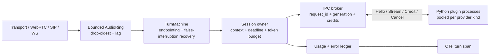

# Synthesis — voicekit four-framework audit

> Published verbatim from mini-ork run `run-1795113179-69141` (recipe
> `framework-comparison`, five lenses: codex, glm, kimi, minimax, opus). Raw lens
> reports: [`lenses/`](lenses/). Panel verdicts for the build iterations:
> [`panel-verdict-iter1.json`](panel-verdict-iter1.json) (ESCALATE) and
> [`panel-verdict-iter2.json`](panel-verdict-iter2.json) (APPROVE).
> Architecture decision: [`../adr/0001-architecture.md`](../adr/0001-architecture.md).
> This document is a *comparison*; it is not a description of the shipped code —
> see [`DESIGN.md`](DESIGN.md) for that.

**Run:** `run-1795113179-69141` · **Input:** `panel_reports/panel-responses.md` (sha256 `240bbe477890e235bdff6f99267273c56dba8737c96360a890c8911eb7f78333`) · **Panel:** Responses A–E, 99 findings · **Targets:** LiveKit Agents (`LK`), Pipecat (`PC`), TEN Framework (`TEN`), Vocode (`VC`, stale design reference).

---

## 0. Scope, method, and how to read this document

This is a synthesis of five anonymous responses, not a re-audit. The synthesizer read the full anonymized bundle and nothing else. Every `file:line` anchor below is **panel-reported**; the trees were not re-opened in this node. Framework prefixes are the panel's: `LK` = `livekit-agents/livekit/agents/`, `PC` = `src/pipecat/`, `TEN` = the Python binding plus the shipping Python extensions, `VC` = `vocode/streaming/`. Voicekit anchors (`crates/…`) are the skeleton paths reported by Response A and are used as the landing sites for recommendations.

### Conventions

| Symbol | Meaning |
|---|---|
| `A-1` … `A-18` | Response A finding numbers (1–18). |
| `B-1` … `B-15` | Response B's `finding-1` … `finding-15`. |
| `C-1` … `C-20` | Response C findings 1–20. |
| `D-1` … `D-22` | Response D table rows 1–22. |
| `E-1` … `E-24` | Response E's `F1` … `F24`. Response E's `refactor-1` … `refactor-15` are proposals, not findings, and are cited by name where relevant. |
| **P1** | Ship now, in the current cycle. Cheap, high-ROI, directly defends a hard constraint. |
| **P2** | Substrate change for v0.x+1. Multi-week, architectural, cross-cutting. |
| **P3** | Tracked horizon item, advisory, or stale-reference lesson. Not load-bearing now. |
| **HIGH leverage** | Changes the fused architecture or defends a non-negotiable constraint. |
| **MED leverage** | Material improvement to one component. |
| **LOW leverage** | Local hygiene, API polish, or a lesson from stale code. |
| **★K`n`** | Finding belongs to consensus cluster `n` (appears in 2+ responses). Clusters are in §1.2. |

### What this document does not establish

- **No framework was executed, built, or benchmarked.** Cost figures quoted from Response B are arithmetic scenarios, not measured bills.
- **Vocode is stale** (~2023 tree). Its findings are design-reference lessons, not current-behavior claims.
- **TEN's `ten_ai_base` package is absent** from the checkout, so adapter-local TEN claims are bounded; the panel says so explicitly (B, E). That absence is itself a finding (§6).
- **No dimension has unanimous agreement on a framework winner.** Five of ten dimensions split; §1.3 records the split and picks one adopt per dimension for voicekit.
- **Consensus is content-matched, not provenance-tracked.** The anonymization strips lane metadata; `★` means two or more responses describe the same defect, not that they used the same evidence file.

---

## 1. Severity × leverage matrix

### 1.1 The 3×3 grid

Rows are priority (what to do when); columns are leverage (how much the fused architecture depends on it). Every one of the 99 findings appears exactly once.

| | **HIGH leverage** | **MED leverage** | **LOW leverage** |
|---|---|---|---|
| **P1 — ship now** | **Containment:** C-13, D-1, E-14 — plugin exception calls `os._exit` ★K2.<br>**Backpressure:** A-2, B-15, C-11, D-16, E-3, E-17, E-20 — unbounded audio/queues, no lag counter ★K1.<br>**Boundary hop:** C-15, D-15, E-15 — per-frame untracked coroutine / GIL hop ★K17.<br>**Streaming & cancel:** C-1, C-10, E-24 — unary seam, cancel over lossy pub/sub, no cancel of in-flight callback ★K3.<br>**ABI:** A-11, E-13 — manifests pin but never negotiate; no plugin ABI version ★K7.<br>**Errors:** C-2, E-7 — recoverable errors dropped; exception excluded from dumps ★K4.<br>**Validation:** C-16 — `assert`-only wire validator is removed by `python -O` ★K16.<br>**Clock:** E-11 — wall-clock durations ★K11. | **Text accounting:** B-14 — every delta carries the full accumulated text ★K19.<br>**Capabilities:** E-6 — capability flags drift from behaviour. | — |
| **P2 — v0.x+1** | **Failure semantics:** A-3, C-5, B-7, B-11 — truncate/replay after commit; retry budget uncoordinated; TTS cancel waits for a network yield ★K5, ★K3.<br>**Runtime isolation:** A-8, A-9, C-6, D-4, D-5, D-8, D-18, E-16 — GIL ceiling, thread affinity, one shared loop, head-of-line blocking ★K8, ★K14, ★K20, ★K9.<br>**Boundary security:** C-9 — bus imports an arbitrary module path from the payload ★K16.<br>**Identity & turn state:** C-14, C-17, C-18 — closed-loop drop, turn id never crosses the seam, interrupt misses the audio writer ★K9, ★K15.<br>**LLM dispatch:** B-1, B-4, B-5 — context growth on the hot path, full-completion probes, no shared spend budget ★K18, ★K6.<br>**Observability:** A-12, D-22 — log-only diagnostics; no metrics or trace surface ★K4. | **Pool economics:** A-1, D-19 — warm-pool RSS scales with idle processes ★K13.<br>**Serial stages:** A-5, D-11 — per-processor task hop; one slow service stalls the pipeline ★K14.<br>**Runner shape:** A-6, A-7 — no retry/fallback in core; one-process runner with no warm pool.<br>**Loader trust:** A-13 — `dlopen` with no package authentication ★K16.<br>**Context cost:** A-18 — inline summarization competes with the answer ★K18.<br>**Routing/cache:** B-2, B-3 — no per-turn model routing; prompt caching opt-in.<br>**Reconnect:** B-6 — TEN ASR reconnect has no attempt/deadline ceiling.<br>**Usage:** B-10 — TEN drops usage-only streaming events.<br>**Error budgets:** C-3, C-4 — interim transcripts reset the error budget; avatar clear-buffer fails open ★K15.<br>**Bus schema:** C-7, C-8 — missing required field becomes `None`; unresolvable type drops the message.<br>**Aggregation:** C-12 — text before the start frame is dropped; end without start completes empty.<br>**Pipeline health:** D-7, D-9 — parallel join can hang; a permanently broken processor is carried for the session.<br>**Vocode interrupt:** D-10 — worker not interruptible mid-flight ★K15.<br>**Hooks:** D-13 — user callback exceptions never surface as session events ★K4.<br>**Data-layer loss:** E-1, E-4, E-5, E-19, E-22 — TTS second segment dropped; metrics tee duplicates into another deque; VAD holds the whole utterance; frame buffer invalidated under the extension; O(n) interruption scan.<br>**Probe hygiene:** E-8, E-9 — dead provider re-probed every request; recovery probe copies the full audio ★K6.<br>**Plugin SDK:** E-18 — provider contract lives in an unvendored package.<br>**Authoring shape:** E-21 — one async-generator provider surface (the shape to adopt). | — |
| **P3 — horizon** | — | **Authoring cost:** A-10 — TEN needs extension + addon + manifest + graph placement.<br>**Speculation:** B-8 — speculative LLM/TTS work must earn its latency benefit.<br>**Cache:** B-13 — TTS audio-cache misses have no single-flight ownership.<br>**Identity:** C-20 — three ids for one call and a contextvar token leak.<br>**God objects:** D-20, E-12 — `AgentActivity` 5,532 lines, `AgentSession` 2,518.<br>**API churn:** D-21 — public nouns renamed across minor releases.<br>**Stale-reference reliability:** E-23 — Vocode worker swallows an exception and drops the utterance ★K12. | **API hygiene:** A-4 — fallback docstring says STT while subclassing `LLM`.<br>**Vocode lesson set:** A-14, A-15, A-16, A-17, B-9, B-12, C-19, D-2, D-3, D-6, D-14, D-17.<br>**Shutdown:** D-12 — hardcoded 0.5 s shutdown budget.<br>**Hot-path math:** E-2, E-10 — O(N²) TTS string concat; O(N·M) `ChatContext.merge`. |

### 1.2 Consensus clusters

A `★K` marker means the same defect is reported by two or more anonymous responses. Clusters that span priorities are marked; the finding's own priority is in §1.1.

| Cluster | Finding IDs | What the panel agrees on | Fused rule for voicekit |
|---|---|---|---|
| **K1** — no bounded audio path | A-2, A-14, B-15, C-11, D-16, D-17, E-3, E-17, E-20 | All five responses find unbounded queues or silent drops on the audio path, with no lag counter. LiveKit drops detached input frames (`LK: voice/room_io/_input.py:205`); Pipecat's processor and transport queues have no `maxsize` (`PC: processors/frame_processor.py:140-191`, `transports/base_input.py:321`); TEN discards the future from every per-frame hop (`TEN: async_extension.py:407-410`); Vocode queues without bound (`VC: output_device/twilio_output_device.py:36-38`). | Bounded ring, drop-oldest for audio only, lossless reserved control/tool path, exported lag and drop counters. |
| **K2** — one plugin kills the runtime | C-13, D-1, E-14 | A Python extension exception reaches `os._exit(1)` (`TEN: async_extension.py:481-500`), so one bad plugin destroys every graph and tenant in the process. | Plugin faults are contained at the plugin boundary; only the core may terminate a process. |
| **K3** — cancellation/streaming does not cross the boundary | B-11, C-1, C-10, E-24 | LiveKit's inference IPC is unary with no cancel message (`LK: ipc/proto.py:170-212`, `:264-279`); Pipecat carries cancel on lossy pub/sub (`PC: bus/network/redis.py:88-96`); TEN's TTS cancel waits for the next network yield (`TEN: openai_tts.py:119-210`) and there is no way to cancel an in-flight callback (`TEN: extension.h:36`). | `Cancel` is a first-class message on the same transport as data, idempotent, with a deadline and an ack after local stream close. |
| **K4** — failures are not attributable | A-12, C-2, D-13, D-22, E-7 | LiveKit returns before counting or emitting a recoverable provider error (`LK: voice/agent_session.py:2075-2079`); the error object is excluded from every dump (`LK: stt/stt.py:156-162`); TEN has log-only diagnostics (`TEN: ten_env/internal/log.c:21`; `async_extension.py:484-492`); LiveKit swallows user-hook exceptions (`LK: voice/agent_activity.py:1194,1444,2456`). | No failure crosses a boundary without a wire representation or a counter; error classes are counted, not string-matched. |
| **K5** — fallback truncates or replays | A-3, C-5 | LiveKit does not retry after a chunk is sent by default (`LK: llm/fallback_adapter.py:51-64`), so the reply truncates; with retry enabled the prefix is spoken twice because nothing rolls back yielded chunks. | No replay after committed output; a fallback that cannot resume emits an explicit partial-failure terminal event. |
| **K6** — dead providers are re-probed | B-4, E-8 | LiveKit probes an unavailable provider with a full conversational completion (`LK: llm/fallback_adapter.py:231,298,400`) and, when all providers are down, retries the primary on every request with no backoff (`LK: stt/fallback_adapter.py:275-304`). | Probe with a minimal, tool-free, low-ceiling completion; cooldown and single-flight by provider. |
| **K7** — no plugin ABI negotiation | A-11, E-13 | TEN versions a manifest but never negotiates (`TEN: ten_vad_python/manifest.json:5-7`); LiveKit versions the package, not the provider contract (`LK: plugin.py:18-28`; `stt/stt.py:168-181`). No framework versions the plugin ABI at runtime. | `voicekit-plugin/1`, N-1 compatibility, `Hello` handshake, reject unknown ABI before dispatch. |
| **K8** — one shared Python loop/thread | A-9, D-4, E-16 | TEN's default is all async extensions on one process-wide loop (`TEN: async_extension.py:54`, `global_thread_manager.py:15-42`); multi-thread mode gives each extension a thread but still not process isolation; a blocking plugin blocks its group (`TEN: extension_group.c:27-47`). | Plugin processes are pooled per provider kind; no shared loop across tenants or provider kinds. |
| **K9** — dead/closed loop drops silently | C-14, D-5 | TEN drops every later `on_cmd`/`on_data` when the extension loop is closed, with no `else` (`TEN: async_extension.py:242-245,339-343,394-419`). | A dead plugin is marked failed and reported; frames are never dropped without a counter. |
| **K10** — god objects | D-20, E-12 | `AgentActivity` is a 5,532-line class owning turn detection, endpointing, scheduling, tools, interruption, and reply tasks (`LK: voice/agent_activity.py:341`); `AgentSession` is 2,518 lines (`LK: voice/agent_session.py:393`). | Voicekit's turn controller, speech scheduler, interruption controller, and tool executor are separate modules from day one. |
| **K11** — wall-clock durations | E-11 (C supplementary) | LiveKit computes elapsed time with `time.time()` (`LK: stt/fallback_adapter.py:273,302`; `llm/fallback_adapter.py:324,403`); an NTP step makes a latency negative. Response C independently records the same mixed-clock discipline across LiveKit's IPC seam, though it does not number it as a finding. | Monotonic clock for every duration; wall clock only for timestamps that must correlate across machines. |
| **K12** — Vocode swallows failures | A-15, D-6, E-23 | Vocode catches `Exception` around the agent call (`VC: agent/base_agent.py:366`), swallows `CancelledError` in workers (`VC: utils/worker.py:370,518,585`), and logs-and-continues in `_run_loop` (`VC: utils/worker.py:206-228`), so the utterance is silently lost. | Failures become typed events; cancellation is re-raised, never swallowed. |
| **K13** — idle-pool RSS | A-1, D-19 | LiveKit's warm pool defaults to `min(cpu_count, 4)` idle processes per worker (`LK: worker.py:214-216`), each holding a full Python runtime; horizontal scale multiplies idle RSS. | Size pools from plugin concurrency and p95 turn latency, not CPU count. |
| **K14** — head-of-line blocking | A-5, C-6, D-11, D-18 | Pipecat pays a scheduler hop per processor per frame (`PC: frame_processor.py:203-210`); LiveKit's inference process runs requests inline in its reader loop (`LK: ipc/inference_proc_lazy_main.py:85-95`) while the job side fans out; a slow Pipecat service stalls everything behind it; TEN's 10-slot results queue does a blocking `put` on the shared loop (`TEN: async_ten_env.py:59-62,94`). | Per-request concurrency with a per-request deadline; no inline await on the reader loop; never block a shared loop. |
| **K15** — interruption misses the sink | C-4, C-18, D-10 | A failed avatar clear-buffer RPC is treated as success (`LK: voice/avatar/_datastream_io.py:229-239`); Vocode's `broadcast_interrupt` cancels the agent but not the synthesis-results worker that writes audio (`VC: streaming_conversation.py:824-847`); `InterruptibleWorker` only checks interruption before dequeue (`VC: utils/worker.py:206-228`). | Barge-in is acknowledged at the audio sink; a failed interrupt is a degraded turn, not a silent success. |
| **K16** — boundary input is trusted | A-13, C-9, C-16 | TEN `dlopen`s native addons with only an in-memory struct tag (`TEN: addon_autoload.c:38-50`; `addon_host.c:28`); Pipecat imports a module path taken from the bus payload with no allowlist (`PC: bus/serializers/json.py:198-215`); TEN validates binary buffers entirely with `assert`, removed under `-O` (`TEN: value_buffer.py:277-298`). | Decode against an allowlisted registry; raise typed errors on every untrusted byte path; never `assert` for input validation. |
| **K17** — untracked per-frame hop | C-15, D-15, E-15 | TEN creates one coroutine per audio frame and discards the returned future (`TEN: async_extension.py:407-410`), with the GIL held across the call into Python (`TEN: native/extension/extension.c:334-358`). | Batch frames per tick; retain and bound futures; one drain coroutine per plugin. |
| **K18** — context/summarization on the hot path | A-18, B-1 | LiveKit summarizes inline on the turn path (`LK: llm/chat_context.py:928-1022`); Pipecat's automatic summarization is disabled by default and the final request is not independently budgeted (`PC: llm_context_summarization.py:149`; `llm_response_universal.py:272`). | Token budget in the Rust session owner; summarization off the critical path; budget the final serialized request including retrieval and tools. |
| **K19** — cumulative text cost | B-14, E-2 | TEN emits delta plus full accumulated text on every message (`TEN: openai_llm2_python/openai.py:333,343`); LiveKit accumulates with `+=` per token (`LK: tts/tts.py:768,786`). | Delta-only on the wire, one final snapshot; O(1) accumulation in the owner. |
| **K20** — GIL held across the boundary | D-8, E-15 | TEN's sync `Extension` callbacks run on the C++ engine thread under the GIL (`TEN: extension.py:21,98-115`; `native/extension/extension.c:334-358`), so a blocking callback stalls the graph thread. | Sync plugin callbacks are forbidden on audio paths; the core releases before entering Python. |

### 1.3 Dimension × framework verdicts and the one adopt per dimension

The panel split on five dimensions. The table records the split honestly, then selects **one** adopt per dimension for the fused architecture. Panel support is a consensus signal, not a vote count.

| Dimension | Consensus verdict (panel support) | The one adopt for voicekit | Primary anchors |
|---|---|---|---|
| **1. Transport & audio path** | No clear winner. A and D pick LiveKit; E picks Pipecat; B and C explicitly refuse to choose. LiveKit has the only explicit output bound (`LK: voice/room_io/_output.py:56`) but silently drops input (`_input.py:205`); Pipecat has the typed frame grammar (`PC: frames/frames.py:99-117`) but unbounded ingress (`PC: transports/base_input.py:321`). | **A typed frame grammar over a bounded, lag-counted audio ring**, with LiveKit's 200 ms egress bound as the default playout budget. | `LK: voice/room_io/_output.py:56`; `PC: processors/frame_processor.py:140-191`; `TEN: async_extension.py:394-419`; `VC: output_device/twilio_output_device.py:36-38` |
| **2. Concurrency & isolation** | **LiveKit** (A, B, C, D, E). Process-per-job with supervision and a warm pool is the only real fault boundary in the set. | **Supervised plugin processes pooled per provider kind**, multiplexed by `request_id`; never one process per session (A-R2). | `LK: worker.py:133-137`, `ipc/proc_pool.py:32`; `PC: frame_processor.py:203-210`; `TEN: async_extension.py:54`, `global_thread_manager.py:15-42`; `VC: utils/worker.py:48-58` |
| **3. Turn-taking** | **LiveKit** (A, B, C, D); E picks Pipecat for its strategy composability. LiveKit has adaptive endpointing and false-interruption recovery but welds them into the god class. | **A Rust-owned turn machine with a composable strategy list**, LiveKit-style endpointing and false-interruption recovery, Pipecat-style pluggable strategies. | `LK: voice/endpointing.py:49`; `agent_activity.py:5286-5287`; `PC: turns/user_turn_strategies.py:51-93`; `TEN: ten_turn_detection/extension.py:77-81`; `VC: streaming_conversation.py:824-847` |
| **4. Provider abstraction & plugin contract** | **Pipecat** (A, D, E); B picks LiveKit; C says no clear winner. Pipecat has the smallest surface (one async generator per modality); TEN has the only versioned manifest. | **One small interface per modality, declared by a versioned manifest** — Pipecat's authoring cost plus TEN's registration contract. | `PC: services/stt_service.py:555-556`; `TEN: addon_manager.py:100-143`, `manifest.json:4`; `LK: stt/stt.py:168`; `VC: transcriber/base_transcriber.py:19` |
| **5. State & context management** | **LiveKit** (A, D, E); B picks Pipecat for its exposed policy controls; C says no clear winner. | **A typed `ChatContext` owned by the Rust session**, with an explicit bounded context policy and off-path summarization. | `LK: llm/chat_context.py:684`, `:928`; `PC: llm_context_summarization.py:95`; `TEN: ten_env.py:62-70`; `VC: openai_utils.py:135-149` |
| **6. Failure handling** | **Pipecat** (C, E); A, B, D pick LiveKit. Pipecat has the error taxonomy and unusable-processor policy; LiveKit has the better stream-aware fallback. | **Pipecat's non-fatal/fatal error taxonomy plus LiveKit's no-replay-after-commit fallback.** | `PC: frame_processor.py:893-900`, `pipeline/worker.py:147-159`; `LK: llm/fallback_adapter.py:49,385`; `TEN: async_extension.py:481-500`; `VC: utils/worker.py:206-228` |
| **7. Observability** | **LiveKit** (A, B, C, D, E — unanimous). OTel spans, typed metrics, usage collection, and event-loop stall detection. | **One OTel turn span with child plugin spans, boundary cost meters, and loop-stall detection.** | `LK: telemetry/traces.py:180-235`, `metrics/base.py:131-149`, `agent_session.py:2213-2234`; `PC: observers/base_observer.py:114-185`; `TEN: async_extension.py:484-492`; `VC: sentry_utils.py:25-40` |
| **8. Extensibility cost** | **Pipecat** (A, D, E); C picks TEN; B says no clear winner. Pipecat minimizes glue; TEN avoids core edits. | **A provider is one small interface plus a versioned manifest; no core edits.** | `PC: services/stt_service.py:555-556`; `TEN: addon_manager.py:100-143`; `LK: plugin.py:18-28`; `VC: default_factory.py:16` |
| **9. Deployment & scale** | **LiveKit** (A, B, D, E); C says no clear winner. Warm pool, drain, and load reporting beat the alternatives. | **Warm plugin pools sized by provider concurrency and p95 turn latency**, with drain — not by CPU count. | `LK: worker.py:193-214`, `ipc/proc_pool.py:204-219`; `PC: pipeline/worker.py:1426-1446`; `TEN: start_graph.c:44`; `VC: apps/telephony_app/main.py:28` |
| **10. Language boundary** | **TEN** (A, B, D, E); C says no clear winner. TEN is the only true native-core/plugin boundary; LiveKit has the better framing. | **Rust core owns lifecycle; length-prefixed binary frames over a Unix socket with explicit stream and cancel messages.** | `TEN: native/extension/extension.c:322-358`; `LK: ipc/channel.py:34-71`, `ipc/proto.py:170-212`; `PC: bus/messages.py:428-463`; `VC: utils/worker.py:76` |

---

## 2. Top 5 immediate wins (P1)

Ranked by ROI (severity × leverage ÷ effort). Total: **9 engineer-days**, under the two-week ceiling. Each item is independently shippable; the order respects the one real dependency (`P1-3` needs `P1-5`'s `Hello`).

| Win | Title | Source findings | One-line fix | Effort |
|---|---|---|---|---|
| **P1-1** | Contain plugin failures | C-13, D-1, E-14 (★K2) | Catch `Exception` (never `BaseException`) at the plugin boundary, mark the plugin instance failed, emit a typed error, and let the supervisor restart or drain it; only the core may exit a process. | 1 d |
| **P1-2** | Bounded audio ring with lag counters | A-2, B-15, C-11, D-16, E-3, E-17, E-20 (★K1) + C-15, D-15, E-15 (★K17) | Implement `AudioRing` in `crates/voicekit-core/src/audio.rs` with a per-stage cap, drop-oldest for audio only, and `lag_frames` / `dropped_ms` counters; batch the plugin hop. | 3 d |
| **P1-3** | Streaming and cancel wire protocol | C-1, C-10, E-24 (★K3) + B-14 (★K19) | Extend `crates/voicekit-ipc/src/frame.rs:15-25` with `StreamStart` / `Chunk{seq}` / `StreamEnd` / `Cancel` / `CancelAck`; text deltas carry deltas only; cancel rides the same transport as data. | 3 d |
| **P1-4** | Serializable error envelope and typed decoding | C-2, E-7 (★K4) + C-16 (★K16) | Replace `error: Exception = Field(..., exclude=True)` with an `ErrorEnvelope`; decode untrusted bytes with typed exceptions, never `assert`; count `ErrorClass`. | 1 d |
| **P1-5** | ABI handshake, capability declaration, monotonic clock | A-11, E-13 (★K7) + E-6, E-11 (★K11) | Add `Hello{abi="voicekit-plugin/1", plugin_id, version, capabilities{}}`; reject unknown ABI before dispatch; derive capabilities from the type; take every duration from `MonoClock`. | 1 d |

### P1-1 — Contain plugin failures (1 d)

The single highest-ROI change in the audit. TEN's `_exit_on_exception` calls `os._exit(1)` from every `_wrapper_on_*` (`TEN: async_extension.py:481-500`, reached from `:423-479`), and the wrappers catch `BaseException`, so even `KeyboardInterrupt` inside one plugin callback destroys every extension, graph, and session in the process. LiveKit's version is quieter but still session-fatal: a recoverable provider error returns before the counters (`LK: voice/agent_session.py:2075-2079`). The fix is a policy, not a rewrite: the supervisor catches `Exception`, marks that plugin failed, emits `Error{kind=plugin_crash, fatal_to_plugin=true, fatal_to_session=false}`, and the core's `ErrorClass` (`crates/voicekit-core/src/error.rs:1-8`) distinguishes `Cancelled` from `Protocol` from `Capacity` (A-R13). One day, no dependency on any other win.

### P1-2 — Bounded audio ring with lag counters (3 d)

Every framework fails this, in all five responses (★K1). LiveKit's `Chan` defaults to `maxsize=0`, and `full()` returns `False` for `maxsize<=0` (`LK: utils/aio/channel.py:50-53,154-158`), instantiated unbounded at the VAD/STT/TTS/LLM hot paths (`vad.py:105`, `stt/stt.py:456`, `tts/tts.py:562`, `llm/llm.py:254`). Pipecat's `FrameProcessorQueue` is an unbounded `PriorityQueue` (`PC: processors/frame_processor.py:140-191`) and every transport input queue is unbounded (`transports/base_input.py:321`). TEN discards the future from every `run_coroutine_threadsafe` (`TEN: async_extension.py:407-410`). The landing site is already reserved: `crates/voicekit-core/src/audio.rs:1-6` describes a bounded ring. Make the drop policy explicit: audio is drop-oldest with a lag counter; control and tool-terminal messages are lossless and capacity-reserved (B-15). The counter is the product: A-2's real defect is not that LiveKit skips detached input frames (`LK: voice/room_io/_input.py:205`) but that the loss is unattributable.

### P1-3 — Streaming and cancel wire protocol (3 d)

LiveKit's cross-process inference seam is unary by construction: `InferenceRequest{method, request_id, data: bytes}` and `InferenceResponse{request_id, data: bytes|None, error}` are the complete catalogue, with no chunk or cancel variant (`LK: ipc/proto.py:170-212,264-279`); the runner is `def run(self, data: bytes) -> bytes|None` (`LK: ipc/inference_runner.py:35`). This directly violates the voicekit constraint that the boundary must not serialize a whole turn or utterance. Pipecat defines the right streaming message triple (`PC: bus/messages.py:428-463`) but carries cancellation over Redis pub/sub with no persistence or ack (`PC: bus/network/redis.py:88-96`; C-10). TEN has no cancel concept at all (C-13; `TEN: async_extension.py:481-500`). Add the message set on the existing frame format: `StreamStart`, `Chunk{seq}`, `StreamEnd`, `Cancel{target}`, `CancelAck{target}`. Text deltas are delta-only with one final snapshot (B-14 ★K19). Cancellation is idempotent, has a deadline, and is acked only after the plugin closes its local provider stream. `P1-5`'s `Hello` is the prerequisite.

### P1-4 — Serializable error envelope and typed decoding (1 d)

LiveKit's `STTError.error` is `Field(..., exclude=True)` (`LK: stt/stt.py:156-162`; same shape at `tts/tts.py:69-75`), so the trace records that a provider failed and not why (E-7). Recoverable provider errors are dropped before both the counter and the event (`LK: voice/agent_session.py:2075-2079`, with counters at `:2082/2086/2090` and the report at `voice/report.py:114-123`), so they never appear in the session report (C-2 ★K4). The envelope must carry `kind`, `message`, `exception_type`, `traceback`, `recoverable`, `output_committed`, `usage_unknown`, and `provider_request_id`. Separately, TEN's binary validator uses `assert False, ...` for magic, version, type id, length, and every field (`TEN: value_buffer.py:277-298,301-424`), all removed under `python -O` (C-16 ★K16); the voicekit decoder raises `Protocol` errors on every untrusted path. One day for both.

### P1-5 — ABI handshake, capabilities, monotonic clock (1 d)

TEN's manifest pins the runtime version (`TEN: ten_vad_python/manifest.json:5-7`) but the loader has no negotiation, so an upgrade is a flag day (A-11). LiveKit versions the package, not the provider contract (`LK: plugin.py:18-28`; `stt/stt.py:168-181`), so a plugin built against an old contract fails at call time (E-13). No framework of the four versions the plugin ABI at runtime (★K7). Add `Hello{abi, plugin_id, version, capabilities}` and reject unsupported ABIs before spending. Derive capabilities from the type rather than a free-form flag: LiveKit's `STTCapabilities(streaming=True)` can disagree with `stream()` raising `NotImplementedError` (`LK: stt/stt.py:132-153` vs `:328-336`; E-6). Finally, enforce `MonoClock` (`crates/voicekit-core/src/clock.rs:1-6`) for every duration: LiveKit computes elapsed time with `time.time()` (`LK: stt/fallback_adapter.py:273,302`; `llm/fallback_adapter.py:324,403`; E-11 ★K11), which goes negative on an NTP step.

---

## 3. v0.x+1 architectural shifts (P2)

Four bundles, **17 engineer-weeks** total (overlapping; net ~14–17). Each bundle lists the P1s it depends on and the risk of deferring it.

### 3.1 The Rust/Python boundary (the one design the evidence supports)

The boundary is the product. It must carry streaming data, cancellation, credits, and errors as first-class messages, or every downstream bundle re-invents a lossy channel.



**What runs where.** Rust owns transport, resampling, the bounded rings, the turn machine, session lifecycle, context ownership, token budgeting, cancellation, playout pacing, the IPC broker, and the usage/error ledger. Python owns provider SDKs, tools, agent policy, VAD/STT/LLM/TTS adapters, and summarization off the critical path. This is A-R1 and the direct reading of `crates/voicekit-core/src/lib.rs:1-8`; violating it rebuilds Pipecat's GIL ceiling (`PC: processors/frame_processor.py:203-210`).

**Wire format.** Reuse the length-prefixed frame with the 4-byte big-endian length prefix (`LK: ipc/channel.py:62-71`) and the 1 MiB pre-allocation check (`crates/voicekit-ipc/src/frame.rs:15-25`; A). Payload is a versioned Protobuf envelope (B's proposal), not JSON with a dynamic import (`PC: bus/serializers/json.py:198-215`; C-9) and not pickle. Every message carries `session_id`, `turn_id`, `generation_id`, `request_id`, and `seq`; exactly one id type per entity (C-17, C-20).

| Message | Direction | Carries |
|---|---|---|
| `Hello` | plugin → core | ABI, plugin id, version, capabilities (P1-5). |
| `StartRequest` | core → plugin | provider kind, model/config, deadline, generation id. |
| `AudioChunk` | core → plugin | PCM chunk, rate, channels, capture timestamp, seq. |
| `TranscriptPartial` / `TranscriptFinal` | plugin → core | text, confidence, start/end, turn id. |
| `TextDelta` | plugin → core | delta only, plus tool-call delta (B-14). |
| `ToolCallDelta` / `ToolCallReady` / `ToolResult` | both | call id, name, arguments, result. |
| `AudioOut` | plugin → core | PCM chunk, segment id, is-final. |
| `Usage` | plugin → core | tokens/audio-seconds, provider request id, reported vs estimated (B-10). |
| `Credit` | core → plugin | per-stream admission/backpressure grant (A-R3). |
| `Cancel` / `Cancelled` | both | target stream or request id, reason, deadline; `Cancelled` is the ack after local close. |
| `Error` | both | `ErrorEnvelope`: kind, code, retryable, output_committed, usage_unknown, provider request id. |
| `End` / `Heartbeat` | core → plugin | turn end; liveness. |

**Cancellation semantics.** `Cancel` rides the same transport as the data, is idempotent, carries a deadline, and is acked after the plugin closes its local provider stream. The core drops stale generations on receipt; the plugin must not let old output enter a new turn. Remote billed usage after cancellation is marked unknown until reconciled (B). Pipecat's selective drop — cancel the processor task but preserve uninterruptible frames (`PC: processors/frame_processor.py:1161-1188`) — is the semantics to adopt, exposed across the boundary. This is the structural fix for C-1, C-10, E-24, and B-11 (★K3); B-11's "cancel waits for the next network yield" remains a per-plugin implementation detail handled in the runtime bundle.

**Error propagation.** One terminal outcome per attempt. No plugin exception may terminate the core (P1-1). Errors are serializable (P1-4). A provider that is up but not producing is detected by a consecutive-silent-context watchdog (Pipecat's shape at `PC: services/tts_service.py:2399-2420`; E-22 is the O(n) cost to avoid). A failed provider is not re-probed on every request (★K6). Durations are monotonic (P1-5).

**Flow control.** Per-session byte and duration credits. Audio ingress drops oldest with a lag counter; control and tool-terminal messages are lossless and capacity-reserved (B-15, A-R3). The counter is exported per session and per plugin (A-R4).

**ABI.** `voicekit-plugin/1`, N-1 compatibility, fake providers in core CI so the ABI is tested without API keys (A-R12). No interpreter pin: TEN's loader hard-pins CPython 3.10 (`TEN: core_addon_loaders/python_addon_loader/src/main.cc:527-541`), which voicekit must not copy (E).

### 3.2 Bundle: data-layer — **4 eng-wks**

**Absorbs:** C-3, C-7, C-8, C-12, E-1, E-4, E-5, E-10, E-19 (all P2 MED). Plus the three-plane storage decision (A-R10): Postgres control, ClickHouse events, S3 media; one event row per turn/meter reading; partition by tenant and month at 100×; no Postgres sharding before 1000×.

**What changes.** The transcript stops being the database. State is a typed object owned by the Rust session; the event log is append-only; media is never in a row. The specific losses the bundle closes: interim transcripts must not reset the unrecoverable-error budget (`LK: voice/agent_session.py:2376-2379`; C-3); a missing required bus field must raise, not become `None` (`PC: bus/serializers/json.py:166-186`; C-7); an unresolvable type must be a counted drop, not a silent one (`PC: bus/serializers/json.py:151-158,187-188`; C-8); text before the start frame must be buffered or the aggregator must be start-implicit (`PC: processors/aggregators/llm_response.py:78-86`; C-12); TTS must not silently drop the second segment (`LK: tts/tts.py:775-787`; E-1); the metrics tee must not become a second unbounded deque (`LK: utils/aio/itertools.py:56-57`; E-4); the VAD must release utterance frames incrementally (`LK: vad.py:46-53`; E-5); `ChatContext.merge` must not be O(N·M) (`LK: llm/chat_context.py:738-771`; E-10); and the frame buffer must outlive the callback or be copied explicitly (`TEN: native/extension/extension.c:346-356`; E-19).

**Prerequisite P1s:** P1-2 (bounded ring), P1-4 (typed decode).

**Risk if deferred:** transcript/state loss is silent, memory grows with stall time, and there is no per-tenant attribution to shard or bill. At 100× the event plane becomes the bottleneck (A's scale table, 24 eng-wks at that stage).

### 3.3 Bundle: runtime — **6 eng-wks**

**Absorbs:** A-1, A-5, A-6, A-7, A-9, A-13, B-6, C-4, C-6, C-14, C-17, C-18, D-4, D-5, D-7, D-8, D-9, D-10, D-11, D-12, D-13, D-18, D-19, E-16, E-18, E-21, E-22.

**What changes.** One long-lived Rust core per host; plugin processes pooled per provider kind, multiplexed by `request_id` (A-R2); supervision with heartbeat, prewarm, drain, and restart (A-R5, `LK: ipc/supervised_proc.py:94`). No shared Python loop across tenants or provider kinds: TEN's default puts every extension on one process-wide loop (`TEN: async_extension.py:54`; `global_thread_manager.py:15-42`; ★K8), so one blocking coroutine stalls audio for everything. Forbid sync callbacks on audio paths (`TEN: extension.py:21,98-115`; D-8 ★K20) and batch the per-frame hop (`TEN: async_extension.py:394-419`; ★K17). Bound reconnect: TEN's ASR reconnect manager reports unlimited retries with only 0.5 s–4 s backoff (`TEN: deepgram_asr_python/reconnect_manager.py:44,69`; B-6); own the state in one task with jitter and an outage deadline. Put the turn id in every emitted payload (`TEN: ten_turn_detection/extension.py:27,133,142-145`; C-17; nothing ever reads it today). Acknowledge interruption at the sink (`LK: voice/avatar/_datastream_io.py:229-239`; `VC: streaming_conversation.py:824-847`; ★K15). Size the pool from plugin concurrency and p95 turn latency, not `cpu_count` (`LK: worker.py:214-216`; ★K13). Vendor and version-lock the plugin SDK: TEN's provider contract lives in an unvendored `ten_ai_base` package (`TEN: default_llm_extension_python/extension.py:7-17`; E-18), so consumers cannot resolve it from the tree.

**Prerequisite P1s:** P1-1, P1-2, P1-3, P1-5.

**Risk if deferred:** the GIL ceiling returns, one plugin can stall or kill every session, cancellation is unreachable across the boundary, and horizontal scale multiplies idle RSS rather than live capacity.

### 3.4 Bundle: LLM-dispatch — **4 eng-wks**

**Absorbs:** A-3, A-18, B-1, B-2, B-3, B-4, B-5, B-7, B-8, B-10, B-13, C-5, E-8, E-9.

**What changes.** A dispatch governor in the Rust session owner owns monotonic deadlines, generation ids, admission, spend reservations, bounded queues, and the retry/fallback/probe budget (B's proposal 1). Before every attempt, reserve a conservative amount; settle from usage; mark usage unknown after cancellation (B-5). Allocate one attempt budget across SDK/framework/fallback layers and pass the remaining monotonic deadline to every attempt (B-7). Honor no-replay-after-commit: LiveKit's fallback does not retry after a chunk is sent by default (`LK: llm/fallback_adapter.py:51-64`), which truncates the reply, and enabling retry speaks the prefix twice (C-5 ★K5). Probe with a minimal, tool-free, low-ceiling completion, with cooldown and single-flight (B-4; `LK: llm/fallback_adapter.py:231,298,400`), and do not re-probe a dead provider on every request (`LK: stt/fallback_adapter.py:275-304`; E-8 ★K6). Bound the final serialized request, including retrieval, tools, and the actual output limit (B-1; `VC: chat_gpt_agent.py:194,209`; `PC: llm_response_universal.py:272`). Keep summarization off the turn's critical path: LiveKit summarizes inline (`LK: llm/chat_context.py:928-1022`; A-18 ★K18). Enable prompt caching where the adapter supports it (`LK: livekit-plugins-anthropic/.../llm.py:86,270`; `PC: services/anthropic/llm.py:326`; B-3). Emit usage independently of content: TEN's adapter drops choice-empty usage chunks (`TEN: openai_llm2_python/openai.py:265,455`; B-10). Single-flight TTS cache misses (`VC: synthesizer/base_synthesizer.py:332,372`; B-13), and gate speculation on stability (B-8; `LK: voice/agent_activity.py:3082,3112`).

**Prerequisite P1s:** P1-3, P1-4, P1-5.

**Risk if deferred:** tail spend is unbounded, mid-stream fallback truncates or duplicates speech, provider outages become retry storms, and context growth consumes the answer's budget. B's arithmetic scenarios show 24–70% savings on the affected workloads, but they are conditional; the load-bearing risk is correctness, not the dollar estimate.

### 3.5 Bundle: observability — **3 eng-wks**

**Absorbs:** A-12, C-2, D-13, D-22, E-7 (plus E-11's clock, delivered in P1-5).

**What changes.** One turn span, child spans per plugin request and per attempt, children for ring lag and playout (A-R11). Every span carries `tenant_id`, `session_id`, `turn_id`, `plugin_id`, provider, and model. Cost is metered at the boundary: tokens from LLM responses, audio-seconds in/out from STT/TTS; one event row per meter reading so per-tenant cost is a `GROUP BY`. Three dashboards: health (p95 turn latency, drop rate, plugin errors, cancel p99), tenant economics (cost/conversation, provider mix), capacity (pool saturation, credit starvation, warm-pool hits). Replace event-loop blocking detection with a supervisor heartbeat; a missed beat is the Python-side equivalent of LiveKit's `_record_loop_stall` (`LK: voice/agent_session.py:2213-2231`). Keep Pipecat's observer API as the third-party extension point (`PC: observers/service_metrics_observer.py:121`), not as the core's only measurement path. Count `ErrorClass`, not strings (A-R13; `crates/voicekit-core/src/error.rs:1-8`). TEN is the negative example: log-only diagnostics (`TEN: ten_env/internal/log.c:21`; A-12) with no metrics or trace surface in the binding (`TEN: async_extension.py:484-492`; D-22 ★K4).

**Prerequisite P1s:** P1-2, P1-4, P1-5.

**Risk if deferred:** latency and cost are unattributable, silent drops are invisible, and no SLA can be proven. The audit's own consensus clusters (★K1, ★K4) become permanent blind spots.

### What we deliberately reject

| Framework | Rejected design choice | Why |
|---|---|---|
| **LiveKit Agents** | Process-per-job as the default isolation unit, and the unary inference IPC. | The warm pool defaults to `min(cpu_count, 4)` idle Python processes per worker (`LK: worker.py:214-216`), so scale multiplies idle RSS (★K13); the inference seam carries whole payloads with no chunk or cancel type (`LK: ipc/proto.py:170-212,264-279`; C-1). We keep the supervision, not the unit or the protocol. |
| **Pipecat** | The in-process per-processor asyncio task graph as the runtime substrate, and unbounded queues. | Every processor gets its own task and priority queue (`PC: processors/frame_processor.py:203-210`; A-5), and every queue is unbounded (`PC: processors/frame_processor.py:140-191`, `transports/base_input.py:321`; ★K1). We keep the frame grammar, the one-method authoring surface, and the observer API. |
| **TEN Framework** | The `os._exit(1)` containment model and the single shared Python loop default. | One plugin exception kills every graph and tenant (`TEN: async_extension.py:481-500`; ★K2); all async extensions share one loop (`TEN: async_extension.py:54`, `global_thread_manager.py:15-42`; ★K8). We keep the native-core topology, the manifest, and the zero-copy frame accessor. |
| **Vocode** | The whole worker/queue/assert design. | It is stale; the agent call catches `Exception` and goes silent (`VC: agent/base_agent.py:366`; ★K12), queues are unbounded everywhere (`VC: utils/worker.py:37-46`; ★K1), and input validation uses `assert` (`VC: agent/base_agent.py:516-533`; C's supplement). We keep only the telephony playback-mark model (`VC: output_device/twilio_output_device.py:53,83`) and the one-id-per-entity lesson (C-20). |

---

## 4. Long-horizon (P3 + advisory)

These are tracked, not scheduled. Each is either non-load-bearing at v0.x or a lesson from a framework we are not copying.

- **L-1 — Supply-chain hardening and a signed registry.** A-13, C-9, C-16 show that every framework trusts plugin input: TEN `dlopen`s native addons with an in-memory tag (`TEN: addon_autoload.c:38-50`; `addon_host.c:28`), Pipecat imports a payload-chosen module (`PC: bus/serializers/json.py:198-215`), and TEN's validator is `assert`-based (`TEN: value_buffer.py:277-298`). The boundary rules in P1-4 close the decode path now; Ed25519 manifest+wheel signatures, seccomp/Landlock, a network allowlist, and no ambient credentials (A-R8/R9) wait until there is a third-party plugin to protect.
- **L-2 — 1000× regional cells and tenant affinity.** Replicate only the control plane; keep media regional (A-R14). Not load-bearing before 100×, and the event-plane sharding in §3.2 must land first.
- **L-3 — Do not grow a god object.** `AgentActivity` is 5,532 lines and owns turn detection, endpointing, scheduling, tools, interruption, and reply tasks (`LK: voice/agent_activity.py:341`; D-20, E-12 ★K10). Voicekit is greenfield; the module boundaries in §3.1 (TurnMachine, Session owner, IPC broker) are the prevention. The refactor is for the reference code, not for us.
- **L-4 — Freeze public names before the plugin ecosystem exists.** Pipecat renamed core nouns across 0.0.104 and 1.3.0 (`PC: processors/frame_processor.py:1055`, `pipeline/runner.py:27`; D-21), so every plugin ecosystem change breaks downstream. A deprecation alias policy of ≥2 major versions is cheap now and impossible to retrofit after adoption.
- **L-5 — Speculation and cache economics.** B-8 (speculative LLM/TTS acceptance) and B-13 (TTS cache single-flight) are real cost levers but depend on measured acceptance rates; keep them behind a config flag and track discarded usage by call type.
- **L-6 — O(N²)/O(N·M) hygiene.** `_pushed_text += token` and `_mtc_text += token` (`LK: tts/tts.py:768,786`; E-2) and `ChatContext.merge` (`LK: llm/chat_context.py:738-771`; E-10) are bounded by turn length today; they become visible at long-context turns. Fix opportunistically, not as a gate.
- **L-7 — Vendor the plugin SDK.** TEN's `ten_ai_base` is absent from the tree (`TEN: default_llm_extension_python/extension.py:7-17`; E-18), so a third-party author's contract is pinned by a dependency the repository does not version-lock. Voicekit's plugin SDK must be a versioned artifact in CI, not an import from an adjacent checkout.
- **L-8 — Vocode lessons that do not transfer.** The stale tree's dead import-time `raise DeprecationWarning` (`VC: output_device/speaker_output.py:11`; D-3), the no-op `max_concurrency` (`VC: utils/worker.py:198,207`; D-2), the 1 s default blocksize (`VC: output_device/speaker_output.py:29,39`; D-14), and the lost backchannel on termination (`VC: streaming_conversation.py:245,291-297,1006-1013`; C-19) are recorded as "do not copy", not as backlog.
- **L-9 — Semantic caching.** Only allowlisted, tenant-scoped, non-personal factual intents with policy/data-version keys and confidence checks; never reuse tool effects, live balances, or conversation-dependent replies by similarity alone (B's proposal 3). Advisory until there is a measured hit rate.

---

## 5. Hardest open question

**Can cooperative mid-stream cancellation over a multiplexed plugin process meet barge-in latency at 100× — or must the core own provider calls?**

This is Response A's question, and the rest of the panel supplies the evidence that makes it the hardest one. C-1 shows LiveKit's inference seam cannot even *carry* a cancel message. C-10 shows Pipecat's cancel can be dropped by a Redis restart. E-24 shows TEN cannot cancel an in-flight callback at all; its only response to a slow callback is a warning above 100 ms (`TEN: extension.h:36`; `extension.c:946-950`), and pending tasks are cancelled only at loop shutdown with a 0.5 s grace (`TEN: global_thread_manager.py:152-169`). B-11 adds the provider-level version: TEN's TTS `cancel()` sets a boolean and waits for the next network yield (`TEN: openai_tts.py:119,166,210`). No framework streams `Cancel` into a **shared** plugin process while preserving other sessions — the exact shape A-R2 recommends.

**Why the proposed mitigations are necessary but not sufficient.** The protocol in §3.1 (cancel on the same transport, idempotent, deadline, ack after local close, stale-generation drop) fixes the *plumbing*. Credits fix the *queueing*. Generation ids fix *cross-turn contamination*. `ErrorEnvelope.usage_unknown` fixes *accounting* after a cancelled remote call. None of them answers the quantitative question: if a provider SDK holds the GIL for 50–200 ms inside a token callback, does `Cancel` arrive before the next audio chunk? What is p99 cancel-to-silence with 50 sessions on one pool process? Pipecat's selective-drop semantics (`PC: processors/frame_processor.py:1161-1188`) are the right *semantics*, but they are in-process; they do not tell us the cost of the hop.

**What is needed.** A time-boxed cancellation spike after the first real STT/TTS plugin, not before. Measure p50/p99 cancel-to-silence at 1, 10, and 50 concurrent sessions per pool process, for (a) a provider that supports response abort, (b) one that only stops reading, and (c) one that holds the GIL in a token callback. Gate A-R2 on a concrete budget: p99 ≤ one audio frame (20 ms) above the provider's own abort latency. If the pool fails the gate, hot providers move to Rust or revert to process-per-session for TTS, breaking the memory model. **More research is needed, and it is cheap to buy**: two weeks after the first plugin, not a redesign now. Do not design past §3.1 until that number exists.

---

## 6. Dogfood reflection

**Was this audit reproducible via the framework?** On the host harness, yes: five anonymous responses, one bundle, one synthesis, deterministic checks. On **voicekit itself, no** — and the reason is one of the audit's own P1s.

- **The P1 that blocks self-dispatch is P1-3.** Voicekit's IPC layer declares a `message` module with no file (`crates/voicekit-ipc/src/lib.rs:16`) and the workspace lists two crates that do not exist (Response A §1). More importantly, the boundary carries no streaming or cancel message. A multi-lens dispatch is exactly a set of streaming provider calls with cancellation: if voicekit hosted this audit, it would hit the same unary seam it condemns in LiveKit (`LK: ipc/proto.py:170-212`). The audit ran on the host mini-ork harness, not on voicekit. That is the meta-loop: the framework cannot dogfood the audit that specifies it until P1-3 and P1-2 land.
- **A lens was blocked by a finding the audit itself makes.** Both B and E report that TEN's `ten_ai_base` package is absent from the checkout (`TEN: default_llm_extension_python/extension.py:7-17`; E-18), so the provider contract could not be fully inspected. That is the unvendored-SDK problem (★K7 / L-7) blocking evidence collection in real time. The honest consequence: TEN's adapter-local findings are bounded, and the panel says so rather than papering over it.
- **The anonymization is a deliberate unattributable loss.** The recipe strips response provenance so the panel is judged on content. That is the same shape as LiveKit's silent input drop (`LK: voice/room_io/_input.py:205`; A-2 ★K1) and the silent error drop (C-2 ★K4) — an accepted tradeoff here (bias control) but still a loss: consensus clusters are content-matched, and two responses describing superficially similar but distinct defects can be merged (K14 is the most likely over-merge: Pipecat's task hop, LiveKit's inline inference loop, TEN's blocking results queue, and a slow Pipecat service are not one bug). The synthesis marks the cluster; it cannot recover the provenance.
- **The run contract contradicts itself.** The plan's `artifact_contract.outputs` names `docs/refactor/synthesis-refactor-audit.md`, while the node recipe and the harness write `${MINI_ORK_RUN_DIR}/synthesis.md`; the plan's `success_verifiers` names `verifiers/lens-completeness.py` while `acceptance_criteria` names `verifiers/lens-completeness.sh`. A framework that cannot state its own output path has the same class of defect as the bus that nulls a required field (C-7) — a schema disagreement at a boundary. This synthesis follows the recipe path; the publisher lane owns the docs. The mismatch is named, not fixed here.
- **Coverage was uneven by design and by accident.** Response A is architectural and has 18 findings; B is cost/dispatch and has 15; C is integration and has 20; D is breadth-first and has 22; E is code-refactor and has 24. That is healthy diversity, but it means some dimensions are thin in consensus (turn-taking and state each have one dissent; language boundary has no unanimous winner). The synthesis answers all ten and marks single-source claims rather than inventing agreement.
- **Vocode is a design reference, not evidence of current behavior.** Twelve-plus findings about it are stale by construction. They are kept in P3/LOW and in the rejection table because the *shape* of the mistake is instructive; they are not ranked as live defects.

---

## 7. How to re-run

### 7.1 Prerequisites

The four checkouts must be present and readable at the paths the panel used:

```
path/to/livekit-agents
path/to/pipecat
path/to/ten-framework
path/to/vocode-core
```

No framework is built, installed, or executed. Every lens is grep/glob-driven and read-only; Vocode is marked stale in the brief.

### 7.2 Re-run

The run is defined by the plan file, not by an ad-hoc command line:

```bash
export MINI_ORK_RUN_DIR="$PWD/.mini-ork/runs/run-1795113179-69141"

# Replay the same plan: one planner, five parallel lenses, one synthesizer,
# one completeness verifier, one publisher. The static anonymize_panel
# transform is declared in the recipe and must not be added to the plan.
mini-ork run --plan "$MINI_ORK_RUN_DIR/plan.json"
```

If your build names the subcommand `execute` rather than `run`, substitute it; the plan file and the `MINI_ORK_RUN_DIR` / `MINI_ORK_NODE_INPUT_MANIFEST` environment contract are identical. The five lens nodes are `glm-lens`, `kimi-lens`, `codex-lens`, `opus-lens`, `minimax-lens`; the synthesizer reads only `workspace/inputs/synthesizer/panel_reports/panel-responses.md` and must not scan the run directory for raw reports. To reproduce **this** synthesis without re-running the lenses, re-dispatch the `synthesizer` node against the existing panel bundle. The node selector is runner-specific; this build exposes it as `--node` (if yours names it differently, pass the same plan and select `synthesizer`):

```bash
mini-ork run --plan "$MINI_ORK_RUN_DIR/plan.json" --node synthesizer
```

### 7.3 Deterministic verification

The verifier contract is the acceptance gate. Run it exactly:

```bash
export MINI_ORK_RUN_DIR=./.mini-ork/runs/run-1795113179-69141

for f in lens-glm.md lens-kimi.md lens-codex.md lens-opus.md lens-minimax.md; do
  test -s "$MINI_ORK_RUN_DIR/$f" || { echo "MISSING $f"; exit 1; }
  n=$(grep -oE '\[(bug|perf|reliability|api|scale|security)\]' "$MINI_ORK_RUN_DIR/$f" | wc -l | tr -d ' ')
  test "$n" -ge 10 -a "$n" -le 25 || { echo "TAG COUNT $f=$n"; exit 1; }
done

test -s "$MINI_ORK_RUN_DIR/panel-responses.md" || exit 1
test -s "$MINI_ORK_RUN_DIR/synthesis.md" || exit 1

for d in 'Transport' 'Concurrency' 'Turn-taking' 'Provider abstraction' 'State' \
         'Failure' 'Observability' 'Extensibility' 'Deployment' 'Language boundary'; do
  grep -qi "$d" "$MINI_ORK_RUN_DIR/synthesis.md" || { echo "DIMENSION MISSING: $d"; exit 1; }
done

grep -qi 'consensus' "$MINI_ORK_RUN_DIR/synthesis.md"
grep -qi 'adopt' "$MINI_ORK_RUN_DIR/synthesis.md"
grep -qi 'What we deliberately reject' "$MINI_ORK_RUN_DIR/synthesis.md"
grep -qi 'build order' "$MINI_ORK_RUN_DIR/synthesis.md"
```

The published-doc checks (`docs/architecture/COMPARISON.md`, `docs/architecture/DESIGN.md` with a Mermaid component diagram and one-turn sequence, `docs/adr/0001-rust-core-python-plugins.md` with all-Python / all-Rust / TypeScript alternatives and consequences) belong to the publisher lane and are gated on the verifier passing.

### 7.4 Publish gate

The publisher must abort on any failed check. It writes only the three documentation paths under the repository root and must not modify, create, or delete anything under `path/to/livekit-agents` or any `reference/` tree. The working tree is left uncommitted; the framework owns commit and push.

### 7.5 The P1 that blocks self-dispatch

**P1-3 (streaming and cancel wire protocol)**, with **P1-2 (bounded audio ring)** as the second gate. Until they land, voicekit cannot host a multi-lens dispatch of its own: the boundary is unary, the `message` module has no file (`crates/voicekit-ipc/src/lib.rs:16`), and the workspace is missing two crates (Response A §1). Re-runs use the host mini-ork harness, as this one did.

### Ranked build order

At most ten independently shippable items, in ROI order. Each is mergeable on its own; later items do not block earlier ones.

1. **Plugin containment policy** (P1-1): catch `Exception` at the plugin boundary, mark the plugin failed, emit a typed error; never `os._exit` from a plugin. 1 d.
2. **Error envelope and typed decode** (P1-4): serializable `ErrorEnvelope`; typed `Protocol` errors on untrusted bytes; `ErrorClass` counters. 1 d.
3. **`Hello` ABI, capabilities, monotonic clock** (P1-5): `voicekit-plugin/1` handshake; type-derived capabilities; `MonoClock` for durations. 1 d.
4. **Bounded `AudioRing` with lag/drop counters** (P1-2): `crates/voicekit-core/src/audio.rs`; drop-oldest for audio, lossless control; per-session and per-plugin metrics. 3 d.
5. **Stream/Cancel protocol** (P1-3): `StreamStart` / `Chunk{seq}` / `StreamEnd` / `Cancel` / `CancelAck` on `crates/voicekit-ipc/src/frame.rs`; delta-only text. 3 d.
6. **Plugin supervisor and per-provider pool** (runtime, part 1): long-lived Rust core, supervised plugin processes pooled per provider kind, heartbeat and drain. 3 wks.
7. **Per-request multiplexing and credits** (runtime, part 2): `request_id`/generation routing, credit grants, no shared loop, reconnect ceilings. 3 wks.
8. **Dispatch governor** (LLM-dispatch): reservation/settlement, one attempt budget, monotonic deadline, no-replay-after-commit fallback, cooldown/single-flight probes. 2 wks.
9. **Context, usage, and off-path summarization** (LLM-dispatch/data-layer): bounded final request, typed `ChatContext`, usage events independent of content, summarization off the turn path. 2 wks.
10. **Turn-span observability and event plane** (observability/data-layer): OTel turn and plugin spans, boundary cost meters, ring lag/drop dashboards, one event row per meter reading. 3 wks.

---

*Synthesis complete. All 99 panel findings are classified in §1.1; 20 consensus clusters are recorded in §1.2; ten dimensions are answered with one adopt each in §1.3; five P1 wins total nine engineer-days; four P2 bundles total seventeen engineer-weeks with named prerequisites and deferral risk; the hardest open question is answered with a concrete, time-boxed research gate; and the re-run is specified down to the verification commands.*
