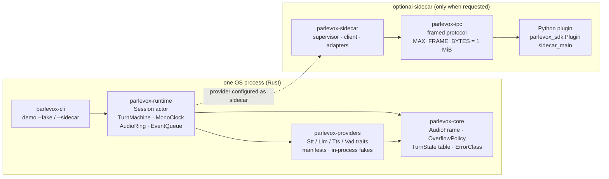
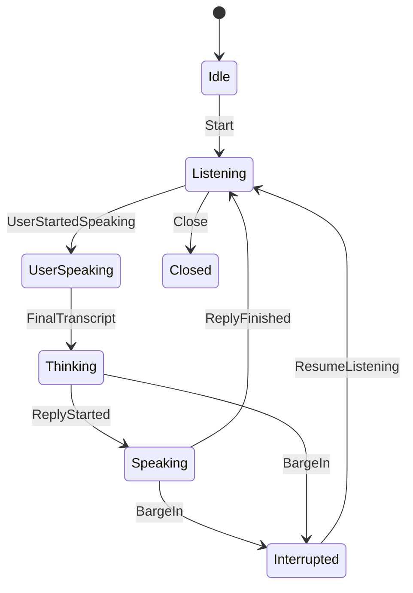

# Parlevox — design of the shipped skeleton (v0)

**One sentence:** parlevox is a voice-agent runtime whose hot path — audio
buffers, the turn state machine, provider calls, cancellation — lives in a
single Rust process, with Python reachable only through an optional, framed
sidecar for providers that need a Python SDK.

This document describes **what exists in this repository today**. The design
was shaped by a prior-art study of four open-source voice-agent frameworks —
LiveKit Agents, Pipecat, TEN Framework and Vocode — compared on the ten
dimensions scored in §5. The study recorded the choices made, not a ranking of
the others. The decision record is
[`../adr/0001-architecture.md`](../adr/0001-architecture.md). Where the two
disagree about scope, the ADR is authoritative.

Status at `62f0850`: 87 Rust tests (including property tests for the audio ring
and the event queue), 27 Python tests, `demo --fake` and `demo --sidecar` both
green with identical event sequences. The advisory-closure change and the
follow-up idiom pass were both reviewed and approved.

---

## 1. Shape of the system



The default turn never crosses the right-hand side of that diagram. `demo
--fake` spawns no process, imports no Python, and touches no network; the
sidecar is started only when a session resolves a provider that lives there.

## 2. Crates

| Crate | Owns | Key types |
|---|---|---|
| `parlevox-core` | Audio frame, clock, bounded ring, FSM, error classes | `AudioFrame`, `MonoClock`, `AudioRing`, `OverflowPolicy`, `TurnMachine`, `TurnState`, `ErrorClass` |
| `parlevox-providers` | Streaming traits + manifests + deterministic fakes | `SttProvider`, `LlmProvider`, `TtsProvider`, `VadProvider`, `ProviderManifest`, `ChatMessage`, `Role`, `Fake*` |
| `parlevox-runtime` | One session: FSM owner, rings, event handoff, provider selection, barge-in, bounded context | `Session`, `SessionConfig`, `SessionEvent`, `EventQueue`, `ProviderRegistry`, `TurnReport`, `ChatContext`, `ContextStats` |
| `parlevox-ipc` | The framed wire protocol — used **only** by the sidecar path | `Frame`, `AudioHeader`, `read_frame`, `write_frame`, `MAX_FRAME_BYTES` |
| `parlevox-sidecar` | Process supervision, the optional warm pool, and the adapter from plugin → provider trait | `SidecarClient`, `SidecarSupervisor`, `SidecarPool`, `PoolConfig`, `PoolLease`, `SidecarStt/Llm/Tts`, `RestartPolicy` |
| `parlevox-cli` | Argument parsing and the one-turn demo, in a library so tests drive the same path | `run_args`, `demo_fake`, `demo_sidecar` |
| `sdks/python/parlevox_sdk` | Reference Python implementation of the plugin side | `Plugin`, `protocol`, `fakes`, `sidecar_main` |

A session obtains its plugin process in one of two ways. When a `SidecarPool`
is configured, the session leases an already-handshaken process from it and
returns the process on release; the pool performs the additive `reset`
handshake on return, keeps at most `PoolConfig::max_idle` processes idle, and
checks age at lease time: a process idle longer than `max_age` is shut down
then and never handed out. A process that has served `max_reuses` pooled
returns is retired at its next release instead of being pooled again. The two
bounds read `0` in opposite ways: `max_idle == 0` disables pooling, so every
release shuts its process down, while `max_reuses == 0` means unlimited, so no
process is ever retired for its reuse count. The pool also kills and counts a
process whose acquire-time probe reset fails rather than handing it out dirty.
Without a pool — including `demo --sidecar` and every existing test — the
session spawns a fresh process and reaps it, exactly as before.
`PROTOCOL_VERSION` and `SIDECAR_ABI` are unchanged: `reset` is an additive
control message and a plugin that does not advertise the `reset` capability is
never pooled.

## 3. One turn

`Session::run_turn` drives VAD → STT → LLM → TTS → playout in sequence, and
the turn's invariants live in one closed transition table (`TurnState`:
`Idle → Listening → UserSpeaking → Thinking → Speaking`, with `Interrupted`
on barge-in and `Closed` terminal). An event that is illegal in the current
state returns `ParlevoxError::Protocol` — it is never swallowed, which is the
point: a misbehaving plugin fails loudly at the boundary instead of silently
corrupting a turn.



**Barge-in** advances a generation counter and fires the turn's
`CancellationToken`. Provider streams observe the token on their next poll and
end with a single `Cancelled` error, so cancellation is cooperative but
deterministic — no task is killed from outside and no provider future is left
dangling. The runtime reports the interrupted turn as `TurnDone { interrupted:
true }`.

**The default turn is half-duplex.** The next stage does not start until the
previous one finishes. Early-start behavior is opt-in only:
`SessionConfig::speculative_start: Option<SpeculativeStart>` (default `None`)
starts the LLM request on the first usable STT partial, and the flag-off path
still discards every partial — see the ADR's "Non-goals for v0".

The reply side has one opt-in exception, `SessionConfig::pipelined_tts`
(default `false`). With it enabled, the reply is split on sentence boundaries
as deltas arrive and each completed sentence is synthesized while the LLM is
still producing the rest. This is `pipelined_tts`, not early-start: it never
synthesizes from a partial transcript, and it does not overlap STT with
anything. The handoff from the delta producer to the synthesizer is a bounded
FIFO sentence queue that drops the incoming sentence under overload and counts
it (`Session::pipeline_stats`); the in-flight synthesis stream stays on the
turn future, so a barge-in tears it down structurally with no spawned task.
With the flag off, the turn loop is the sequential one described above — same
provider calls, order, events and span shape.

The other opt-in exception is `SessionConfig::speculative_start` (default
`None`). When set, the first non-final transcript whose trimmed text is at
least `min_partial_chars` long starts exactly one LLM request against that
partial, on a `CancellationToken` child of the turn's so a barge-in still
reaches it. When the final arrives the stream is adopted only if the trimmed
partial is a prefix of the trimmed final; every character the model saw was
spoken, so the rule bounds the risk to an under-specified prompt and never
admits injected text. A divergent final cancels the child token and runs the
ordinary path, and `Session::speculation_stats` reports cumulative and
per-turn `started`/`adopted`/`abandoned` counts. This overlaps generation with
the tail of STT, not synthesis with the reply, and only one request per turn is
tried.

## 4. Invariants (the reason this exists)

1. **Every buffer is bounded and accounted for.** Input audio, playout audio
   and the session→transport event handoff each have an explicit capacity and
   an `OverflowPolicy` (default `DropOldest`). Each surfaces `dropped_frames`,
   `dropped_ms` or `dropped_events`, per turn, as deltas from a captured
   baseline — so a session can tell the difference between "the network was
   fine" and "we quietly threw away 300 ms of speech".
2. **Control events are never dropped silently.** The event queue reserves a
   slot for the terminal event and refuses to drop turn structure
   (`TurnStarted`, `TranscriptFinal`, `TurnDone`, `Failed`); only streaming
   `ReplyDelta`/`AudioOut` traffic is droppable under backpressure.
3. **One monotonic clock per session.** `MonoClock` is the only source of time
   on the audio and turn paths; wall-clock time does not appear there.
4. **The default path has no Python.** If `demo --fake` ever needed an
   interpreter, the architecture would be wrong.
5. **Errors are classified.** `ParlevoxError` carries an `ErrorClass` and an
   `is_recoverable()` answer, so a caller can retry, degrade or abort without
   string-matching a message.
6. **The boundary is framed, not textual.** Audio travels as binary frames
   (`u8 header_len | JSON header | LE i16 PCM`), never base64; a declared
   length above `MAX_FRAME_BYTES` is rejected *before* allocation, and odd PCM
   is a protocol error.

## 5. How the ten comparison dimensions landed

The prior-art study selected one adopt per dimension. This is the honest
scorecard against the shipped tree:

| # | Dimension | Adopted direction | v0 status |
|---|---|---|---|
| 1 | Transport & audio path | Typed frames over a bounded, lag-counted ring | **Implemented** — `AudioRing`, `RingStats`, `dropped_ms` |
| 2 | Concurrency & isolation | Supervised plugin processes, multiplexed by `request_id` | **Partial** — supervision + restart backoff + id-multiplexed client exist; an opt-in bounded warm pool reuses a `reset`-capable process across sessions (`demo --sidecar --pool` runs two turns through one process and reports the pool counters on stderr), while the default still spawns one plugin process per session; an opt-in request stall watchdog (`StallPolicy` + `SidecarClient::spawn_watched` + `SidecarSupervisor::with_stall_watchdog` + `SidecarPool::with_stall_watchdog`) declares a plugin wedged when one request produces no event for the idle bound, fails that request as a recoverable transient provider error so the fallback chains can switch, and lets the supervisor replace the process on the next `ensure`. Still **Partial**: a plugin that stops reading its stdin can still block the request *writer*, which the watchdog does not cover |
| 3 | Turn-taking | Rust-owned FSM with composable strategies | **Partial** — explicit FSM and barge-in are real, and an opt-in adaptive endpointing decorator (`EndpointingPolicy` + `AdaptiveEndpointingVad`) sits at the VAD boundary and accepts or rejects `SpeechEnd` transitions from the trailing silence of the analysed audio. The session still transcribes the whole utterance per `run_turn`, so the decorator shapes the turn-state events and the endpoint decision at the provider boundary; it does not make STT start earlier. An opt-in false-interruption recovery (`InterruptionRecovery` + `Session::with_interruption_recovery`) retains a complete reply after a user barge-in and replays it when the next final transcript is short enough to be a backchannel; the separate `PartialResume` opt-in (`Session::with_partial_audio_resume`) resumes the sequential path from an *estimated* playback position when the produced audio fits a bounded retention cap (a synthesis cut short by the barge resumes only its produced prefix), while recovery without it (and the pipelined path) still replays the whole reply through TTS. The estimate compares wall-clock elapsed time since the first emitted frame with the frames' declared durations, assuming real-time playout; there is no acknowledgement, so a buffering transport under-skips and the cursor never passes the produced frames. Opting in keeps the default emission cadence (no ring-window batching). An ordered, pluggable **turn-start** strategy list exists (`TurnStrategies` + `Session::with_turn_strategies`, `TurnStrategy`/`TurnDecision`/`TurnContext`, and `Session::strategy_stats`): it is consulted once per final transcript before the turn is committed, and a rejecting list suppresses the turn without a user message, LLM call or TTS call. Endpoint/stop strategies remain unimplemented because the caller owns utterance boundaries. The arbitration policy itself is not yet *provable*: there is no stated floor-ownership contract, no turn-facing adapter conformance suite, and no recorded-trace replay, so a production false interrupt cannot be reproduced — the E10 programme in `TURN-SEMANTICS-REQUIREMENTS.md` specifies the contract, pure arbiter, conformance and replay work |
| 4 | Provider abstraction | One small interface per modality + versioned manifest | **Implemented** — traits, `ProviderManifest`, registry lookup |
| 5 | State & context | Rust-owned `ChatContext`, bounded policy | **Implemented** — `ChatContext`/`ContextStats` bound by message count and character budget; eviction prefers non-system messages and all loss is counted. The char budget is an estimate, not a token count |
| 6 | Failure handling | Non-fatal/fatal taxonomy, no replay after commit | **Implemented** — `ErrorClass` + `is_recoverable`; all four modalities have fallback chains (`FallbackLlm`/`FallbackTts`/`FallbackStt`/`FallbackVad`) that switch only on a pre-commit `Transient`/`Capacity` failure and never after a provider has committed output; the reply side also has opt-in retry-with-backoff (`RetryPolicy` + `RetryingLlm`) that retries the same `LlmProvider` only on a pre-commit `Transient`/`Capacity` failure and never after a committed delta or a cancellation; and an opt-in reply-side circuit breaker (`BreakerPolicy` + `CircuitBreakingLlm`) opens after N consecutive pre-commit `Transient`/`Capacity` failures, refuses requests while open without calling the provider, and admits one half-open probe after the cool-down (success closes, failure re-opens). Breakers exist for the reply side only; they compose with the fallback chains by wrapping a chain as the inner provider |
| 7 | Observability | OTel turn span + boundary cost meters | **Partial** — the opt-in `otel` feature emits one MonoClock-timed `turn` span with `vad`, `stt`, `llm`, `tts` and `playout` children and boundary-cost attributes, plus a fixed six-instrument turn metric set when a caller supplies a `Meter`, but the runtime installs no exporter: exporter/collector wiring is caller-supplied. The CLI demo adds an opt-in `otlp` feature that builds OTLP/HTTP-protobuf trace and metric exporters from one `OTEL_EXPORTER_OTLP_ENDPOINT` and resource, routes the demo sessions through the runtime's injected tracer and meter, and drains both on exit. Still **Partial**: no plugin/attempt child spans, no loop-stall detection, no exemplars or views/aggregation tuning, and no per-tenant or cost event plane |
| 8 | Extensibility cost | New provider = one interface + manifest, no core edits | **Implemented** — register/select by name |
| 9 | Deployment & scale | Warm pools sized by provider concurrency and p95 latency | **Deferred** |
| 10 | Language boundary | Rust owns lifecycle; length-prefixed binary frames with explicit cancel | **Implemented** — `parlevox-ipc` + `parlevox-sidecar` |

Deferred rows are deferrals, not omissions being papered over: they are the
v0.1+ agenda, and the ADR records the boundary.

## 6. Adding a provider

A Rust provider is two things: an implementation of one trait from
`parlevox-providers` (`transcribe`, `generate`, `synthesize` or `analyze`,
each returning a stream rather than a whole-utterance future) and a manifest
declaring name, modality, capabilities and config schema. It is registered
with `ProviderRegistry::register_*` and selected by name at session
construction. The runtime and the FSM do not change.

A Python-only provider implements `parlevox_sdk.Plugin` and is reached through
the sidecar adapter, which presents it to the runtime as the same trait. The
plugin host bounds each in-flight request's pending audio, purges it on
`cancel`, and acknowledges only after the local stream is torn down; the
process survives a cancel and serves the next request. The SDK directory is
resolved at run time in this order: `PARLEVOX_PYTHON_SDK` (a hard error when
set but invalid), then `sdks/python` relative to the executable (including the
installed `<prefix>/lib/parlevox` layout), then a documented build-tree
fallback; when nothing matches, the error lists every path tried.

## 7. Running it

```bash
cargo test --workspace
cargo run -q -p parlevox-cli -- demo --fake      # no Python involved
PYTHONPATH=sdks/python python3 -m pytest sdks/python/tests -q
cargo run -q -p parlevox-cli -- demo --sidecar   # same turn through the plugin
```

Expected: a turn prints two `AudioOut` frames and a `TurnDone` carrying
`dropped_frames`, `dropped_ms`, `dropped_events`, `interrupted`.

## 8. Known gaps

The v0.1 advisory list is closed: the sidecar's
dropped-frame count now reaches `TurnDone` as `sidecar_dropped_frames`,
`EventQueue` has the same property coverage as `AudioRing`, the plugin's
cancelled-request tombstones are a bounded ledger with counted eviction, and
CLI parity is a differential run of both backends rather than a framing
round-trip.

What remains open:

- Producers can optionally observe playout capacity, but overflow is still
  handled by dropping rather than by slowing the producer. The playout ring
  publishes a non-blocking `CreditSnapshot` (capacity, depth, slack) with
  cumulative `granted`/`cancelled` counters, and a caller may explicitly await
  a cancellation-aware `SessionCredits::wait`. The turn loop never awaits it, so
  drop-not-throttle remains the default (see ADR §"Backpressure and loss
  accounting" and its 2026-11-20 amendment).
- Half-duplex turn model by default (see §3 and the ADR's "Non-goals for v0").
  Reply-side `pipelined_tts` and speculative LLM start from a partial
  (`speculative_start`, with prefix-extension adoption and counted
  abandonments through `Session::speculation_stats`) exist behind opt-in flags.
  The pipelined sentence handoff is bounded and its drops are counted through
  `Session::pipeline_stats`. Early-start *synthesis* remains unimplemented.
- Turn-taking has an opt-in adaptive endpointing decorator
  (`EndpointingPolicy` + `AdaptiveEndpointingVad`) at the VAD boundary: it
  accepts or rejects each `SpeechEnd` from the trailing silence of the analysed
  audio and synthesizes one end at the audio duration when the inner stream ends
  with speech still open. The honest limit is that the session still transcribes
  the whole utterance per `run_turn`, so the decorator shapes the turn-state
  events and the endpoint decision at the provider boundary; it does not make
  STT start earlier. False-interruption recovery is opt-in
  (`InterruptionRecovery` + `Session::with_interruption_recovery`, off by
  default): a user barge-in that interrupts a turn whose reply text was
  completely known retains that reply, and the next turn replays it instead of
  calling the LLM when its final transcript is short enough to be a backchannel
  (the test is a trimmed character threshold, not a model, and
  `Session::recovery_stats` reports retained/resumed/discarded counts).
  Partial-audio resume is a second opt-in on top of it (`PartialResume` +
  `Session::with_partial_audio_resume`): when the sequential path's *produced*
  frames fit the bounded retention cap and the estimated playback position had
  not reached their end, the backchannel turn emits only the produced frames
  after that position — no LLM call, no TTS call, no duplicate audio and no
  repeated `ReplyDelta` — while an over-long reply (cap exceeded) or an
  exhausted position falls back to the text-only whole-reply replay. The
  position is an estimate, not an acknowledgement: the session compares the
  wall-clock elapsed time since the first emitted frame with the frames'
  declared durations, assuming the transport starts playing each frame in real
  time on receipt. A transport that buffers far ahead of real time makes the
  estimate late, so it under-skips (the user may hear a frame twice) but the
  cursor can never pass the produced frames; with no emitted frame it is zero.
  Emission cadence is unchanged from the policy-off path: every produced frame
  is pushed to the bounded playout ring and drained immediately, with no
  ring-window deferral, so both paths emit the same `AudioOut` sequence. Only
  produced frames can be resumed: when the barge-in cut synthesis short, the
  unproduced remainder of the reply's audio never exists on either turn, so the
  resume plays the produced prefix's tail and then ends while
  `TurnReport.reply` stays the full LLM reply. Recovery without the option, and
  the pipelined path, still replay text. The remaining honest limits are that a
  reply longer than the cap replays in full, that a truncated synthesis resumes
  only its produced prefix, and that recovery is impossible when the reply was
  interrupted during the LLM stream. Early-start STT, streaming audio intake,
  multi-chunk utterances, and endpoint/stop (as opposed to turn-start)
  strategies remain unimplemented.
- Turn semantics are asserted, not proven. The FSM is closed and generation
  fencing drops stale output, but the arbitration policy lives in the async
  turn loop, observations are neither timestamped nor sequenced, `SessionEvent`
  is not serializable, and there is no recorder or replay harness — so a
  false interrupt seen in production cannot be reproduced locally.
  [`TURN-SEMANTICS-REQUIREMENTS.md`](TURN-SEMANTICS-REQUIREMENTS.md) (roadmap
  E10) tracks the fix: stated contract (T0), pure `TurnArbiter` plus
  recorder/replay over golden traces (T1), backchannel-vs-barge-in evaluation
  with ducking (T2, gated on E8's concurrent intake), and a semantic
  turn-completion seam with spoken-vs-generated accounting (T3).
- Turn spans and turn metrics exist but are opt-in: `cargo build -p
  parlevox-runtime --features otel` emits one `turn` root span with `vad`,
  `stt`, `llm`, `tts` and `playout` children plus MonoClock-derived
  boundary-cost attributes, and the default build still carries no
  OpenTelemetry dependency. With `pipelined_tts` on, the `llm` and
  per-sentence `tts` spans honestly overlap; the span timeline is not
  serialized to preserve the sequential shape. The runtime itself still
  installs no exporter: a library caller installs one or passes a tracer to
  `Session::with_tracer` and a meter to `Session::with_meter`. The CLI demo
  bridges that gap opt-in with `cargo run -p parlevox-cli --features otlp --
  demo --fake` (or `demo --sidecar`): it builds an OTLP/HTTP-protobuf
  `SpanExporter` for `/v1/traces` and a `MetricExporter` for `/v1/metrics`
  from one `OTEL_EXPORTER_OTLP_ENDPOINT`, uses `OTEL_SERVICE_NAME` (default
  `parlevox`) as the shared resource service name, routes the demo session
  through `Session::with_tracer` plus `Session::with_meter`, and drains both
  providers on exit. Spans go behind a batch span processor: span end performs
  no export work, it only enqueues, so the export runs on the processor's
  background schedule and once more on the exit drain. The six turn
  instruments — `parlevox.turns`, `parlevox.turn.duration`,
  `parlevox.turn.stage.duration`, `parlevox.frames.dropped`,
  `parlevox.sidecar.frames.dropped`, and `parlevox.playout.depth` — go behind
  a periodic reader with the SDK's 60-second interval, so only the exit
  shutdown collects and exports them; with no meter the runtime path records
  nothing. Both signals share a single five-second drain budget: traces are
  force-flushed and shut down first, then the meter provider's single shutdown
  (which performs the final collect-and-export) runs with the remaining time.
  Against a black hole the trace flush and its shutdown retry each spend the
  four-second per-export timeout, so the meter's share of the budget can shrink
  to approximately zero; its export is still attempted and then abandoned at
  the deadline rather than delaying the process. The SDK drains on detached
  threads, so the CLI owns a dedicated export runtime for the whole process and
  enters its handle around every poll: an abandoned export can no longer poll a
  runtime that is already shutting down (which made tokio panic on the next
  timer registration when the demo's own runtime was used). An unresponsive
  collector can therefore delay the exit drain by at most that five-second
  bound but can never delay a turn. The honest limit on the meter side is that `opentelemetry_sdk` 0.33.1's
  `SdkMeterProvider::shutdown_with_timeout` ignores its timeout argument and
  the reader's own shutdown waits a fixed five seconds, so the CLI runs that
  one shutdown on a detached named worker thread and bounds the caller's wait
  with `recv_timeout(remaining)`, reporting expiry as a timeout rather than
  joining a stuck export. The other honest limits are: no plugin/attempt child
  spans and no loop-stall detection, no exemplars or views/aggregation tuning,
  no per-tenant or cost event plane, HTTP/protobuf only (no gRPC/tonic, no
  blocking client), a single process-global provider pair, a four-second
  per-export timeout (below the drain bound, so a black-holed collector leaves
  the workers idle when the drain returns), and a failed flush reported once
  on stderr rather than failing the turn. The default build carries no
  OpenTelemetry, OTLP or HTTP-client dependency edge and prints nothing new.
