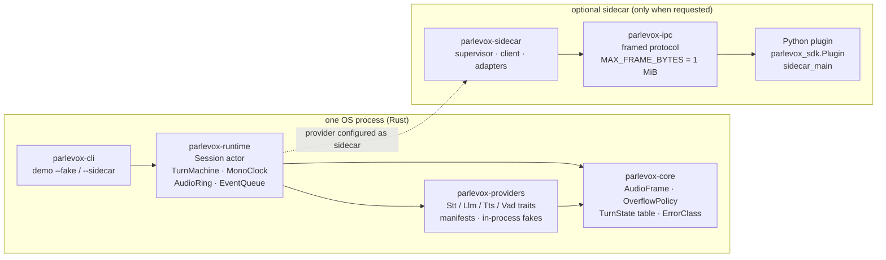
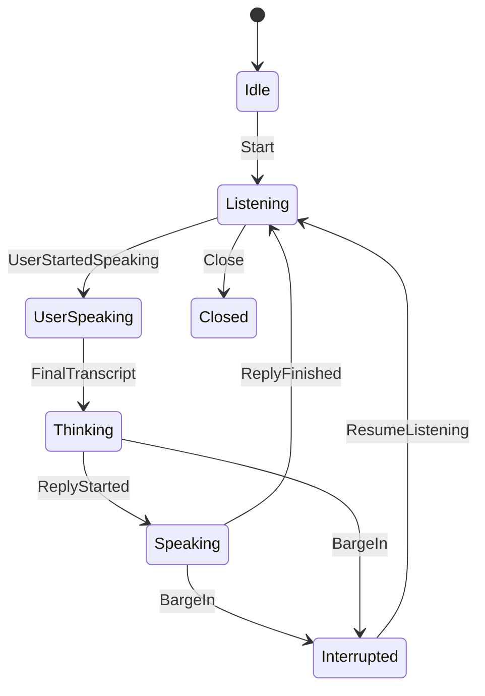

# Parlevox — design of the shipped skeleton (v0)

**One sentence:** parlevox is a voice-agent runtime whose hot path — audio
buffers, the turn state machine, provider calls, cancellation — lives in a
single Rust process, with Python reachable only through an optional, framed
sidecar for providers that need a Python SDK.

This document describes **what exists in this repository today**. The
prior-art study that preceded the code is [`COMPARISON.md`](COMPARISON.md)
(it records choices made, not a ranking of other frameworks); the decision
record is
[`../adr/0001-architecture.md`](../adr/0001-architecture.md). Where the two
disagree about scope, the ADR is authoritative.

Status at `62f0850`: 87 Rust tests (including property tests for the audio ring
and the event queue), 27 Python tests, `demo --fake` and `demo --sidecar` both
green with identical event sequences. The advisory-closure run
(`run-1795127680-3383`) and the follow-up idiom pass
(`run-1795129305-30892`) were both approved by the four-family panel (glm,
kimi, codex, minimax); [`panel-verdict.json`](panel-verdict.json) holds the
most recent verdict, copied from its run directory.

---

## 1. Shape of the system



The default turn never crosses the right-hand side of that diagram. `demo
--fake` spawns no process, imports no Python, and touches no network; the
sidecar is started only when a session resolves a provider that lives there.

## 2. Crates

| Crate | Owns | Key types |
|---|---|---|
| `parlevox-core` | Audio frame, clock, bounded ring, FSM, error classes | `AudioFrame`, `MonoClock`, `AudioRing`, `OverflowPolicy`, `TurnMachine`, `TurnState`, `ErrorClass` |
| `parlevox-providers` | Streaming traits + manifests + deterministic fakes | `SttProvider`, `LlmProvider`, `TtsProvider`, `VadProvider`, `ProviderManifest`, `ChatMessage`, `Role`, `Fake*` |
| `parlevox-runtime` | One session: FSM owner, rings, event handoff, provider selection, barge-in, bounded context | `Session`, `SessionConfig`, `SessionEvent`, `EventQueue`, `ProviderRegistry`, `TurnReport`, `ChatContext`, `ContextStats` |
| `parlevox-ipc` | The framed wire protocol — used **only** by the sidecar path | `Frame`, `AudioHeader`, `read_frame`, `write_frame`, `MAX_FRAME_BYTES` |
| `parlevox-sidecar` | Process supervision, the optional warm pool, and the adapter from plugin → provider trait | `SidecarClient`, `SidecarSupervisor`, `SidecarPool`, `PoolConfig`, `PoolLease`, `SidecarStt/Llm/Tts`, `RestartPolicy` |
| `parlevox-cli` | Argument parsing and the one-turn demo, in a library so tests drive the same path | `run_args`, `demo_fake`, `demo_sidecar` |
| `sdks/python/parlevox_sdk` | Reference Python implementation of the plugin side | `Plugin`, `protocol`, `fakes`, `sidecar_main` |

A session obtains its plugin process in one of two ways. When a `SidecarPool`
is configured, the session leases an already-handshaken process from it and
returns the process on release; the pool performs the additive `reset`
handshake on return, keeps at most `PoolConfig::max_idle` processes idle, and
checks age at lease time: a process idle longer than `max_age` is shut down
then and never handed out. A process that has served `max_reuses` pooled
returns is retired at its next release instead of being pooled again. The two
bounds read `0` in opposite ways: `max_idle == 0` disables pooling, so every
release shuts its process down, while `max_reuses == 0` means unlimited, so no
process is ever retired for its reuse count. The pool also kills and counts a
process whose acquire-time probe reset fails rather than handing it out dirty.
Without a pool — including `demo --sidecar` and every existing test — the
session spawns a fresh process and reaps it, exactly as before.
`PROTOCOL_VERSION` and `SIDECAR_ABI` are unchanged: `reset` is an additive
control message and a plugin that does not advertise the `reset` capability is
never pooled.

## 3. One turn

`Session::run_turn` drives VAD → STT → LLM → TTS → playout in sequence, and
the turn's invariants live in one closed transition table (`TurnState`:
`Idle → Listening → UserSpeaking → Thinking → Speaking`, with `Interrupted`
on barge-in and `Closed` terminal). An event that is illegal in the current
state returns `ParlevoxError::Protocol` — it is never swallowed, which is the
point: a misbehaving plugin fails loudly at the boundary instead of silently
corrupting a turn.



**Barge-in** advances a generation counter and fires the turn's
`CancellationToken`. Provider streams observe the token on their next poll and
end with a single `Cancelled` error, so cancellation is cooperative but
deterministic — no task is killed from outside and no provider future is left
dangling. The runtime reports the interrupted turn as `TurnDone { interrupted:
true }`.

**The default turn is half-duplex.** The next stage does not start until the
previous one finishes. Early-start STT (synthesizing before the transcript is
final) remains deliberately unimplemented — see the ADR's "Non-goals for v0".

The reply side has one opt-in exception, `SessionConfig::pipelined_tts`
(default `false`). With it enabled, the reply is split on sentence boundaries
as deltas arrive and each completed sentence is synthesized while the LLM is
still producing the rest. This is `pipelined_tts`, not early-start: it never
synthesizes from a partial transcript, and it does not overlap STT with
anything. The handoff from the delta producer to the synthesizer is a bounded
FIFO sentence queue that drops the incoming sentence under overload and counts
it (`Session::pipeline_stats`); the in-flight synthesis stream stays on the
turn future, so a barge-in tears it down structurally with no spawned task.
With the flag off, the turn loop is the sequential one described above — same
provider calls, order, events and span shape.

## 4. Invariants (the reason this exists)

1. **Every buffer is bounded and accounted for.** Input audio, playout audio
   and the session→transport event handoff each have an explicit capacity and
   an `OverflowPolicy` (default `DropOldest`). Each surfaces `dropped_frames`,
   `dropped_ms` or `dropped_events`, per turn, as deltas from a captured
   baseline — so a session can tell the difference between "the network was
   fine" and "we quietly threw away 300 ms of speech".
2. **Control events are never dropped silently.** The event queue reserves a
   slot for the terminal event and refuses to drop turn structure
   (`TurnStarted`, `TranscriptFinal`, `TurnDone`, `Failed`); only streaming
   `ReplyDelta`/`AudioOut` traffic is droppable under backpressure.
3. **One monotonic clock per session.** `MonoClock` is the only source of time
   on the audio and turn paths; wall-clock time does not appear there.
4. **The default path has no Python.** If `demo --fake` ever needed an
   interpreter, the architecture would be wrong.
5. **Errors are classified.** `ParlevoxError` carries an `ErrorClass` and an
   `is_recoverable()` answer, so a caller can retry, degrade or abort without
   string-matching a message.
6. **The boundary is framed, not textual.** Audio travels as binary frames
   (`u8 header_len | JSON header | LE i16 PCM`), never base64; a declared
   length above `MAX_FRAME_BYTES` is rejected *before* allocation, and odd PCM
   is a protocol error.

## 5. How the ten comparison dimensions landed

Section 1.3 of [`COMPARISON.md`](COMPARISON.md) selects one adopt per
dimension. This is the honest scorecard against the shipped tree:

| # | Dimension | Adopted direction | v0 status |
|---|---|---|---|
| 1 | Transport & audio path | Typed frames over a bounded, lag-counted ring | **Implemented** — `AudioRing`, `RingStats`, `dropped_ms` |
| 2 | Concurrency & isolation | Supervised plugin processes, multiplexed by `request_id` | **Partial** — supervision + restart backoff + id-multiplexed client exist; an opt-in bounded warm pool reuses a `reset`-capable process across sessions (`demo --sidecar --pool` runs two turns through one process and reports the pool counters on stderr), while the default still spawns one plugin process per session |
| 3 | Turn-taking | Rust-owned FSM with composable strategies | **Partial** — explicit FSM and barge-in are real; strategy list and adaptive endpointing are not |
| 4 | Provider abstraction | One small interface per modality + versioned manifest | **Implemented** — traits, `ProviderManifest`, registry lookup |
| 5 | State & context | Rust-owned `ChatContext`, bounded policy | **Implemented** — `ChatContext`/`ContextStats` bound by message count and character budget; eviction prefers non-system messages and all loss is counted. The char budget is an estimate, not a token count |
| 6 | Failure handling | Non-fatal/fatal taxonomy, no replay after commit | **Partial** — `ErrorClass` + `is_recoverable`; an LLM/TTS fallback chain (`FallbackLlm`/`FallbackTts`) switches only on a pre-commit `Transient`/`Capacity` failure and never after a provider has committed output; STT/VAD chains, retry-with-backoff, and circuit breakers are not implemented |
| 7 | Observability | OTel turn span + boundary cost meters | **Implemented** — the opt-in `otel` feature emits one MonoClock-timed `turn` span with `vad`, `stt`, `llm`, `tts` and `playout` children and boundary-cost attributes; exporter/collector wiring is caller-supplied |
| 8 | Extensibility cost | New provider = one interface + manifest, no core edits | **Implemented** — register/select by name |
| 9 | Deployment & scale | Warm pools sized by provider concurrency and p95 latency | **Deferred** |
| 10 | Language boundary | Rust owns lifecycle; length-prefixed binary frames with explicit cancel | **Implemented** — `parlevox-ipc` + `parlevox-sidecar` |

Deferred rows are deferrals, not omissions being papered over: they are the
v0.1+ agenda, and the ADR records the boundary.

## 6. Adding a provider

A Rust provider is two things: an implementation of one trait from
`parlevox-providers` (`transcribe`, `generate`, `synthesize` or `analyze`,
each returning a stream rather than a whole-utterance future) and a manifest
declaring name, modality, capabilities and config schema. It is registered
with `ProviderRegistry::register_*` and selected by name at session
construction. The runtime and the FSM do not change.

A Python-only provider implements `parlevox_sdk.Plugin` and is reached through
the sidecar adapter, which presents it to the runtime as the same trait. The
plugin host bounds each in-flight request's pending audio, purges it on
`cancel`, and acknowledges only after the local stream is torn down; the
process survives a cancel and serves the next request. The SDK directory is
resolved at run time in this order: `PARLEVOX_PYTHON_SDK` (a hard error when
set but invalid), then `sdks/python` relative to the executable (including the
installed `<prefix>/lib/parlevox` layout), then a documented build-tree
fallback; when nothing matches, the error lists every path tried.

## 7. Running it

```bash
cargo test --workspace
cargo run -q -p parlevox-cli -- demo --fake      # no Python involved
PYTHONPATH=sdks/python python3 -m pytest sdks/python/tests -q
cargo run -q -p parlevox-cli -- demo --sidecar   # same turn through the plugin
```

Expected: a turn prints two `AudioOut` frames and a `TurnDone` carrying
`dropped_frames`, `dropped_ms`, `dropped_events`, `interrupted`.

## 8. Known gaps

The v0.1 advisory list is closed (run `run-1795127680-3383`): the sidecar's
dropped-frame count now reaches `TurnDone` as `sidecar_dropped_frames`,
`EventQueue` has the same property coverage as `AudioRing`, the plugin's
cancelled-request tombstones are a bounded ledger with counted eviction, and
CLI parity is a differential run of both backends rather than a framing
round-trip.

What remains open:

- Producers cannot observe backpressure — there are no credits; overflow is
  handled by dropping, not by slowing the producer (see ADR §"Backpressure
  and loss accounting", which records this as deliberate for v0.1).
- Half-duplex turn model by default (see §3 and the ADR's "Non-goals for v0").
  Reply-side `pipelined_tts` exists behind an opt-in flag; early-start STT
  (synthesis before the final transcript) remains unimplemented. The pipelined
  sentence handoff is bounded and its drops are counted through
  `Session::pipeline_stats`.
- Turn spans exist but are opt-in: `cargo build -p parlevox-runtime --features otel`
  emits one `turn` root span with `vad`, `stt`, `llm`, `tts` and `playout`
  children plus MonoClock-derived boundary-cost attributes, and the default
  build still carries no OpenTelemetry dependency. With `pipelined_tts` on,
  the `llm` and per-sentence `tts` spans honestly overlap; the span timeline is
  not serialized to preserve the sequential shape. There is no OTLP exporter
  configuration, no collector wiring, and no OTel metrics in v0 — the caller
  installs a tracer or passes one to `Session::with_tracer` (dimension 7 is
  implemented for spans, not for an export pipeline).
