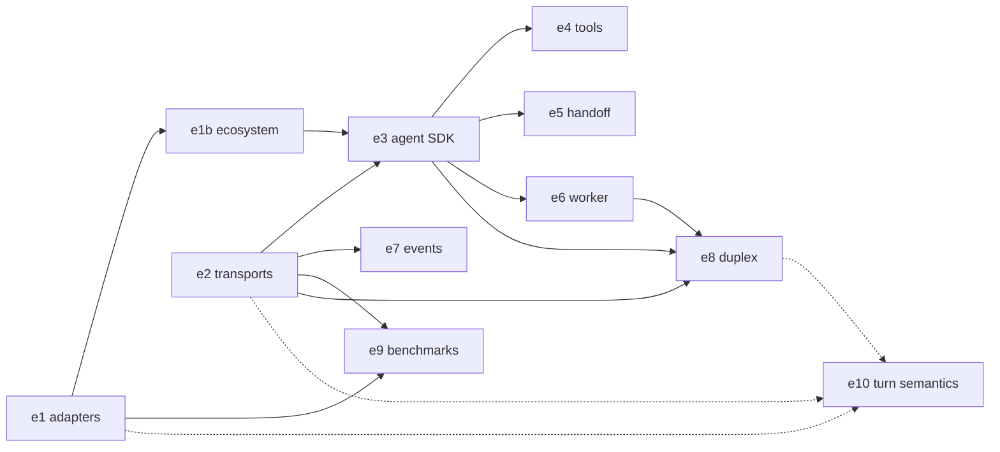

# Parlevox epics — machine-readable index

Status: living index · Updated 2026-11-23 ·
Roadmap narrative: [PARITY-LIVEKIT-AGENTS.md](PARITY-LIVEKIT-AGENTS.md)

This file is the **tracking source** for delivery: every `##` heading is one
epic, and the body is the kickoff text. The detailed specification for each
epic lives in [`epics/`](epics/) and is the source of record; the body here is
short on purpose so `mini-ork epics split` produces a usable kickoff without
duplicating prose that would then drift.

```bash
mini-ork epics ingest docs/architecture/EPICS.md   # epics + dependency edges
mini-ork epics ready                               # what can be dispatched now
mini-ork epics split docs/architecture/EPICS.md    # kickoffs/auto/<id>.md
mini-ork epics show e10                            # one epic + its deps
```

Dependency tokens resolve by epic id, so `e1b` must be written exactly. A hard
edge (`depends on`) blocks dispatch; a soft edge (`should follow`) only orders
the queue.

| Epic | Title | Detail | Hard deps |
|---|---|---|---|
| `e1` | Real provider adapters | [e1](epics/e1-real-provider-adapters.md) | — |
| `e1b` | Adapter ecosystem | [e1b](epics/e1b-adapter-ecosystem.md) | e1 |
| `e2` | Transports | [e2](epics/e2-transports.md) | — |
| `e3` | Agent SDK ergonomics | [e3](epics/e3-agent-sdk.md) | e1b, e2 |
| `e4` | Tool calling | [e4](epics/e4-tool-calling.md) | e3 |
| `e5` | Multi-agent handoff | [e5](epics/e5-agent-handoff.md) | e3 |
| `e6` | Worker and job model | [e6](epics/e6-worker-job-model.md) | e3 |
| `e7` | Public event stream parity | [e7](epics/e7-event-stream.md) | e2 |
| `e8` | Full-duplex / early-start STT | [e8](epics/e8-full-duplex.md) | e3, e2, e6 |
| `e9` | Proof (benchmarks) | [e9](epics/e9-benchmarks.md) | e1, e2 |
| `e10` | Turn semantics: contract, arbiter, conformance, replay | [e10](epics/e10-turn-semantics.md) | — (soft: e8, e1, e2) |

## Real provider adapters (id: e1)

Real vendor adapters written in Python and reached through the sidecar: one
streaming-adapter base in `sdks/python` (env-keyed auth, bounded retries mapped
onto the existing `ErrorClass` taxonomy, fixture-injectable transport), then
STT Deepgram / OpenAI / AssemblyAI, TTS ElevenLabs / Cartesia / OpenAI, LLM
OpenAI-compatible / Anthropic. Each adapter is one module + one manifest + one
fixture test; a live call stays opt-in behind the provider's key env var.

Done when `parlevox demo --sidecar` runs a full turn on fixtures for every
shipped adapter and `git diff --stat crates/` is empty. Detail:
[`epics/e1-real-provider-adapters.md`](epics/e1-real-provider-adapters.md).

## Adapter ecosystem (id: e1b)

Turn the adapters into a distribution asset: a name→constructor registry with
`parlevox providers list|describe` over the manifest's `config_schema`,
one-crate-per-vendor packaging, a conformance kit every adapter must pass,
BYO-credential resolution with an entitlement preflight, and a manifest
protocol version. Foundation spec:
[`PROVIDER-FOUNDATION-REQUIREMENTS.md`](PROVIDER-FOUNDATION-REQUIREMENTS.md);
phases F0–F3 are in the detail file.

- depends on: e1

Done when a provider can be added with zero Rust changes and no patches to the
runtime (F0's no-patching test), then scored on provider metrics M1–M5. Detail:
[`epics/e1b-adapter-ecosystem.md`](epics/e1b-adapter-ecosystem.md).

## Transports (id: e2)

(a) WebSocket PCM transport — binary 24 kHz s16le mono in/out, JSON control,
one session per connection, bounded ingress with counted drops. (b) Optional
LiveKit-room bridge behind a cargo feature: join a room, subscribe the mic,
publish the TTS track — interop, not replacement. (c) Twilio Media Streams
over the same WS transport (μ-law 8 kHz resample).

Done when a browser or `wscat` client can drive a full turn end to end and
buffered samples are counted, never silently lost. Detail:
[`epics/e2-transports.md`](epics/e2-transports.md).

## Agent SDK ergonomics (id: e3)

Python `AgentSession` / `Agent` / `RunContext` mirroring `livekit.agents`
naming, plus `parlevox console` and `parlevox run` wiring the WS transport to
the Rust session, so a migration is a rename rather than a rewrite. Touches
`sdks/python` and `crates/parlevox-cli`.

- depends on: e1b, e2

Done when the same agent definition runs under `livekit.agents` and parlevox
with only import and factory changes. Detail:
[`epics/e3-agent-sdk.md`](epics/e3-agent-sdk.md).

## Tool calling (id: e4)

Tool schemas through the LLM call, a bounded tool-call loop in Rust (max
rounds, timeout, error → tool output rather than a dead turn), `@function_tool`
in Python, and `ToolCallStarted/Updated/Ended` events on the public stream.

- depends on: e3

Done when a tool that throws is answered honestly and the loop's abandonments
are counted. Detail: [`epics/e4-tool-calling.md`](epics/e4-tool-calling.md).

## Multi-agent handoff (id: e5)

Agent registry in the session, a `Handoff` event, context carry-over into the
next agent's instructions, and `Agent(handoff=...)` in Python.

- depends on: e3

Done when a mid-session handoff preserves the conversation in the receiving
agent's first request and the stream shows exactly one `Handoff`. Detail:
[`epics/e5-agent-handoff.md`](epics/e5-agent-handoff.md).

## Worker and job model (id: e6)

Single-node `AgentServer` equivalent: job dispatch, `--concurrency`, a warm
plugin pool sized from concurrency and p95 turn latency (closes DESIGN
dimension 9), drain on SIGTERM, `/healthz`.

- depends on: e3

Done when N+1 sessions never exceed N live turns and a SIGTERM mid-turn still
produces a completed `TurnDone`. Detail:
[`epics/e6-worker-job-model.md`](epics/e6-worker-job-model.md).

## Public event stream parity (id: e7)

Transport-delivered typed events (`user_input_transcribed`, `speech_created`,
`agent_state_changed`, `function_tools_executed`, `usage_updated`), a usage /
`TurnReport` API, child plugin spans and loop-stall detection.

- depends on: e2

Done when an app can render a turn from the event stream alone. Detail:
[`epics/e7-event-stream.md`](epics/e7-event-stream.md).

## Full-duplex / early-start STT (id: e8)

Streaming intake that feeds STT while the user speaks, interim transcripts as
events, speculative start on stable prefixes, and concurrent VAD during
playback. The one genuinely architectural gap: the turn loop stops being a
one-shot function.

- depends on: e3, e2, e6

Done when the VAD observes speech during agent playback and a half-said
sentence produces one turn, not two. Detail:
[`epics/e8-full-duplex.md`](epics/e8-full-duplex.md).

## Proof (id: e9)

Benchmark harness publishing numbers instead of adjectives: per-stage latency
(VAD-end → STT-final → LLM-first-token → TTS-first-byte → first `AudioOut`),
p50/p95 at 1/10/50 concurrent sessions, RSS per session, steady-state pool
cost.

- depends on: e1, e2

Done when one command reproduces the published table on a documented machine
class. Detail: [`epics/e9-benchmarks.md`](epics/e9-benchmarks.md).

## Turn semantics: contract, arbiter, conformance, replay (id: e10)

Make turn behaviour a specified, executable, replayable contract: serializable
`Observation { t_ms, event_id, turn, generation, kind }` on a monotonic clock,
a pure `TurnArbiter::step(&Model, Observation) -> (Model, Vec<Command>)` with
additive states (`Committing`, `AgentGenerating`, `EvaluatingBargeIn`), a
declarative `Command` enum including `DuckAudio{gain}` / `RestoreAudio`, a
turn-facing provider conformance suite, and a JSONL recorder plus deterministic
replay over a golden corpus.

- should follow: e8, e1, e2

T0–T1 (contract, envelope, recorder, pure arbiter skeleton, replay harness)
are runtime-local and start immediately; T2 (barge-in evaluation, ducking,
semantic `TurnDetector` seam) waits on e8 and e2; T3 (spoken-vs-generated
accounting on the public stream) follows e7 and e9. Full spec with TS-1…TS-12,
PR-1…PR-6 and metrics M1–M6:
[`TURN-SEMANTICS-REQUIREMENTS.md`](TURN-SEMANTICS-REQUIREMENTS.md). Detail:
[`epics/e10-turn-semantics.md`](epics/e10-turn-semantics.md).

## Dependency graph (context)



Solid edges are hard dependencies; dotted edges are `should follow` and only
order the queue. `e10` is therefore dispatchable immediately for its T0–T1
phases.
