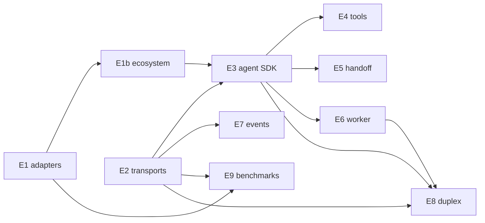

# Parity target: LiveKit Agents

**Locked 2026-11-23.** Parlevox replaces **LiveKit Agents** — the agent
framework (`AgentSession`, `Agent`, plugins, worker/job model, room I/O) — not
the LiveKit SFU, Cloud, SIP or TURN stack. Those are media-infrastructure
products; parlevox interoperates with them by joining a room as a participant
and never reimplements them.

Reference copy: `/Volumes/docker-ssd/ps/livekit/agents` (88 plugin packages,
`livekit-agents` v1.x Python SDK). All anchors below are relative to
`livekit-agents/livekit/agents/`.

## 1. Surface map

| LiveKit Agents concept | Reference | Parlevox today | Gap |
|---|---|---|---|
| `AgentSession` orchestration | `voice/agent_session.py` | `Session` + `run_turn` (Rust) | Python SDK surface (E3) |
| `Agent` instructions + tools | `voice/agent.py` | prompt in `SessionConfig` | agent object, per-turn overrides (E3) |
| Turn model: endpointing, barge-in, false interruption | `voice/endpointing.py`, `voice/agent_activity.py` | **implemented** (closed FSM, recovery, partial resume, turn strategies) | none — advantage |
| STT/LLM/TTS contracts + 88 plugins | `plugin.py`, `livekit-plugins/*` | plugin protocol + sidecar process supervision | **zero real adapters** (E1) |
| Room I/O: participant audio in/out | `voice/room_io/` | none | **no transport at all** (E2) |
| Function tools, `function_tool`, `ToolContext`, `StopResponse` | `llm/tool_context.py` | none | tool loop + SDK decorator (E4) |
| `AgentHandoff`, context transfer | `llm/chat_context.py`, `llm/delegation.py` | typed `ChatContext` only | handoff registry + event (E5) |
| `AgentServer`, `JobContext`, warm pool, drain, load | `worker.py`, `job.py` | none | worker/job model (E6) |
| Typed event stream, usage, metrics events | `voice/events.py`, `metrics/` | `SessionEvent` + `TurnReport` + OTel | public event stream over transport, usage API (E7) |
| `cli run console / dev / start` | `cli/cli.py` | `demo --fake/--sidecar` | console mode, project runner (E3/E6) |
| Realtime/duplex models | `llm/realtime*.py`, `llm/duplex.py` | half-duplex by design | early-start STT / duplex (E8) |
| Simulation/scenarios | `simulation/` | none | out of scope for parity v1 |

## 2. Epics

**E1 — Real provider adapters** (Python, through the sidecar).
One streaming-adapter base in `sdks/python` (env-keyed auth, bounded retries
mapped onto the existing `ErrorClass` taxonomy, fixture-injectable transport),
then: STT Deepgram / OpenAI / AssemblyAI; TTS ElevenLabs / Cartesia / OpenAI;
LLM OpenAI-compatible / Anthropic. Each adapter is one module + manifest + a
fixture test; a live call is opt-in behind the provider's key env var.

**E1b — Adapter ecosystem (the distribution asset).**
E1 produces adapters; E1b makes them a *network* rather than a product.
LiveKit's adoption advantage is not the plugin count, it is that the provider
a team already pays for works without leaving the framework. The primitives
are already in the tree — the four modality traits and a `ProviderManifest`
with `name`/`modality`/`capabilities`/`config_schema` — so the gap is
distribution plumbing, not design:

- **Registry**: a name→constructor map plus `parlevox providers list|describe`.
  `describe` renders the manifest's `config_schema`, so required keys and
  defaults are discoverable without docs.
- **Packaging**: one crate (or one sidecar module) per vendor. A third party
  adds *their* provider without touching the runtime or the turn machine —
  the manifest doc comment already promises this; the packaging has to make
  it true.
- **Conformance kit**: one suite every adapter must pass — partials then one
  final, cancellation propagates, errors classified into the existing
  `ErrorClass` taxonomy, dropped-frame accounting, empty-text synthesis
  refused. This is what lets contributions be self-verifying instead of
  review-bound.
- **BYO credentials**: env + config resolution with a preflight that *probes
  entitlement*, not mere key presence (a lane whose subscription lapsed passes
  a presence check and 403s at first dispatch).
- **Manifest protocol version**: so an older plugin fails loudly instead of
  misbehaving silently.

Priority tiers by "what a team already pays for": STT Deepgram / AssemblyAI /
OpenAI-Whisper; TTS ElevenLabs / Cartesia / OpenAI / Azure; LLM
OpenAI-compatible / Anthropic / Bedrock / Vertex; VAD Silero. Roughly eleven
adapters cover the majority of LiveKit deployments — breadth here is worth
more than any single transport feature.

The foundation is specified in
[`PROVIDER-FOUNDATION-REQUIREMENTS.md`](PROVIDER-FOUNDATION-REQUIREMENTS.md):
three support tiers (descriptor / connector / sidecar), fifteen technical and
ten product requirements, and four phases. **F0 is the gate**: manifest v2, a
descriptor loader, an HTTP connector for the OpenAI-compatible family, a
registry with `providers list|describe`, and a no-patching test — proving a
provider can be added with zero Rust code before any breadth work starts.

**E2 — Transports.**
(a) WebSocket PCM transport: binary 24 kHz s16le mono in/out, JSON control,
one session per connection, bounded ingress with counted drops.
(b) LiveKit-room bridge (optional cargo feature): join a room, subscribe the
mic, publish the TTS track. Interop, not replacement.
(c) Twilio Media Streams over the same WS transport (μ-law 8 kHz resample).

**E3 — Agent SDK ergonomics.**
Python `AgentSession` / `Agent` / `RunContext` mirroring `livekit.agents`
naming, plus `parlevox console` and `parlevox run` wiring the WS transport to
the Rust session. Migration should be a rename, not a rewrite.

**E4 — Tool calling.**
Tool schemas through the LLM call, a bounded tool-call loop in Rust (max
rounds, timeout, error → tool output), `@function_tool` in Python, and
`ToolCallStarted/Updated/Ended`-shaped events on the public stream.

**E5 — Multi-agent handoff.**
Agent registry in the session, `Handoff` event, context carry-over into the
next agent's instructions, Python `Agent(handoff=...)` ergonomics.

**E6 — Worker and job model.**
Single-node `AgentServer` equivalent: job dispatch, `--concurrency`, warm
plugin pool sized from concurrency and p95 turn latency (closes DESIGN
dimension 9), drain on SIGTERM, `/healthz`.

**E7 — Public event stream parity.**
Transport-delivered typed events (`user_input_transcribed`, `speech_created`,
`agent_state_changed`, `function_tools_executed`, `usage_updated`) and a
usage/`TurnReport` API; child plugin spans and loop-stall detection
(dimension 7).

**E8 — Full-duplex / early-start STT.**
Streaming intake that feeds STT while the user speaks, interim transcripts,
speculative start on stable prefixes. The one genuinely architectural gap.

**E9 — Proof.**
Benchmark harness: per-stage latency (VAD-end → STT-final → LLM-first-token →
TTS-first-byte → first `AudioOut`), p50/p95 at 1/10/50 concurrent sessions,
RSS per session. Numbers are published, not asserted.

## 3. Migration map

| livekit.agents | parlevox |
|---|---|
| `AgentSession(stt=..., llm=..., tts=...)` | session built from the sidecar provider set |
| `Agent(instructions=..., tools=[...])` | agent definition + `@function_tool` |
| `function_tool` | same name in `parlevox_sdk` |
| `JobContext`, `AgentServer` | `parlevox serve --concurrency N` |
| `room_io` (Joins a LiveKit room) | `--livekit-room` bridge feature |
| `cli run console` | `parlevox console` |

## 4. Non-goals

Own SFU/WebRTC server, SIP stack, TURN, STT/TTS models, noise cancellation,
dashboards, billing, mobile SDKs, multi-node scheduling before single-node
worker works.

## 5. Sequencing and operating model

Lanes run as mini-ork deliverables in **separate git worktrees**, one run per
worktree, each with its own `MINI_ORK_HOME`. Land order: E2(a) → E1 → E3, then
E4/E5/E6 fan out; E9 after E2(a)+E1. Estimates: E2(a) 1–2 runs, E1 4 runs,
E3 2–3 runs, E4 2–3 runs, E5 1–2, E6 2–3, E7 2, E9 1–2, E8 3–4.

Provider work interleaves rather than waits: **F0** (descriptor + HTTP +
registry, 1–2 runs) has no dependency on transports and should land alongside
E2(a); **F1** (WS connector + Deepgram, 1–2 runs) needs F0 only; **F2** and
**F3** land after E1's first adapters so the conformance kit has real
counterparties. Every provider deliverable is scored against the no-patching
metrics M1–M3 in `PROVIDER-FOUNDATION-REQUIREMENTS.md`.
