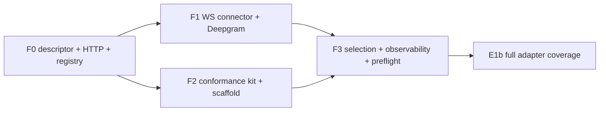

# Provider foundation — requirements for "any provider, least code, no patching"

Status: requirements draft for review · 2026-11-23
Parent roadmap: `docs/architecture/PARITY-LIVEKIT-AGENTS.md` §E1b

## 1. Goal

A team that already pays for an STT, TTS, LLM or VAD provider must be able to
use it with parlevox **without forking the framework, recompiling it, or
patching core code** — and the amount of new code must be proportional to how
unusual that provider's wire protocol is, not to the number of vendors.

Three support tiers, chosen by protocol shape rather than by vendor:

| Tier | Provider shape | What you write | What you do **not** write |
|---|---|---|---|
| **A — descriptor** | HTTP/JSON, or WebSocket with a known dialect (OpenAI-compatible chat, OpenAI audio, Azure/OpenRouter/Groq/Together variants, ElevenLabs REST) | one YAML descriptor (name, kind, endpoint, auth, model ids, capabilities, limits) | any Rust; any rebuild |
| **B — connector** | a proprietary streaming protocol shared by a family (Deepgram streaming WS, Cartesia WS, OpenAI Realtime) | one connector module in `providers/` plus descriptors that select it by `kind` | changes to runtime, session, turn machine, or CLI |
| **C — sidecar** | only reachable through a vendor SDK, or a non-Rust implementation | one Python module registering the provider with the existing plugin host | any core change; any new Rust crate |

`Tier A = data`, `Tier B = one connector per protocol family`, `Tier C = zero
core code`. A provider must never require patching the framework.

### Success metrics (measurable)

- **M1** Adding an OpenAI-compatible provider (Groq, Together, Fireworks,
  OpenRouter, a self-hosted vLLM) is **0 lines of Rust and 1 descriptor**,
  provable by a test that loads an out-of-tree descriptor directory.
- **M2** Adding a new streaming protocol family costs **≤ 1 connector module**
  and touches **no file** under `crates/parlevox-runtime`, `-core`, `-ipc`,
  `-cli`.
- **M3** Adding a sidecar-only provider touches only `sdks/python` (or an
  external Python package) — `git diff --stat crates/` is empty.
- **M4** `parlevox providers list|describe|check` works **offline** from
  descriptors alone; no vendor call at load time.
- **M5** A new adapter is accepted on green conformance cassettes — review is
  a checklist, not a re-derivation.

## 2. What exists today

| Asset | Location | Reusable? |
|---|---|---|
| Modality traits: streaming, `CancellationToken` per call, `ProviderStream<T>`, drop accounting hook | `crates/parlevox-providers/src/traits.rs:124-200` | **yes** — the contract is already vendor-neutral |
| `ProviderManifest { name, modality, capabilities, config_schema }` + `validate()` | `crates/parlevox-providers/src/manifest.rs:32-80` | **yes** — start of the descriptor; needs versioning + adapter fields |
| Decorators: fallback, retry, circuit breaker, endpointing | `crates/parlevox-providers/src/{fallback,retry,breaker,endpointing}.rs` | yes — selection/fallback semantics already exist |
| Sidecar plugin host: binary framing, request ids, cancellation tombstones, bounded pending audio, overflow policy | `sdks/python/parlevox_sdk/{protocol,plugin}.py`, `crates/parlevox-sidecar` | yes — Tier C is 80 % built |
| `SIDECAR_ABI` / `PROTOCOL_VERSION` handshake | `sdks/python/parlevox_sdk/protocol.py`, `plugin.py:148` | needs a documented compatibility policy |
| CLI | `crates/parlevox-cli/src/lib.rs:178-191` — hand-rolled match, only `demo --fake|--sidecar` | needs real subcommands |

Gaps: **zero real adapters**; no descriptor format or loader; no registry;
no credential resolution; no `providers` CLI; no conformance kit; no
entitlement probe; no provider-level observability beyond per-turn counters.

## 3. Technical requirements

Each requirement is written to be testable; the acceptance column is what a
verifier can check without judgement.

### TR-1 — Manifest v2
Extend `ProviderManifest` additively with `protocol_version: u32`,
`adapter: { kind: String, endpoint: Option<String> }`, `models: Vec<ModelEntry>`
(`id`, display name, modality, context/limits, capabilities), and
`limits: { max_concurrency, max_inflight, sample_rates, channels }`.
`validate()` rejects unknown `kind`, empty model ids, duplicate model ids.
**Acceptance:** a manifest parsed from YAML round-trips to JSON unchanged; an
unknown `kind` is a protocol error naming the offender.

### TR-2 — Declarative descriptor format and loader
Descriptors are YAML files in `config/providers/*.yaml` (repo) →
`$PARLEVOX_HOME/providers/*.yaml` (user), plus any directory named by
`PARLEVOX_PROVIDER_DIRS` (colon-separated). Loader: strict schema (JSON Schema
generated from the Rust types), errors name file + line + key, duplicate
provider names across layers are an error (not last-wins). **Acceptance:**
loading an out-of-tree directory registers a provider with no code change (M1);
a malformed file reports its path.

### TR-3 — Registry and CLI
`parlevox providers list` (name, modality, tier, capabilities, source file),
`describe <name>` (renders `config_schema` + models + required env vars),
`check <name>` (offline schema check) / `check <name> --live` (TR-7).
Registry keyed by `(modality, name)`; selection resolves a name, never a
hard-coded enum. **Acceptance:** `list` works with the network disabled;
`describe` prints required keys computed from the schema.

### TR-4 — HTTP/JSON connector toolkit
Reusable primitives: auth injection (bearer / header / query template),
SSE and chunked-JSON streaming parsers, per-request timeout, retry with the
existing `ErrorClass` taxonomy, cancellation that aborts the HTTP request,
bounded buffers with counted drops. One `openai-compatible-chat`,
`openai-audio-stt`, `openai-audio-tts` connector covers the Tier-A majority.
**Acceptance:** fixture-replay tests for streaming partials, a 429 mapped to
`ErrorClass::RateLimit`, and cancellation observed within one chunk.

### TR-5 — WebSocket frame connector toolkit
Connect + auth handshake, per-provider frame encode/decode hooks (a trait with
three methods: `handshake`, `encode`, `decode`), keepalive, close-on-cancel,
backpressure with counted drops. Deepgram streaming and Cartesia TTS are the
first two connectors; both are Tier B. **Acceptance:** cancel closes the socket
within 100 ms in the fixture harness; a dropped ingress frame is counted in the
report's `sidecar_dropped_frames` equivalent.

### TR-6 — Credential resolution and redaction
Descriptor names the env var(s) (`api_key_env`), never the key. Resolution
order: session override → env → config file. No path may serialize a secret:
`providers describe` and every log line print `<set>` / `<missing>`.
**Acceptance:** a test greps all provider CLI output and diagnostics for a
planted fake key and finds none.

### TR-7 — Entitlement preflight
`providers check --live` performs the cheapest authenticated call per modality
(models list, 1-character synthesis, models endpoint) and classifies
`ok | unauthorized | quota | unreachable | malformed`, with the HTTP status
class. **Acceptance:** a revoked-key fixture classifies `unauthorized`, a
plan-exhausted fixture `quota` — the distinction that a presence-only check
misses.

### TR-8 — Selection, fallback and capability negotiation
`select(modality, requirements)` filters by capability flags (`streaming`,
`partials`, `cancel`, sample-rate/channel support), then by declared limits and
cost hints, then applies the configured fallback chain (existing decorators).
Selection is deterministic and unit-testable without providers.
**Acceptance:** a property test asserts selection only ever returns providers
whose caps satisfy the requirements, or a typed error.

### TR-9 — Conformance kit
`parlevox providers conformance <name>` runs the modality invariants against
recorded cassettes: partials-then-one-final for STT; empty-text synthesis
refused for TTS; structured history accepted for LLM; cancellation
propagates; errors classified; drop counters honest; no unrequested audio.
Cassettes are committed as fixtures; recording is a maintainer-only,
key-gated step. **Acceptance:** the kit fails for each of seven deliberately
broken fixture providers (one per invariant).

### TR-10 — Sidecar as first-class Tier C
Documented ABI: `SIDECAR_ABI` compatibility check at handshake (refuse loudly
on mismatch), manifest passthrough, error taxonomy mapping, request-id
cancellation, bounded pending audio. Ship `parlevox providers scaffold
--sidecar <name>` emitting a runnable module + test. **Acceptance:** scaffold
output passes the conformance kit unchanged (except live cassettes).

### TR-11 — No-patching guarantee
A CI test loads a descriptor directory containing a provider that exists
nowhere in the source tree, runs it against fixtures through the public
registry, and asserts the runtime/session crates are untouched
(`git diff --stat` on `crates/parlevox-runtime` empty). **Acceptance:** that
test exists and gates merges.

### TR-12 — Layered configuration
Repo config < user config < session config < env, with a `providers explain
<name>` command printing the effective value and its source layer. No implicit
merging of secrets across layers. **Acceptance:** a test walks a four-layer
matrix and asserts the winner and the reported source.

### TR-13 — Provider observability
Per provider: request count, error class histogram, latency percentiles,
drop counts, estimated cost when `cost_hints` exist. Export via the existing
OTel path with `provider.name`, `provider.kind`, `provider.tier` attributes —
never endpoint credentials. **Acceptance:** one span/metric assertion per
modality under the `otel` feature.

### TR-14 — Compatibility policy
Descriptor `protocol_version`; adapter semver; sidecar ABI version; a
deprecation window of one minor release; `providers doctor` reports
mismatches. Unknown future fields are ignored with a warning, not rejected.
**Acceptance:** an old descriptor with a removed field loads with a warning;
an incompatible ABI refuses with the two versions named.

### TR-15 — Failure UX
Every error names provider, modality, tier, and next action; HTTP status is
classified not echoed; vendor text is truncated and redacted. **Acceptance:**
golden-error tests for unauthorized / quota / unreachable / malformed.

## 4. Product requirements

- **PR-1 — Five-minute onboarding.** `parlevox providers add <name>` writes the
  descriptor into the user layer, `check --live` confirms the key, the demo
  runs on that provider. No docs needed to get to first audio.
- **PR-2 — Coverage that matches what teams already buy.** STT Deepgram,
  AssemblyAI, OpenAI; TTS ElevenLabs, Cartesia, OpenAI, Azure; LLM
  OpenAI-compatible family, Anthropic, Bedrock/Vertex; VAD Silero. A migration
  table maps each to the equivalent LiveKit plugin name.
- **PR-3 — Zero-patch contribution path.** A community PR is "descriptor or
  connector + cassettes + conformance green". Review checklist, not code
  archaeology. Connectors live in a directory with a stability label.
- **PR-4 — Generated per-provider docs.** The provider page is rendered from
  the descriptor (capabilities, limits, env vars, models) so docs cannot drift
  from the registry.
- **PR-5 — Honest status.** `providers list` shows tier, conformance badge
  (tested/untested), and protocol version. No implied support without a badge.
- **PR-6 — Offline and air-gapped.** Descriptors ship in the repo; loading and
  selection never touch the network; live checks are explicit.
- **PR-7 — Enterprise controls.** Private descriptor directories, allowlist of
  providers, documented egress endpoints per vendor, cost guardrails from
  `cost_hints`.
- **PR-8 — Support matrix.** Per provider: streaming vs batch, partials,
  languages, sample rates/channels, cancellation, concurrency limits.
- **PR-9 — Migration ergonomics.** `parlevox migrate livekit` reads an
  `AgentSession(stt=..., llm=..., tts=...)` snippet and prints the equivalent
  descriptor selection.
- **PR-10 — Trust and pinning.** Protocol versions and model ids are pinned in
  descriptors; upgrades are explicit; `providers doctor` diff-checks the
  installed set against the shipped set.

## 5. Foundation phases

**F0 — Prove the zero-code path (smallest useful foundation).**
TR-1 (manifest v2), TR-2 (loader), TR-3 (registry + `list|describe`), TR-4
(HTTP connector, OpenAI-compatible chat + audio), TR-11 (no-patching test),
plus three shipped descriptors (OpenAI LLM, OpenAI STT, OpenAI TTS) and one
out-of-tree descriptor test (Groq-style) that proves M1.
*Exit:* M1 and M4 hold; `cargo test` green; no runtime-crate diff.

**F1 — Streaming protocol family.**
TR-5 (WS toolkit), Deepgram STT connector, Cartesia or ElevenLabs WS TTS
connector, TR-6 redaction. *Exit:* M2 holds — a second vendor on the same
connector needs only a descriptor.

**F2 — Contribution surface.**
TR-9 (conformance kit), TR-10 (scaffold + ABI policy), TR-14 (compat).
*Exit:* M3 and M5 hold; scaffold output passes conformance.

**F3 — Production plumbing.**
TR-7 (entitlement preflight), TR-8 (selection/fallback), TR-12 (layered
config), TR-13 (observability), TR-15 (failure UX).
*Exit:* every error path has a golden test; provider metrics visible in the
demo's OTLP export.

## 6. Non-goals (v1)

- A plugin marketplace or hosted registry service.
- Auto-generating SDKs from vendor OpenAPI specs.
- Replacing the turn machine or transport work (E2/E3 own those).
- Supporting non-audio modalities (vision, embeddings) before v1 ships.
- Automatic credential provisioning or billing integration.

## 7. Open decisions

- **D1 — Where Tier B connectors live.** A new `crates/parlevox-connectors`
  crate (feature-gated per family) vs a `providers/` directory inside
  `parlevox-providers`. Recommendation: separate crate so the core provider
  crate keeps zero network code and builds offline.
- **D2 — Descriptor schema source of truth.** Rust types with generated JSON
  Schema (recommended) vs a hand-written schema kept in sync by a test.
- **D3 — Cost hints format.** Per-million-token and per-character/per-second
  audio, versioned, optional; selection may use them only as a tiebreaker.
- **D4 — Cassette format.** One JSONL per provider+modality with a recorded
  request id, timestamp, and a schema version (recommended) vs per-test files.
- **D5 — Tier C packaging.** Ship scaffold inside `sdks/python` (recommended)
  vs a separate `parlevox-provider` PyPI package.
