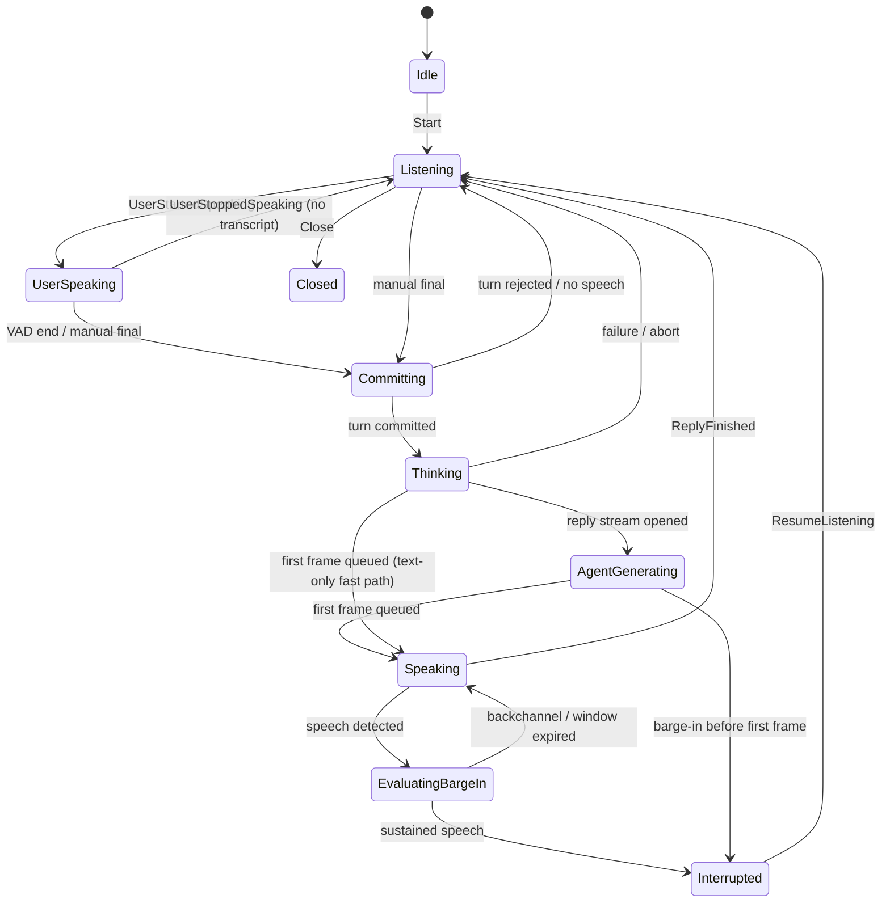
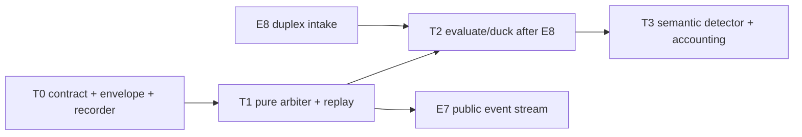

# Turn semantics — contract, deterministic arbiter, conformance and replay

Status: requirements draft for review · 2026-11-23
Parent roadmap: `docs/architecture/PARITY-LIVEKIT-AGENTS.md` §E10
Companion: `docs/architecture/PROVIDER-FOUNDATION-REQUIREMENTS.md` (conformance
kit TR-9 is shared; this document adds the turn-facing cases).

## 1. Goal

A developer must be able to answer three questions from the repository alone,
without reading the turn loop:

1. **Who owns the audio floor right now?** — a stated contract over explicit
   states, not a set of overlapping flags.
2. **How is a barge-in decided?** — a named arbitration policy (cut, duck, or
   ignore) applied by a pure function, not a heuristic scattered across
   plugins and `if` statements.
3. **Can a false interrupt from production be reproduced?** — yes, by
   replaying a recorded, timestamped observation stream through the arbiter in
   a unit test.

These map one-to-one onto the three root failures of the prior-art autopsy:
no stated contract, no conformance tests, no deterministic replay.

### Success metrics (measurable)

- **M1 — The contract is executable.** One transition table drives both the
  Rust FSM and the documented state graph; a test fails if the doc and the code
  disagree on a legal or illegal transition.
- **M2 — A turn is replayable.** A recorded JSONL trace replays through the
  arbiter to the same `(State, Command)` sequence with **zero provider calls**
  and no wall-clock reads.
- **M3 — Extraction is invisible.** Moving arbitration into the pure core
  changes no observable behaviour: the pinned demo output and the entire
  existing test suite pass unchanged.
- **M4 — Replay is cheap.** 1,000 golden traces replay in **< 10 s** in CI.
- **M5 — Backchannel does not cut.** A backchannel observation during
  `AGENT_SPEAKING` does not cancel the LLM/TTS stream; sustained speech inside
  the evaluation window does. Both are proven by replay, not by timing.
- **M6 — Interruption is located.** Every interrupted turn reports generated
  vs spoken characters, so the next context turn knows *where* the user cut in.

## 2. What exists today

Audited against the described four-layer architecture. File anchors are in the
current tree.

| Asset | Location | Reusable? |
|---|---|---|
| Closed FSM with a pure transition function | `crates/parlevox-core/src/turn.rs:14`, `:96` | **yes** — the pure core already exists, it just has no `Command` output |
| Monotonic clock, no wall-clock in the control path | `crates/parlevox-core/src/clock.rs:1-12` | **yes** — observations need stamping, the clock does not need replacing |
| Generation fencing: every emit checks `token.is_cancelled() \|\| self.generation != generation` | `crates/parlevox-runtime/src/session.rs:1804`, `:1890`, `:2027`, `:2186` | **yes** — the effect of a command fence already holds; only its declarative form is missing |
| Cancellation contract on all four modalities | `crates/parlevox-providers/src/traits.rs` | yes |
| Opt-in recovery (`InterruptionRecovery`, `PartialResume`) and turn strategies | `crates/parlevox-runtime/src/session.rs:65-130`, `strategy.rs` | yes — the policies are real, their position is wrong |
| Typed egress events | `crates/parlevox-runtime/src/events.rs:19` | needs `Serialize` + timestamps |
| Deterministic fakes and property tests | `crates/parlevox-providers/src/fakes.rs`, `tests/` | yes — determinism exists at test level only |

Gaps: no observation envelope; no `COMMITTING` or `AGENT_GENERATING` vs
`AGENT_SPEAKING` distinction; no barge-in evaluation or ducking; no semantic
turn detector; no declarative commands; no turn-facing conformance kit; no
event log, recorder, or replay harness.

### Honest status by layer

| Layer | Described | Here |
|---|---|---|
| 1 — Normalized ingress + monotonic clock | timestamped, sequenced observations on one queue | audio ring + typed streams awaited inline; no per-observation stamp, no `event_id` |
| 2 — Deterministic arbiter | pure `step(State, Observation) → (State, Commands)` | pure FSM transitions; **policy lives in the async shell**; no barge-in evaluation state |
| 3 — Command executor + conformance | declarative commands, adapter contract suite | direct calls with `CancellationToken`; per-feature tests only |
| 4 — Event log + replay | flight recorder, JSONL replay, golden traces | none (OTel spans are observability, not replay) |

**Structural constraint:** the session is half-duplex. VAD is analysed once per
turn before STT (`session.rs:1309`), so a VAD trigger during `Speaking` is not
merely unimplemented — it is impossible by construction. Layer 2's most
important behaviour (the collision) cannot be exercised until E8 lands. That
gates TS-6/TS-7 below, not TS-1–TS-5.

## 3. Target state graph

Three states are additions (`Committing`, `AgentGenerating`,
`EvaluatingBargeIn`); the rest exist today.

`Committing`, `AgentGenerating` and `EvaluatingBargeIn` are additions; every
other state exists in `crates/parlevox-core/src/turn.rs` today.

Floor ownership is the contract's core rule:

| State | Owns floor | May emit audio | May accept user speech |
|---|---|---|---|
| `Idle`, `Listening` | user | no | yes (starts a turn) |
| `UserSpeaking` | user | no | yes (continues) |
| `Committing` | nobody | no | yes (cancels commit) |
| `Thinking`, `AgentGenerating` | agent, unconfirmed | no | yes (cancels generation) |
| `Speaking` | agent, confirmed | yes | escalated to `EvaluatingBargeIn` |
| `EvaluatingBargeIn` | contested | ducked | yes (resolution window) |
| `Interrupted` | nobody | drain only | yes (next turn) |

## 4. Technical requirements

Each requirement is testable; the acceptance column is what a verifier checks
without judgement. Prefix `TS-` (turn semantics) avoids colliding with the
provider document's `TR-`.

### TS-1 — Stated turn contract
`docs/architecture/TURN-CONTRACT.md` states: the state set, each legal
transition, each illegal transition with its error, floor ownership per state,
and the arbitration policy for every collision. The Rust transition table
(`turn.rs`) is the single source of truth and the document is generated from
it or checked against it.
**Acceptance:** a test enumerates every `(state, event)` pair, asserts it
against the table, and fails if the document's listed transitions differ from
the code's.

### TS-2 — Additive state model
Add `Committing`, `AgentGenerating`, and `EvaluatingBargeIn` to `TurnState`
(additive, non-breaking for exhaustive matches by using `#[non_exhaustive]` or
a documented mapping). `Committing` covers the endpointing window;
`AgentGenerating` distinguishes an LLM stream that has not produced audio from
`Speaking`, whose current definition is "first frame queued", not "confirmed
playing".
**Acceptance:** every existing public state query has a documented mapping to
the new model; the pinned demo event sequence is unchanged when the new states
are not exercised.

### TS-3 — Serializable observation envelope
`Observation { t_ms: u64, event_id: u64, turn: u64, generation: u64, kind }`
with `serde` round-trip; `t_ms` from `MonoClock`, never wall-clock. Provider
output (final/partial transcript, VAD transition, delta, audio frame) is
normalized into `Observation` at the ingress boundary. `SessionEvent` gains
`Serialize` and carries `t_ms`.
**Acceptance:** a recorded trace parses back to byte-identical observations;
no observation struct exposes `SystemTime`.

### TS-4 — Pure arbiter with declarative commands
`TurnArbiter::step(&Model, Observation) -> (Model, Vec<Command>)`, synchronous,
no I/O, no locks, no clock reads. `Command` is an exhaustive enum:
`StartGeneration{..}`, `CancelGeneration{generation}`, `StartSynthesis{..}`,
`FlushAudioBuffer{turn}`, `DuckAudio{gain}`, `RestoreAudio`, `Emit(SessionEvent)`,
`Record{...}`. The async shell only executes commands and feeds observations.
**Acceptance:** a property test asserts `step` is pure (same model + same
observation → same result), and a unit test drives 10,000 observations with no
provider or task in scope.

### TS-5 — Fence law, formalized
Every observation carries `(turn, generation)`; the arbiter drops — and counts
— any observation from a superseded generation, including a late STT final for
`turn N-1`. Counters surface in `TurnReport` and on the event stream.
**Acceptance:** replaying a trace with injected late observations produces the
same commands as replaying it without them, and the drop counter equals the
number injected.

### TS-6 — Backchannel vs barge-in guard *(gated on E2 + E8)*
When `Speaking` and speech is detected, enter `EvaluatingBargeIn`: emit
`DuckAudio(gain)`, wait up to a configured window for either a semantic
barge-in signal or sustained speech energy. Backchannel → `RestoreAudio` and
no cancellation. Sustained speech → `CancelGeneration(generation)` then
`Interrupted`. Recovery-after-the-fact (`InterruptionRecovery`) remains as the
fallback when no evaluation is configured.
**Acceptance:** replay TS-M5 with two traces: "uh-huh" leaves the LLM stream
alive (no cancel command); 600 ms of speech emits exactly one
`CancelGeneration` and one `FlushAudioBuffer`. Both are counted, neither is
timing-dependent.

### TS-7 — Semantic turn-completion seam *(gated on E8)*
`TurnDetector` trait consulted in `Committing`: `fn complete(&mut self,
&TurnWindow) -> TurnVerdict` with `Accept | Reject | Abstain`. Default is the
existing trailing-silence arithmetic (`EndpointingPolicy`); a model-backed
detector is opt-in and must not block the arbiter (cache-read or abstain).
**Acceptance:** installing no detector reproduces today's endpoint decisions
exactly (property test over the existing endpointing cases); an accepting
detector commits a turn that trailing silence alone would have rejected.

### TS-8 — Spoken vs generated accounting
`TurnReport` gains `generated_chars`, `spoken_chars` (frames actually
emitted), and `heard_chars` (from a transport ack, or the documented estimate
when no ack exists). Interrupted turns populate all three; a context engine can
record the spoken prefix instead of the full reply.
**Acceptance:** a barge-in at delta 3 reports `heard_chars < generated_chars`
and the sum never exceeds the reply length; with no ack the estimate is marked
as an estimate in the report.

### TS-9 — Turn-facing provider conformance
Extend the provider conformance kit (provider doc TR-9) with turn invariants
per adapter: time-to-silence after `CancelGeneration` is bounded; no orphan
audio frames after cancellation is acknowledged; no audio emitted outside a
`StartSynthesis` window; drop counters honest across cancel.
**Acceptance:** each of the four invariants fails for its deliberately broken
fixture adapter, and the kit runs offline.

### TS-10 — Recorder
`parlevox console --record trace.jsonl` (and the same flag on `demo`) appends
`(t_ms, Observation)` records; bounded by an explicit cap with a counted drop,
secrets redacted, transcripts included only behind `--record-transcripts`.
**Acceptance:** a recorded file validates against the envelope schema; a full
disk or a cap hit drops and counts rather than blocking the turn.

### TS-11 — Replay harness and golden corpus
`parlevox console --replay trace.jsonl` reproduces the `(State, Command)`
sequence; a test harness feeds committed traces under `tests/traces/` through
`TurnArbiter::step` with no providers. Threshold or policy changes must replay
the whole corpus.
**Acceptance:** M2 and M4 hold; a deliberately weakened barge-in threshold
changes the command sequence of at least one golden trace.

### TS-12 — Honest defaults
Every item above ships off by default; the default turn loop stays
byte-identical (same provider calls, same order, same events). New loss paths
count; nothing is dropped silently. `SessionConfig` gains no required field.
**Acceptance:** the pinned demo stdout and the full pre-existing suite pass
with no new builder called.

## 5. Product requirements

- **PR-1 — One page for a new hire.** The contract document is readable without
  reading `session.rs`, and it is the page linked from `DESIGN.md`.
- **PR-2 — Self-service debugging.** A user can record a failing session and
  replay it locally, without our involvement and without vendor keys.
- **PR-3 — No default-build cost.** Replay/recorder are behind serde (already
  present) and an explicit flag; no new mandatory dependency.
- **PR-4 — Ducking is a transport capability.** The runtime emits gain
  commands; the transport applies them. No hidden audio mutation inside crates.
- **PR-5 — Migration parity.** The event stream exposes
  `agent_state_changed`-shaped transitions so a LiveKit migrate sees the same
  turn story (ties into E7).
- **PR-6 — Honest status.** While the session is half-duplex, the contract
  document says so and marks `EvaluatingBargeIn` as unreachable until E8.

## 6. Phases

**T0 — State the contract (no behaviour change).** TS-1, TS-2, TS-3, TS-10,
TS-12. The transition table is extracted and documented; observations become
serializable; the recorder exists. *Exit:* M1 holds; default output identical.

**T1 — Pure arbiter and replay (no behaviour change).** TS-4, TS-5, TS-9,
TS-11, plus the golden corpus seeded from existing scripted tests. *Exit:* M2,
M3, M4 hold; the suite passes without touching provider code.

**T2 — The collision (after E8).** TS-6 and the transport-side gain plumbing
(E2). *Exit:* M5 holds; `EvaluatingBargeIn` is reachable in a trace and the
default (no evaluator) still cuts immediately, as today.

**T3 — Semantic ending and located interruption.** TS-7, TS-8. *Exit:* M6
holds; a context engine can record the spoken prefix of an interrupted reply.

Estimates: T0 1–2 runs, T1 2–3 runs, T2 2–3 runs after E8, T3 1–2 runs.

## 7. Non-goals and honest limits

- Not a new transport: room I/O and WebSocket PCM stay in E2. Ducking requires
  a transport that can change gain; until one exists, TS-6 ships commands that
  the CLI transport can apply to its speaker path only.
- Not a replacement for provider adapters: conformance cases bind to adapters
  that do not exist yet (E1); TS-9 lands with the first real STT/TTS pair.
- Replay is deterministic over the *decision path*, not over providers: a trace
  replays the observations a provider produced, it does not re-call the vendor.
  That is the point — it removes latency and keys from debugging — and it is
  also the limit: a provider bug that changes *content* still needs a live
  cassette.
- No playout acknowledgement requirement. `heard_chars` stays an estimate unless
  a transport supplies acks; the report marks which it is.
- Half-duplex remains the default until E8. TS-6 does not change that; it makes
  the *decision* ready for the day intake becomes concurrent.

## 8. Open questions

1. Does `TurnArbiter` own context recording (`Record` commands) or stay purely
   audio/turn-facing? Context is already behind `ContextEngine`; a command is
   cleaner for replay but moves engine calls into the executor.
2. Is `t_ms` per session or per process? Per session keeps traces portable;
   per process aligns OTel spans across sessions.
3. Do golden traces live in-repo (`tests/traces/`, plain-text reviewable) or as
   a separate corpus package? In-repo favours reviewability; size favours a
   package.
4. Should `Committing` be a real machine state or a sub-state of `Thinking`
   recorded only in the trace? A real state makes the contract plainer but
   every existing `state()` consumer gains a case.
