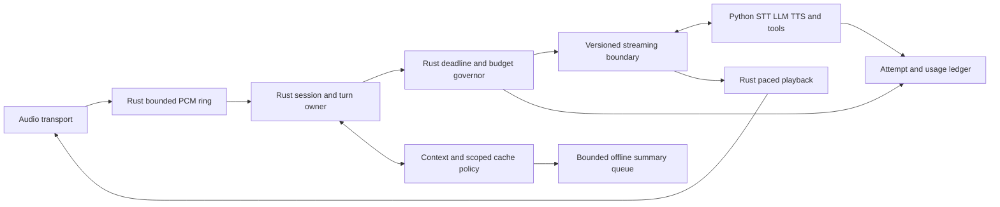

## Codex LLM Dispatch Audit — LiveKit Agents, Pipecat, TEN Framework, and Vocode

### Scope, evidence, and economics

This is a source-only audit of the local checkouts, not a benchmark or a claim about hosted products. No framework was executed, built, tested, or modified. Vocode is treated as a stale design reference, as required by the kickoff. Rankings reflect likely leverage and implementation reach, not measured production spend. This report is the Codex lens only; it does not assert panel consensus or complete the other lanes' deliverables.

**Source-anchor convention:** every `LK/...:line`, `PC/...:line`, `TEN/...:line`, and `VC/...:line` below is a concrete repository-relative file and line, resolved against these exact roots:

| Prefix | Absolute source root |
|---|---|
| LK | `path/to/livekit-agents` |
| PC | `path/to/pipecat` |
| TEN | `path/to/ten-framework` |
| VC | `path/to/vocode-core` |

TEN inspection covers its Python binding, native graph startup, and selected shipping Python provider extensions. The imported `ten_ai_base` package is not present at the documented `ai_agents/agents/ten_packages/system/` location in this checkout. Consequently, adapter-local findings are not claims that unseen base classes lack safeguards. No generated assets, UI, examples, tests, or vendored code support the findings. Repository instructions were read for navigation; runtime source is the evidence.

**Savings model:** “task” means one completed user turn unless a finding says otherwise. Dollar examples use 100,000 turns/day and an explicitly hypothetical $0.01 baseline LLM cost/turn, or $1,000/day. These are arithmetic scenarios, not current provider prices. Component-specific savings do not equal whole-agent savings; STT minutes, TTS characters, transport costs, and quality regressions must be included in a deployment-specific model. Findings overlap and must not be summed. Provider prefix caching can operate without an SDK cache flag; rebuilding a Python prompt object does not itself prove a cache miss.

### High-leverage cost cuts (>50% savings each, conditional on the stated workload)

#### finding-1: Bound conversation history before every dispatch [perf]
**File**: `PC/src/pipecat/processors/aggregators/llm_response_universal.py:272`; `PC/src/pipecat/utils/context/llm_context_summarization.py:149`; `VC/vocode/streaming/agent/openai_utils.py:124`.
**Cost class**: quadratic (per-task × per-iter).
**Pattern**: Pipecat's automatic summarization is disabled by default; Vocode trims at the model window rather than an economic context target, repeatedly sending growing history.
**Evidence and limits**: Pipecat already implements token/message thresholds, a summary target, and a separate summarizer LLM (`PC/src/pipecat/utils/context/llm_context_summarization.py:95`). Vocode does enforce a context-window limit, so its growth is quadratic only before the window saturates. LiveKit also provides truncation and summarization primitives (`LK/livekit-agents/livekit/agents/llm/chat_context.py:684`, `:928`); this is not a claim that those features are absent.
**Optimization**: Enable a measured context policy: preserve instructions, recent turns, tool-call/result pairs, and compact older facts; budget after adding retrieval and tools. **SAVINGS estimate:** reducing average input from 12K to 4K tokens saves 67% of input-token cost before summary charges. If input is 90% of the baseline and amortized summaries cost 3% of baseline, net savings are **57%, or $570/day** at the illustrative scale. Short calls may save nothing.

#### finding-2: Route easy turns to a cheaper compatible model [perf]
**File**: `TEN/ai_agents/agents/ten_packages/extension/openai_llm2_python/openai.py:214`; `PC/src/pipecat/services/openai/base_llm.py:395`; `VC/vocode/streaming/agent/chat_gpt_agent.py:103`; `LK/livekit-agents/livekit/agents/voice/agent.py:598`.
**Cost class**: linear (per-task).
**Pattern**: The inspected dispatch seams use the configured model/LLM; they do not perform per-turn complexity-and-price selection.
**Evidence and limits**: TEN also blacklists per-request `model` overrides by default (`TEN/ai_agents/agents/ten_packages/extension/openai_llm2_python/openai.py:55`). Pipecat has a service switcher and LiveKit has overridable nodes: applications can already implement routing. There is no evidence that everything uses Opus: Pipecat's OpenAI default is `gpt-4.1` (`PC/src/pipecat/services/openai/llm.py:55`), while TEN's adapter defaults to `gpt-4o` (`TEN/ai_agents/agents/ten_packages/extension/openai_llm2_python/openai.py:43`). These are checkout defaults, not model recommendations.
**Optimization**: Route using task type, tool/schema capabilities, language, and deadline; escalate only when needed, without racing multiple paid models. **SAVINGS estimate:** with 80% easy turns at one-quarter the original price, unchanged token counts, and negligible routing cost, spend is `0.8×0.25 + 0.2 = 0.4`: **60% saved, or $600/day**. Escalation calls and quality failures reduce that saving.

#### finding-3: Enable the Anthropic prompt-cache support already present [perf]
**File**: `LK/livekit-plugins/livekit-plugins-anthropic/livekit/plugins/anthropic/llm.py:86`; `LK/livekit-plugins/livekit-plugins-anthropic/livekit/plugins/anthropic/llm.py:270`; `PC/src/pipecat/services/anthropic/llm.py:326`.
**Cost class**: linear (per-task).
**Pattern**: Explicit Anthropic prompt caching is opt-in in the inspected adapters, leaving stable instructions/tools/history uncached through that mechanism when defaults are used.
**Evidence and limits**: LiveKit adds cache controls to system text, tools, and historical boundaries when enabled. Pipecat has `enable_prompt_caching` and configurable system-prompt cache TTL. Actual eligibility, provider behavior, TTL, and write costs are not established by source inspection.
**Optimization**: Enable supported caching, retain stable prefixes, and place transient turn data after them; measure cache-read and cache-write tokens separately. **SAVINGS estimate:** if 80% of baseline spend is eligible repeated input, warm reads cost 10% of normal input, and amortized writes add 2% of baseline, net saving is **70%, or $700/day**. The 10% multiplier is a scenario assumption, not a quoted tariff.

#### finding-4: Stop using a full conversational completion as a recovery probe [perf]
**File**: `LK/livekit-agents/livekit/agents/llm/fallback_adapter.py:231`; `LK/livekit-agents/livekit/agents/llm/fallback_adapter.py:298`; `LK/livekit-agents/livekit/agents/llm/fallback_adapter.py:400`.
**Cost class**: linear (per-task).
**Pattern**: An unavailable LLM is probed with the current chat context, tools, and options, and the probe consumes all chunks while discarding its output.
**Evidence and limits**: The adapter suppresses concurrent recovery tasks per model within one adapter instance, but a completed probe can be replaced on a subsequent request. Probes generate tool-call proposals but do not execute tools here. Successful recovery normally restores availability, so this is not a permanent doubling of every turn's cost.
**Optimization**: Add provider-level cooldown and single-flight health probes, using a minimal safe completion with no tools and a small output ceiling where a health endpoint is insufficient. **SAVINGS estimate:** a probe costing 2% of a full completion cuts **98% of probe spend**. At one full-price probe per ten turns, the example saves **$98/day**; it does not save 98% of total conversation cost.

### Further findings, ranked by operational leverage

#### finding-5: Enforce a shared budget at the last pre-dispatch boundary [scale]
**File**: `LK/livekit-agents/livekit/agents/voice/agent.py:600`; `PC/src/pipecat/services/openai/base_llm.py:365`; `TEN/ai_agents/agents/ten_packages/extension/openai_llm2_python/openai.py:244`; `VC/vocode/streaming/agent/chat_gpt_agent.py:156`.
**Cost class**: linear (per-task), amplified by tool iterations and retries.
**Pattern**: The inspected call sites dispatch without a visible monetary reservation spanning LLM attempts, STT, TTS, tools, probes, and speculative work.
**Evidence and limits**: Limits are not entirely absent: LiveKit defaults to three tool steps (`LK/livekit-agents/livekit/agents/voice/agent_session.py:425`); TEN sets a 4096-token output cap (`TEN/ai_agents/agents/ten_packages/extension/openai_llm2_python/openai.py:51`); Pipecat's OpenAI defaults leave output limits unspecified (`PC/src/pipecat/services/openai/llm.py:64`). None of these is a session-wide spend limit. Application/gateway controls outside these seams remain possible.
**Optimization**: Atomically reserve a conservative amount before each attempt, settle from usage, and explicitly mark unknown usage after cancellation; include voice-appropriate output caps and an economical terminal response. **SAVINGS estimate:** if 5% of turns currently cost 10× normal and a gate caps those at 3×, spend falls from 1.45 to 1.10 units: **24%**, or **$350/day** against a $1,450/day tail-heavy scenario. No saving is promised for well-behaved turns.

#### finding-6: Bound TEN ASR reconnection across callbacks [reliability]
**File**: `TEN/ai_agents/agents/ten_packages/extension/deepgram_asr_python/reconnect_manager.py:44`; `TEN/ai_agents/agents/ten_packages/extension/deepgram_asr_python/reconnect_manager.py:69`; `TEN/ai_agents/agents/ten_packages/extension/deepgram_asr_python/extension.py:560`; `TEN/ai_agents/agents/ten_packages/extension/deepgram_asr_python/extension.py:586`.
**Cost class**: unbounded (retry storms over session lifetime).
**Pattern**: The reconnect manager explicitly reports unlimited retries; nonfatal error and close callbacks can request reconnects without an attempt/deadline ceiling in the shown paths.
**Evidence and limits**: Backoff exists: 0.5s exponentially increasing to 4s. Fatal error strings and `stopped` checks exist. This is callback-driven repeated retry, not a demonstrated busy-loop or evidence that failed handshakes are billed as STT. The helper provides no single-flight guard against overlapping callback invocations.
**Optimization**: Own reconnect state in one task, add jitter and an outage deadline/circuit breaker, then degrade or end cleanly. **SAVINGS estimate:** replacing approximately 150 attempts in a ten-minute continuing outage with five cuts **about 97% of connection attempts** for an affected session, ignoring connection duration. Provider-dollar savings are unquantified; the immediate gain is reduced outage load.

#### finding-7: Coordinate retry timing and retain the turn deadline [reliability]
**File**: `LK/livekit-agents/livekit/agents/types.py:175`; `LK/livekit-agents/livekit/agents/llm/llm.py:334`; `PC/src/pipecat/services/openai/base_llm.py:367`; `PC/src/pipecat/services/openai/base_llm.py:188`.
**Cost class**: linear (per-task).
**Pattern**: LiveKit retries on a 0.1s first delay followed by fixed intervals; Pipecat's optional timeout retry drops its outer `wait_for` deadline on the second attempt.
**Evidence and limits**: LiveKit's default is bounded to four total attempts, not an unbounded storm. Pipecat's extra retry is disabled by default and the SDK may still enforce a timeout; “without a timeout” in its comment does not prove an infinite wait. Neither shown retry block establishes a shared end-to-end turn budget.
**Optimization**: Allocate one attempt budget across SDK/framework/fallback layers, honor retry-after, use jitter, and pass remaining monotonic deadline to every attempt. **SAVINGS estimate:** avoiding three redundant attempts out of four saves **75% of attempts on affected failures**. Dollar savings range from zero for unbilled failures to the prevented billed work; ordinary successful-call cost is unchanged.

#### finding-8: Make speculative LLM and TTS work earn their latency benefit [perf]
**File**: `LK/livekit-agents/livekit/agents/voice/agent_activity.py:3082`; `LK/livekit-agents/livekit/agents/voice/agent_activity.py:3112`; `LK/livekit-agents/livekit/agents/voice/agent_activity.py:3891`.
**Cost class**: linear (per-task).
**Pattern**: Changed transcript/context/tools invalidate preemptive work and trigger fresh generation; when preemptive TTS is enabled, synthesis may also start before speech is scheduled.
**Evidence and limits**: LiveKit correctly checks equivalence, cancels discarded work, and reuses valid work. This is a configurable latency/cost tradeoff, not unconditional duplication. Cancellation cannot refund already generated tokens or necessarily stop remote billing.
**Optimization**: Track speculative acceptance and discarded usage by call type; gate speculation on stability and reserve budget separately, delaying TTS where acceptance is poor. **SAVINGS estimate:** at 30% invalidation and a discarded attempt costing half a normal turn, eliminating that waste changes cost from 1.15 to 1.00: **13%**, or **$150/day** against a $1,150/day speculative baseline. Measure the latency penalty before disabling it.

#### finding-9: Vocode adds retrieval after its context-window check [bug]
**File**: `VC/vocode/streaming/agent/chat_gpt_agent.py:194`; `VC/vocode/streaming/agent/chat_gpt_agent.py:209`; `VC/vocode/streaming/agent/chat_gpt_agent.py:90`; `VC/vocode/streaming/agent/openai_utils.py:130`.
**Cost class**: linear (per-task).
**Pattern**: Retrieved documents are concatenated and inserted after transcript trimming; the resulting nonempty message list bypasses another formatting/budget pass.
**Evidence and limits**: The transcript check reserves a constant `LLM_AGENT_DEFAULT_MAX_TOKENS`, whereas the request uses configured `agent_config.max_tokens` (`VC/vocode/streaming/agent/chat_gpt_agent.py:99`). Retrieval content and configurable output reserve can therefore invalidate an otherwise successful size check. This is a source-level issue in the stale reference, not a reproduced API failure.
**Optimization**: Budget the final serialized request, including documents, tool schemas, and actual output limit; select bounded evidence before adding it. **SAVINGS estimate:** cutting retrieved text from 6K to 1K tokens saves **83% of retrieval-input tokens**. If those tokens represent 30% of total spend, that is **25%, or $250/day** in the normalized scenario, plus fewer over-window failures.

#### finding-10: TEN's LLM adapter drops usage-only streaming events [api]
**File**: `TEN/ai_agents/agents/ten_packages/extension/openai_llm2_python/openai.py:213`; `TEN/ai_agents/agents/ten_packages/extension/openai_llm2_python/openai.py:265`; `TEN/ai_agents/agents/ten_packages/extension/openai_llm2_python/openai.py:455`.
**Cost class**: linear (per-task; accounting gap rather than proven extra inference).
**Pattern**: The adapter does not request stream usage by default and skips chunks with no choices, without emitting token-usage responses.
**Evidence and limits**: Request parameters can supply extra options at line 236, so a caller could request usage; the no-choices branch still discards usage-only chunks. The inspected file contains no usage-handling path. External billing reconciliation may exist outside this adapter. Contrast Pipecat's `include_usage=True` and interruption-time usage reporting (`PC/src/pipecat/services/openai/base_llm.py:398`, `:652`).
**Optimization**: Emit usage independently of content, preserve provider request IDs, and distinguish reported totals from estimates for interrupted requests. **SAVINGS estimate:** **0% direct cost reduction** from measurement alone; it makes budget and routing savings verifiable. No unsupported dollar return is assigned.

#### finding-11: TEN TTS cancellation waits for the next network yield [reliability]
**File**: `TEN/ai_agents/agents/ten_packages/extension/openai_tts2_python/openai_tts.py:119`; `TEN/ai_agents/agents/ten_packages/extension/openai_tts2_python/openai_tts.py:166`; `TEN/ai_agents/agents/ten_packages/extension/openai_tts2_python/openai_tts.py:210`.
**Cost class**: linear (per-task).
**Pattern**: The client's `cancel()` sets a boolean, checked after headers or the next received audio chunk; it does not itself cancel a pending network read.
**Evidence and limits**: The response is correctly managed by an async context manager, and `clean()` closes the client at line 269. An unseen base class may also cancel the owning task, which would mitigate the issue; this finding concerns the client's own cancel contract. A stalled stream exposes the gap most clearly.
**Optimization**: Bind each request to a cancellable task/response handle and acknowledge cancellation only after local stream closure; retain request identity so old output cannot enter a new turn. **SAVINGS estimate:** if half of synthesis would remain at interruption, prompt termination can avoid **up to 50% of that affected request's remaining generation work**; with 20% affected requests this is up to 10% of TTS work. Character-billed providers may save **$0** despite reduced latency/resource use.

#### finding-12: Vocode fallback covers only a narrow subset of failures [reliability]
**File**: `VC/vocode/streaming/agent/chat_gpt_agent.py:123`; `VC/vocode/streaming/agent/chat_gpt_agent.py:142`; `VC/vocode/streaming/agent/chat_gpt_agent.py:260`.
**Cost class**: latency-only (availability impact; monetary effect unknown).
**Pattern**: The initial fallback catches not-found and rate-limit errors, leaves an OpenAI-to-Azure setup branch unimplemented, and does not wrap later stream-consumption failures.
**Evidence and limits**: Primary SDK retries are disabled when fallback is configured (`VC/vocode/streaming/agent/chat_gpt_agent.py:47`). Transport errors therefore do not gain this helper's fallback behavior. Retrying after text has already been spoken would itself be unsafe; the fix must distinguish pre-output from post-output failure.
**Optimization**: Use capability-compatible adapters and a typed error policy, allowing failover before committed output and an explicit partial-failure terminal event afterward. **SAVINGS estimate:** **0% proven token saving**; affected turns can avoid the remainder of an unavailable provider's timeout. No fabricated millisecond or dollar estimate.

#### finding-13: Vocode's audio-cache miss path has no single-flight ownership [perf]
**File**: `VC/vocode/streaming/synthesizer/base_synthesizer.py:332`; `VC/vocode/streaming/synthesizer/base_synthesizer.py:372`; `VC/vocode/streaming/synthesizer/audio_cache.py:27`.
**Cost class**: linear (per-task).
**Pattern**: Each caller checks exact phrase/voice cache state and directly starts uncached synthesis on a miss; concurrent identical cold requests can all synthesize.
**Evidence and limits**: A cache already exists, and `cache_phrase` allows explicit phrase aliases. This is not evidence of an absent cache or a reason to reuse semantically similar private utterances. `set_audio` also makes TTL optional (`VC/vocode/streaming/synthesizer/audio_cache.py:36`), so cache lifecycle needs an explicit policy.
**Optimization**: Single-flight approved static phrases with keys including voice, model/settings, encoding, sample rate, and tenant; persist only completed audio with a TTL. **SAVINGS estimate:** coalescing ten simultaneous misses into one saves **90% of synthesis calls for that burst**. If such duplicates account for 10% of a $1,000/day TTS bill, saving is **$90/day**. Dynamic speech may see no benefit.

#### finding-14: TEN emits accumulated text with every delta [perf]
**File**: `TEN/ai_agents/agents/ten_packages/extension/openai_llm2_python/openai.py:333`; `TEN/ai_agents/agents/ten_packages/extension/openai_llm2_python/openai.py:343`; `TEN/ai_agents/agents/ten_packages/extension/openai_llm2_python/openai.py:455`.
**Cost class**: latency-only (potential quadratic serialization work).
**Pattern**: Each message/reasoning delta carries both the incremental text and the full text accumulated so far.
**Evidence and limits**: The adapter constructs cumulative Python strings. If downstream serializes the full response object at every boundary, n equal chunks carry roughly `n(n+1)/2` chunks of cumulative content as well as n deltas. The missing base package prevents asserting the exact current wire serialization cost.
**Optimization**: Carry delta-only events across the Rust/Python boundary and optionally one final full snapshot; reconstruct text once at the owner. **SAVINGS estimate:** at 100 equal chunks, text payload falls from approximately 5,150 to 200 chunk-units including a final snapshot: **96% less text payload under that serialization assumption**. This is not a 96% reduction in provider tokens or end-to-end latency.

#### finding-15: Bound the producer side, not only the consumer queue [scale]
**File**: `TEN/core/src/ten_runtime/binding/python/interface/ten_runtime/async_ten_env.py:53`; `TEN/core/src/ten_runtime/binding/python/interface/ten_runtime/async_ten_env.py:91`; `PC/src/pipecat/transports/base_input.py:321`; `VC/vocode/streaming/utils/worker.py:53`.
**Cost class**: latency-only (memory/backlog growth under sustained overload).
**Pattern**: TEN's command-result callback schedules unawaited `queue.put` coroutines despite a ten-item queue; Pipecat input and Vocode worker queues are unbounded at these seams.
**Evidence and limits**: TEN's returned thread-safe future is ignored, so queue capacity alone does not bound pending producer tasks. Native upstream limits may exist. Pipecat has interruption-aware queue cleanup (`PC/src/pipecat/processors/frame_processor.py:1161`), and LiveKit's RTC output source has a 200ms queue (`LK/livekit-agents/livekit/agents/voice/room_io/_output.py:56`); neither fact proves all buffers end-to-end are bounded.
**Optimization**: Put per-session byte/duration credits in the Rust core; use drop-oldest plus a lag counter for ingress audio as required by the kickoff, and lossless bounded delivery for tool results and terminal control events. **SAVINGS estimate:** a 200ms audio ring replaces a hypothetical 10s backlog with **98% less queued audio memory** at equal sample format. Provider-token savings are unproven, and dropped audio must be visible to turn handling.

### Comparison across all ten mandated dimensions

Winners below are architectural judgments for the proposed voicekit runtime, not performance rankings. Every framework cell has its own runtime source anchor. “No clear winner” denotes a real tradeoff or insufficient scope, rather than invented parity.

| Dimension | LiveKit Agents | Pipecat | TEN Framework | Vocode | Winner and reason |
|---|---|---|---|---|---|
| 1. Transport & audio path | RTC track input exposes rate/channels/frame size; output source queues 200ms, with another Python buffer. `LK/livekit-agents/livekit/agents/voice/room_io/_input.py:422`; `LK/livekit-agents/livekit/agents/voice/room_io/_output.py:56`. | Frame-based input has an unbounded audio queue; output normalizes into configurable 10ms multiples. `PC/src/pipecat/transports/base_input.py:321`; `PC/src/pipecat/transports/base_output.py:149`. | Native audio objects cross into Python; selected ASR copies locked bytes and advertises a 10MiB keep buffer. `TEN/core/src/ten_runtime/binding/python/interface/ten_runtime/audio_frame.py:30`; `TEN/ai_agents/agents/ten_packages/extension/deepgram_asr_python/extension.py:368`. | Byte ingress and telephony WebSocket output with explicit clear/mark events; queues are unbounded. `VC/vocode/streaming/utils/audio_pipeline.py:16`; `VC/vocode/streaming/output_device/twilio_output_device.py:36`. | **No clear winner**: LiveKit supplies RTC framing/playout; Pipecat is transport-composable; TEN supplies native frames; Vocode exposes telephony playback acknowledgment. None of these inspected paths establishes the required end-to-end drop-oldest policy. |
| 2. Concurrency & isolation | Process jobs by default off Windows; configurable process pool and per-job memory controls. `LK/livekit-agents/livekit/agents/worker.py:133`; `LK/livekit-agents/livekit/agents/worker.py:633`. | Async frame tasks with interruption-aware cancellation; pipeline processors share Python execution unless externally isolated. `PC/src/pipecat/processors/frame_processor.py:279`; `PC/src/pipecat/processors/frame_processor.py:1161`. | Python async extensions default to a shared asyncio thread, with an optional thread per extension; neither is process isolation. `TEN/core/src/ten_runtime/binding/python/interface/ten_runtime/async_extension.py:54`; `TEN/core/src/ten_runtime/binding/python/interface/ten_runtime/async_extension.py:162`. | Async worker tasks plus optional thread/Janus bridge, not a per-call process supervisor in this abstraction. `VC/vocode/streaming/utils/worker.py:48`; `VC/vocode/streaming/utils/worker.py:76`. | **LiveKit Agents** for explicit job/process supervision. Python threads are not a substitute for fault containment or a guarantee of CPU parallelism. |
| 3. Turn-taking | Adaptive endpointing plus validated speculative-response reuse/cancel. `LK/livekit-agents/livekit/agents/voice/endpointing.py:49`; `LK/livekit-agents/livekit/agents/voice/agent_activity.py:3082`. | Configurable inference-assisted turn completion cancels stale decisions and avoids redundant re-prompts; interruptions preserve uninterruptible frames. `PC/src/pipecat/turns/user_stop/llm_turn_completion_user_turn_stop_strategy.py:151`; `PC/src/pipecat/processors/frame_processor.py:1161`. | Selected turn extension cancels prior evaluation, flushes on turn start, and evaluates finalized text. `TEN/ai_agents/agents/ten_packages/extension/ten_turn_detection/extension.py:85`. | Transcription worker coordinates interruption and final input forwarding. `VC/vocode/streaming/streaming_conversation.py:143`; `VC/vocode/streaming/streaming_conversation.py:271`. | **LiveKit Agents** for integrating endpointing and speculative lifecycle with session ownership; Pipecat is attractive when turn policy must be composed independently. No latency superiority is measured. |
| 4. Provider abstraction & plugin contract | Typed LLM stream and default STT/LLM/TTS nodes, including nonstreaming-to-stream adapters. `LK/livekit-agents/livekit/agents/llm/llm.py:154`; `LK/livekit-agents/livekit/agents/voice/agent.py:525`. | Universal-context adapters, provider services, and service switching separate conversion from execution. `PC/src/pipecat/adapters/llm/base_llm_adapter.py:60`; `PC/src/pipecat/pipeline/service_switcher.py:377`. | Native addon registration plus provider extension delegation into an imported LLM base; complete base contract unavailable locally. `TEN/core/src/ten_runtime/binding/python/interface/ten_runtime/addon_manager.py:100`; `TEN/ai_agents/agents/ten_packages/extension/openai_llm2_python/extension.py:77`. | Explicit configurable agent factory with provider-specific classes. `VC/vocode/streaming/agent/default_factory.py:16`. | **LiveKit Agents** for a small typed streaming execution contract; borrow Pipecat's separate normalization adapter. TEN's native loader is stronger evidence for registration than for LLM portability. |
| 5. State & context management | ChatContext supports structural truncation and summary generation. `LK/livekit-agents/livekit/agents/llm/chat_context.py:684`; `LK/livekit-agents/livekit/agents/llm/chat_context.py:928`. | Optional automatic token/message triggers and separately configurable summary LLM. `PC/src/pipecat/utils/context/llm_context_summarization.py:95`; `PC/src/pipecat/utils/context/llm_context_summarization.py:149`. | Provider receives caller-owned message list and prompt; local `memory` fields do not prove active retention policy. `TEN/ai_agents/agents/ten_packages/extension/openai_llm2_python/openai.py:136`; `TEN/ai_agents/agents/ten_packages/extension/openai_llm2_python/extension.py:26`. | Transcript-derived request with model-window trimming, but retrieval added afterward. `VC/vocode/streaming/agent/openai_utils.py:109`; `VC/vocode/streaming/agent/chat_gpt_agent.py:215`. | **Pipecat** for the exposed automatic policy controls, provided they are enabled and the final request is independently budgeted. No framework wins on automatic monetary control in the inspected seams. |
| 6. Failure handling | Bounded retries, availability tracking, zero inner retries by default under fallback, and no replay after emitted chunks by default. `LK/livekit-agents/livekit/agents/llm/fallback_adapter.py:49`; `LK/livekit-agents/livekit/agents/llm/fallback_adapter.py:385`. | Usability-aware service failover and explicit close of iterator plus HTTP stream. `PC/src/pipecat/pipeline/service_switcher.py:180`; `PC/src/pipecat/services/openai/base_llm.py:564`. | Native calls return errors/results; selected LLM flattens provider exceptions to RuntimeError, and ASR reconnect has no attempt ceiling. `TEN/core/src/ten_runtime/binding/python/interface/ten_runtime/async_ten_env.py:74`; `TEN/ai_agents/agents/ten_packages/extension/openai_llm2_python/openai.py:461`; `TEN/ai_agents/agents/ten_packages/extension/deepgram_asr_python/reconnect_manager.py:44`. | Narrow initial-call fallback and worker loops that log exceptions. `VC/vocode/streaming/agent/chat_gpt_agent.py:142`; `VC/vocode/streaming/utils/worker.py:110`. | **LiveKit Agents** for stream-aware fallback ownership; Pipecat has particularly useful explicit cleanup. Carry both into voicekit and replace full-prompt probes. |
| 7. Observability | Retry-attempt spans, provider IDs, TTFT, cached tokens, cancellation, model metadata. Failed/no-chunk attempts may not produce usage metrics. `LK/livekit-agents/livekit/agents/llm/llm.py:334`; `LK/livekit-agents/livekit/agents/llm/llm.py:434`. | Usage distinguishes cached/reasoning/audio counters; stream cleanup reports received usage even on cancellation. `PC/src/pipecat/metrics/metrics.py:109`; `PC/src/pipecat/services/openai/base_llm.py:652`. | Selected LLM logs calls but drops choice-empty events; TTS exposes vendor metadata. `TEN/ai_agents/agents/ten_packages/extension/openai_llm2_python/openai.py:265`; `TEN/ai_agents/agents/ten_packages/extension/openai_tts2_python/openai_tts.py:278`. | Sentry first-token/first-sentence spans and detailed STT latency tracking. `VC/vocode/streaming/agent/chat_gpt_agent.py:252`; `VC/vocode/streaming/transcriber/deepgram_transcriber.py:536`. | **LiveKit Agents** for request/attempt attribution, narrowly over Pipecat's rich usage model. Neither telemetry path should treat missing provider usage as free inference. |
| 8. Extensibility cost | Provider implements chat/stream and can inherit retry/metrics lifecycle; nodes offer customization without editing the core. `LK/livekit-agents/livekit/agents/llm/llm.py:154`; `LK/livekit-agents/livekit/agents/llm/llm.py:235`; `LK/livekit-agents/livekit/agents/voice/agent.py:408`. | OpenAI-compatible service reuse minimizes provider glue; context adapters expose an explicit async-interface deprecation transition. `PC/src/pipecat/services/openai/base_llm.py:93`; `PC/src/pipecat/adapters/llm/base_llm_adapter.py:85`. | Decorated addon creates the extension; provider class delegates completion to its client, but external base version compatibility must be managed. `TEN/ai_agents/agents/ten_packages/extension/openai_llm2_python/addon.py:15`; `TEN/ai_agents/agents/ten_packages/extension/openai_llm2_python/extension.py:77`. | Default factory is a chain of known configuration types; custom factory injection is available at the server boundary. `VC/vocode/streaming/agent/default_factory.py:16`; `VC/vocode/streaming/telephony/server/base.py:62`. | **No clear winner**: Pipecat minimizes compatible-provider glue; LiveKit gives compact typed contracts; TEN's addon registration avoids central factory edits. None proves a versioned cross-process voicekit ABI as-is. |
| 9. Deployment & scale | Warm process pool, load threshold, configurable job memory limits; default hard memory limit is zero. `LK/livekit-agents/livekit/agents/worker.py:155`; `LK/livekit-agents/livekit/agents/worker.py:317`; `LK/livekit-agents/livekit/agents/worker.py:633`. | Workers expose bus/registry coordination; pipeline-local queues still need host admission and isolation. `PC/src/pipecat/workers/base_worker.py:119`; `PC/src/pipecat/transports/base_input.py:321`. | Native graph startup distinguishes local from connected apps; Python extension scheduling can share one loop. This is not evidence of a cloud autoscaler. `TEN/core/src/ten_runtime/engine/msg_interface/start_graph.c:44`; `TEN/core/src/ten_runtime/binding/python/interface/ten_runtime/async_extension.py:171`. | Telephony server composes routes, configuration manager, and factories; worker runtime is task-based. `VC/vocode/streaming/telephony/server/base.py:56`; `VC/vocode/streaming/utils/worker.py:48`. | **LiveKit Agents** for explicit warm-job admission/supervision. TEN's external Go server is outside this lens's scope, so no process-per-session deployment claim is inferred from documentation. |
| 10. Language boundary | Python agent layer calls RTC objects; job control uses explicit message IDs and binary Unix-duplex serialization. That job protocol is not shown to carry all audio. `LK/livekit-agents/livekit/agents/voice/room_io/_input.py:422`; `LK/livekit-agents/livekit/agents/ipc/channel.py:24`. | Ordinary processors exchange Python frames in a linked pipeline; native/plugin IPC is not inherent in that abstraction. `PC/src/pipecat/pipeline/pipeline.py:91`. | Python wraps native AudioFrame/Data types and returns async command results across callback/loop boundaries. `TEN/core/src/ten_runtime/binding/python/interface/ten_runtime/audio_frame.py:30`; `TEN/core/src/ten_runtime/binding/python/interface/ten_runtime/async_ten_env.py:91`. | Python byte queues and optional Janus thread bridge; no native control-plane contract at the worker seam. `VC/vocode/streaming/utils/audio_pipeline.py:16`; `VC/vocode/streaming/utils/worker.py:76`. | **TEN Framework** for the most explicit native extension/message boundary in scope. Adopt its typed message/lifecycle idea, not its implicit producer buffering or a promise of process isolation. |

### Streaming dispatch and cancellation trace

The chains below describe composable runtime seams; they do not assert that an unseen application graph wires these exact providers together.

- **LiveKit:** RTC `AudioStream` → concurrent audio forwarding into STT → endpoint decision → `llm_node` async chunks → incremental TTS → RTC output. STT and LLM streams use async context managers; forwarding tasks are cancelled in `finally`. Nonstreaming STT requires VAD; nonstreaming TTS is sentence-adapted. Anchors: `LK/livekit-agents/livekit/agents/voice/agent.py:513`, `:584`, `:608`; `LK/livekit-agents/livekit/agents/voice/room_io/_output.py:56`. Speculation can overlap the endpoint wait; semantic tool dependencies still require ordered follow-up inference.
- **Pipecat:** input audio queue → STT transport callbacks → turn/context frames → streamed LLM text/tool calls → text aggregation/TTS frames → output audio chunks. Deepgram receives bytes asynchronously and disconnects on cancel (`PC/src/pipecat/services/deepgram/stt.py:577`, `:591`); LLM closes both iterator and stream (`PC/src/pipecat/services/openai/base_llm.py:564`); TTS supports sentence aggregation or token streaming (`PC/src/pipecat/services/tts_service.py:92`). Parallel tool calls already create separate managed tasks (`PC/src/pipecat/services/llm_service.py:1970`); adding parallelism blindly is not a justified fix.
- **TEN:** native audio frame → ASR adapter byte copy/send → transcription Data → configured turn extension flush/evaluation → LLMRequest → message/reasoning/tool deltas → TTS HTTP chunks → native audio send. Anchors: `TEN/ai_agents/agents/ten_packages/extension/deepgram_asr_python/extension.py:379`; `TEN/ai_agents/agents/ten_packages/extension/ten_turn_detection/extension.py:85`; `TEN/ai_agents/agents/ten_packages/extension/openai_llm2_python/openai.py:265`; `TEN/ai_agents/agents/ten_packages/extension/openai_tts2_python/openai_tts.py:166`; `TEN/core/src/ten_runtime/binding/python/interface/ten_runtime/async_ten_env.py:156`. Native send defaults to fire-and-forget; optional completion acknowledgment is not proof that the remote speaker played the audio. End-to-end flush ownership cannot be certified without the imported base package and a concrete graph.
- **Vocode:** received bytes → transcription worker → ChatGPT response generator → token-aware or collated response → synthesizer/cache → output device. Anchors: `VC/vocode/streaming/utils/audio_pipeline.py:16`; `VC/vocode/streaming/streaming_conversation.py:143`; `VC/vocode/streaming/agent/chat_gpt_agent.py:260`; `VC/vocode/streaming/synthesizer/base_synthesizer.py:372`. Cancellation uses interruptible events and current-task cancellation (`VC/vocode/streaming/utils/worker.py:237`); Twilio output uses clear plus mark acknowledgments (`VC/vocode/streaming/output_device/twilio_output_device.py:53`, `:83`). The inspected ChatGPT generator lacks the explicit stream-close block seen in Pipecat; remote cancellation behavior is therefore unverified.

### Architectural changes for 10x scale

These are three design proposals, not implemented features or a measured tenfold capacity claim.

1. **A Rust-owned dispatch governor with Python provider adapters.** The Rust session actor owns monotonic deadlines, generation IDs, admission, spend reservations, bounded queues, and the retry/fallback/probe budget. Python owns provider SDKs, normalization, VAD/STT/LLM/TTS models, tools, and user logic. Use warm Python worker processes for fault containment; sharing an asyncio loop is not an isolation boundary. Register one small capability-aware interface and manifest per provider; negotiate protocol versions and reject unsupported capabilities before spending. Preserve LiveKit's no-replay-after-committed-output rule and Pipecat's explicit stream cleanup. A quality-gated model router realizes finding 2 without spending on speculative model races. Fake providers should later exercise the same contract without API keys.

2. **An explicit streaming protocol and separate media/control flow control.** Use versioned, length-delimited Protobuf envelopes over local Unix sockets for control and deltas; use a bounded shared-memory PCM ring where feasible, with framed byte chunks as a portable fallback. Include session ID, turn ID, generation/attempt ID, sequence, media format, and deadline. Message types: `StartRequest`, `AudioChunk`, `TranscriptPartial`, `TranscriptFinal`, `TextDelta`, `ToolCallDelta`, `ToolCallReady`, `ToolResult`, `Usage`, `Credit`, `Cancel`, `Cancelled`, `Error`, and `End`. Never serialize a whole utterance or turn as the required streaming unit. Rust drops stale generations and drop-oldest ingress audio with a lag counter; control/tool terminal messages are lossless and capacity-reserved. Cancellation must close local provider streams and acknowledge cleanup, while marking remote billed usage unknown until reconciled. Each attempt gets one terminal outcome; errors carry provider code, retryability, and whether output was committed. Avoid `unwrap()` on network/audio paths, as required by the kickoff.

3. **A context/cache service with a separate offline work queue.** Maintain a stable instruction/tool prefix, bounded final-request context, and a versioned summary plus recent turns. Use provider prefix caching first, then exact single-flight reuse of approved static TTS/lookup requests. Add semantic caching only for allowlisted, tenant-scoped, nonpersonal factual intents with policy/data version keys and confidence checks; never reuse tool effects, live balances, or conversation-dependent replies by similarity alone. Move post-call summarization/evaluation into bounded offline batches when latency permits; keep dependent live turns and tool-result inference sequential. No serial “reflection loop” was established in the inspected core paths, so batch reflection is a future workload design, not a claimed existing defect. Benchmark its economics later, including cache lookup and summary-model overhead.

### What's already right

- **Streaming is already the normal live path.** Pipecat sets `stream=True` with usage requested (`PC/src/pipecat/services/openai/base_llm.py:395`); Vocode explicitly streams (`VC/vocode/streaming/agent/chat_gpt_agent.py:222`); LiveKit exposes async streams (`LK/livekit-agents/livekit/agents/voice/agent.py:600`); TEN supports request-selected streaming (`TEN/ai_agents/agents/ten_packages/extension/openai_llm2_python/openai.py:220`). Pipecat's nonstreaming one-shot helper at `PC/src/pipecat/services/openai/base_llm.py:486` is out-of-band inference, not evidence that the live response path is nonstreaming.
- **Provider abstraction and fallback exist.** LiveKit composes LLM fallback and suppresses replay after emitted content by default (`LK/livekit-agents/livekit/agents/llm/fallback_adapter.py:385`). Pipecat gates inactive services, rather than sending every turn to every configured model (`PC/src/pipecat/pipeline/service_switcher.py:377`). Do not replace that with paid fan-out.
- **Caching and context controls already have useful implementation seams.** LiveKit's Anthropic cache boundaries, Pipecat's summary configuration, and Vocode's audio cache should be configured or strengthened rather than reimplemented without compatibility tests. See findings 1, 3, and 13.
- **Partial-output cleanup and parallel tools are not uniformly missing.** Pipecat closes streams on cancellation and already runs independent tools in parallel (`PC/src/pipecat/services/openai/base_llm.py:564`; `PC/src/pipecat/services/llm_service.py:1970`). LiveKit cancels obsolete generation and its forwarding tasks (`LK/livekit-agents/livekit/agents/voice/agent_activity.py:3112`; `LK/livekit-agents/livekit/agents/voice/agent.py:575`). Preserve these ownership boundaries.
- **TEN exposes native lifecycle and typed audio boundaries, with real backoff in its selected ASR adapter.** `TEN/core/src/ten_runtime/binding/python/interface/ten_runtime/async_extension.py:130`; `TEN/core/src/ten_runtime/binding/python/interface/ten_runtime/audio_frame.py:30`; `TEN/ai_agents/agents/ten_packages/extension/deepgram_asr_python/reconnect_manager.py:72`. The critique is missing ceilings/flow control, not “no backoff” or “all Python.”
- **Vocode models actual telephony playback progress.** Output marks and interruption callbacks distinguish generated audio from played audio (`VC/vocode/streaming/output_device/twilio_output_device.py:83`). This is useful for truthful conversation history even though the repository is only a stale design reference here.

### Acceptance and unresolved evidence boundaries

The lane delivers 15 singly tagged findings, a ten-dimension matrix with four-framework anchors and explicit winners, conditional savings, three architecture proposals, streaming/cancellation traces, and preserved strengths. No runtime throughput, actual bill, provider pricing, semantic-cache hit rate, or end-to-end cancellation guarantee was measured. The missing TEN base package is an evidence limitation, not an instruction to install or execute it. A credential-bearing log statement exists in the selected TEN client (`TEN/ai_agents/agents/ten_packages/extension/openai_llm2_python/openai.py:73`); this lens does not reproduce credentials or expand into a security audit, but any adopted adapter must redact configuration logging.

Requirements were taken from this run's `kickoff.md` and the supplied lens brief. There were no local `docs/**/*.md` task documents at inspection. The other lens reports, anonymous transform, synthesis, published design/ADR, and publishing checks belong to their assigned lanes; this report makes no completion claim for them.
