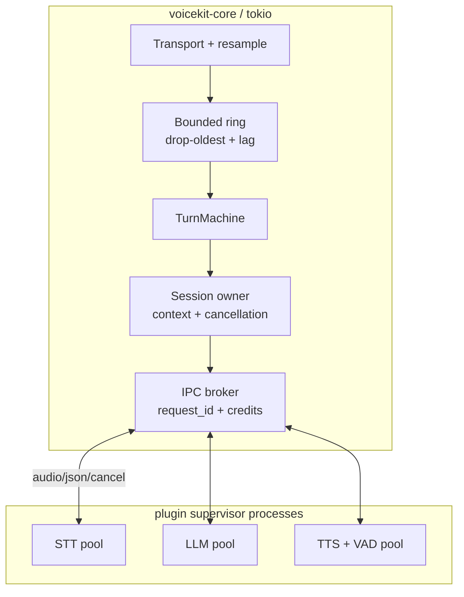
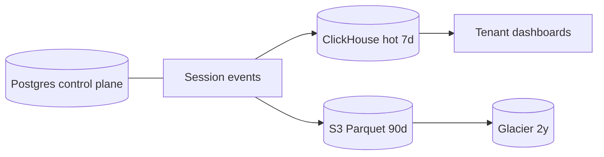
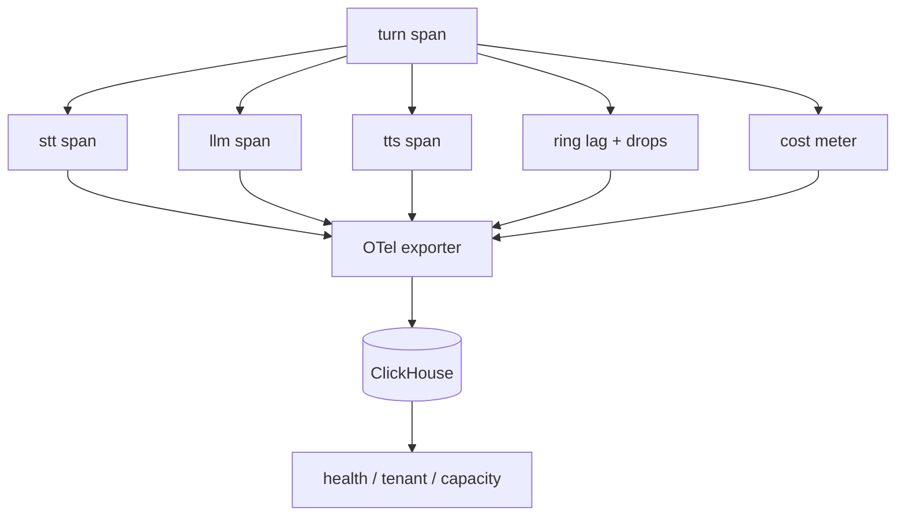

# Opus lens — the architectural shape of `voicekit` at 10×, 100×, 1000×

**Stance.** Top-down: what shape must the target codebase have so the best idea of each framework survives 10× growth without inheriting its failure mode?

**Doc note.** `docs/ARCHITECTURE.md` and `docs/SAFETY.md` do not exist at HEAD (`docs/` is absent). I will not invent citations. The framework's authoritative commitments are in-tree: `crates/voicekit-core/src/lib.rs:1-8` (structural rules), `crates/voicekit-ipc/src/lib.rs:1-10` (streaming boundary), `crates/voicekit-core/src/audio.rs:1-6` (bounded ring), and `kickoffs/framework-comparison.md` (non-negotiable constraints). Pivots below cite these; when `docs/` lands, it must restate them.

**Legend.** LK = LiveKit (`livekit-agents/livekit/agents/`); PC = Pipecat (`src/pipecat/`); TN = TEN (`core/src/ten_runtime/`, extensions under `ai_agents/agents/ten_packages/extension/`); VC = Vocode (`vocode/streaming/`), design reference only. Paths are repo-relative.

## 1. Scale trajectory

| Stage | Concurrency | Bottleneck class | Survives | Structural change | Eng-wk |
|---|---|---|---|---|---|
| Current | 0–50, one host | Runtime absent: clock/audio/turn exist, transport/session loop do not | Ring, turn machine, error classes, frame format | Everything above the crate skeleton | — |
| 10× | ~200/host, 2–4 hosts | Python scheduling; per-session plugin memory | Same invariants | Plugin pools multiplex sessions; credits; pool sizing by concurrency | 8 |
| 100× | ~20k | Tenant isolation; metric cardinality; plugin sprawl | Same invariants | Cells, sharded events, signed manifests, quotas | 24 |
| 1000× | ~200k | Edge network; control-plane consistency; ABI churn | Same invariants | Regional cells, tenant affinity, replicated control plane only | 65 |

The starting point is a skeleton. `crates/voicekit-core/src/lib.rs:1-8` declares the four rules; `crates/voicekit-ipc/src/frame.rs:15-25` fixes the wire format. But `crates/voicekit-ipc/src/lib.rs:16` declares a `message` module with no file, and the workspace lists two crates that do not exist.

At 10× the binding constraint is Pipecat's: every processor gets its own asyncio task and priority queue (`PC: processors/frame_processor.py:203-210`), so a 20-node graph pays 20 scheduler hops per audio frame on one GIL-bound loop. Rust removes the per-frame Python hop but not the plugin hop — hence R2.

At 100× the constraint becomes isolation and attribution. LiveKit shows the trap: `num_idle_processes` defaults to `min(cpu_count,4)` per worker (`LK: worker.py:214-216`), so more workers means more idle RSS. Isolation must be explicit and measured (R4).

At 1000× the constraint is ABI stability plus regional placement. Nobody in the set solved it: TEN versions manifests but never negotiates (`TN: ai_agents/agents/ten_packages/extension/ten_vad_python/manifest.json:5-7`); Pipecat has no native ABI (`PC: pyproject.toml:1-8`).

**R1.** The Rust core owns transport, resampling, rings, turn machine, and session lifecycle. Python never schedules PCM or owns a real-time timer. This is the direct reading of `crates/voicekit-core/src/lib.rs:1-8`; violate it and you rebuild Pipecat's GIL ceiling (`PC: frame_processor.py:203-210`).

## 2. Runtime migration path

Three observed limits bound the design. Pipecat's per-processor task model (`PC: processors/frame_processor.py:203-210`) will not hold 200 sessions on one loop. LiveKit's process-per-job gives real isolation (`LK: ipc/job_proc_executor.py:24`, `LK: ipc/proc_pool.py:32`) but pays memory per process (`LK: worker.py:214-216`). TEN binds each Python extension to a thread (`TN: binding/python/interface/ten_runtime/async_extension.py:202-213`) and asserts thread affinity (`TN: core/src/ten_runtime/extension_group/extension_group.c:27-47`), so a blocking plugin blocks its whole group.

**Recommended hybrid.** One long-lived Rust core per host owns transport (WebRTC/SIP/WebSocket), resampling, one `AudioRing` per stream, `TurnMachine`, endpointing, playout, context ownership, cancellation, and the IPC broker. Python owns provider SDKs, tools, agent policy, and summarization. Plugin processes are pooled **per provider kind**, not per session; one STT pool serves many sessions, multiplexed by `request_id`. This keeps LiveKit's supervision without its memory floor.

The boundary is already structural: length-prefixed frames, 1 MiB checked before allocation, audio as a first-class frame (`crates/voicekit-ipc/src/frame.rs:15-25`, `crates/voicekit-ipc/src/lib.rs:1-10`). Add three message classes: `Hello` (ABI + capabilities), `Credit` (backpressure), `Cancel`/`CancelAck`.

**R2.** One plugin process per provider kind, multiplexing sessions by `request_id`; never one process per session.

**R3.** A credit-based streaming protocol over the existing frame format: `Hello`, `Credit`, `Cancel`, `CancelAck`. No whole-turn or whole-utterance serialization.

**R4.** Export ring lag, drop count, dropped duration, and credit starvation per session and plugin. LiveKit silently skips detached input frames (`LK: voice/room_io/_input.py:205`); do not copy unattributable loss.

**R5.** Reuse LiveKit's prewarm/drain supervision (`LK: ipc/supervised_proc.py:94`, `LK: worker.py:193-214`) but size pools from plugin concurrency and p95 turn latency, not CPU count.

**R6.** Keep token budgeting in the Rust session owner; run summarization as a Python request **off the turn's critical path**. LiveKit summarizes inline (`LK: llm/chat_context.py:928-1022`), adding a provider round-trip to the answer.

## 3. Data layer scaling

Separate three planes; do not treat the transcript as the database.

- **Control (Postgres):** tenants, agents, versions, manifests, key metadata. Small, transactional; no application sharding before 1000×.
- **Events (ClickHouse):** one row per turn/latency/usage/drop, partitioned by `toYYYYMM(ts)`, ordered by `(tenant_id, session_id, ts)`. Grows fastest; shard by tenant at 100×, 7 days hot.
- **Media (S3):** audio and full transcripts as Parquet/Opus keyed by `tenant/session/turn`; no DB row holds audio.
- **Ladder:** 7d hot → 90d Parquet → 2y Glacier, enforced by table policy.
- **Migration:** `vk-migrate` reads the append-only log, dual-writes two releases, shadow-reads, then cuts over. Every event carries monotonic duration and wall-clock ingestion; `MonoClock` (`crates/voicekit-core/src/clock.rs:1-6`) makes the former authoritative for latency, the latter for partitions.

**R10.** Postgres control, ClickHouse events, S3 media; partition events by tenant and month at 100×; no Postgres sharding before 1000×.

## 4. Ecosystem scaling

Pipecat proves the growth engine: a provider is one service subclass implementing `run_stt` (`PC: services/stt_service.py:556`), with no manifest and no graph edit. TEN proves governance: a versioned manifest declares the runtime dependency (`TN: ai_agents/agents/ten_packages/extension/ten_vad_python/manifest.json:1-7`), but loading is `dlopen`/`LoadLibrary` (`TN: core/src/ten_runtime/addon/addon_autoload.c:38-50`, `TN: core/src/ten_runtime/addon/addon.c:462-468`) and the only "signature" is an in-memory struct tag (`TN: core/src/ten_runtime/addon/addon_host.c:28`), not package authentication.

Take Pipecat's authoring cost, TEN's manifest, and add what neither has: Ed25519 signatures over manifest plus wheel digest; subprocess sandboxing with seccomp/Landlock, a network allowlist, no ambient credentials; `abi = "voicekit-plugin/1"` with N-1 compatibility and a `Hello` handshake; a signed registry with tenant allowlists at 100×.

**R7.** Keep Pipecat's one-method ergonomics (`run_stt`/`run_tts`), not its in-process frame bus.

**R8.** Adopt TEN's manifest and semver, add `Hello` ABI negotiation and cryptographic signatures; reject unverified packages.

**R9.** Sandbox every plugin: subprocess, seccomp/Landlock, network allowlist, no ambient credentials.

**R12.** Publish `voicekit-plugin/1`, support N-1, and keep fake providers in core CI so the ABI is tested without API keys.

## 5. The core promise at scale

The promise is narrow and durable: **real-time correctness a Python event loop cannot guarantee, with authoring ergonomics a Rust-only framework cannot offer.** `crates/voicekit-core/src/lib.rs:1-8` states the first half; `crates/voicekit-ipc/src/lib.rs:1-10` the second.

At 10× it holds only if the core team refuses to absorb provider logic. At 100× the product becomes substrate plus marketplace: the core owns compatibility, isolation, and attribution; the ecosystem owns coverage. Multi-agent handoffs stress state ownership — the Rust session owner must own the handoff boundary, while policy stays in Python. If handoff state lives in a plugin, two plugins can disagree about the conversation. At 1000× the promise is **ABI stability**: every break taxes every installed plugin, and the likely failure is social — provider authors fork the boundary and "one interface" becomes false.

**R14.** At 1000× deploy regional cells with tenant affinity; replicate only the control plane, keep media regional.

## 6. Observability and cost attribution

Design at the boundary, where latency and money are incurred. One **turn span**, child spans per plugin request, and children for ring lag and playout. LiveKit is the closest model: a tracer that prevents unrelated spans becoming parents (`LK: telemetry/traces.py:180-235`), typed metrics (`LK: metrics/base.py:21`), a usage collector (`LK: metrics/usage_collector.py:62`), session tags (`LK: observability.py:23`). Pipecat's observer API (`PC: observers/service_metrics_observer.py:121`) is the third-party extension point, not the core's only measurement path.

Every span carries `tenant_id`, `session_id`, `turn_id`, `plugin_id`, provider, model. Cost is metered at the boundary: tokens from LLM responses, audio-seconds in/out from STT/TTS. Store one event row per meter reading so per-tenant cost is a `GROUP BY`. Three dashboards: health (p95 turn latency, drop rate, plugin errors, cancel p99), tenant economics (cost/conversation, provider mix), capacity (pool saturation, credit starvation, warm-pool hits). Replace event-loop blocking detection with a supervisor heartbeat; a missed beat is the Python-side equivalent.

**R11.** One OTel span per turn, child spans per plugin request, tenant/session/turn/plugin/model attributes, and boundary cost meters. Never infer cost from logs.

**R13.** Treat `ErrorClass` (`crates/voicekit-core/src/error.rs:1-8`) as the observability contract: `Cancelled` is not an incident, `Protocol` is a plugin bug, `Capacity` is a drop event. Count classes, not strings.

## 7. The hardest open question

**Can cooperative mid-stream cancellation over a multiplexed plugin process meet barge-in latency at 100× — or must the core own provider calls?**

I do not know, and the four frameworks provide no evidence. LiveKit makes cancellation a process boundary: a job process can be killed (`LK: ipc/supervised_proc.py:94-335`). Pipecat cancels in-process tasks and resets frame queues (`PC: utils/frame_queue.py:13-60`). TEN orders cancellation through a thread-affine loop (`TN: async_extension.py:202-213`). None streams `Cancel` into a **shared** plugin process while preserving other sessions — the shape R2 recommends.

The uncertainty is quantitative. If a provider SDK holds the GIL for 50–200 ms inside a token callback, does `Cancel` arrive before the next audio chunk? What is p99 cancel-to-silence with 50 sessions on one pool process? If it is too slow, hot providers must move to Rust or revert to process-per-session, breaking the memory model. If it is fast enough, the pool is right. The honest resolution is a cancellation benchmark after the first real plugin; I would not design past R3 until that number exists.

## Dimension verdicts

| Dimension | Winner | Why | LK | PC | TN | VC |
|---|---|---|---|---|---|---|
| Transport & audio path | **LiveKit** | Only explicit bounded media queue plus input drop | `voice/room_io/_output.py:56`; `_input.py:205` | `transports/base_output.py:89-91`; `frames/frames.py:187` | `binding/python/interface/ten_runtime/extension.py:109`; `ten_env.py:94` | `output_device/twilio_output_device.py:36-38` |
| Concurrency & isolation | **LiveKit** | Process-per-job with supervision and warm pool | `job.py:132`; `worker.py:214`; `ipc/job_proc_executor.py:24` | `processors/frame_processor.py:203-210` | `async_extension.py:202-213`; `extension_group.c:27-47` | `utils/worker.py:48-58` |
| Turn-taking | **LiveKit** | Adaptive endpointing, false-interruption recovery | `voice/endpointing.py:10-30`; `agent_activity.py:377` | `processors/audio/vad_processor.py:29`; `observers/turn_tracking_observer.py:29-52` | `ten_vad_python/extension.py:162`; `ten_turn_detection/extension.py:147` | `streaming_conversation.py:271-283` |
| Provider abstraction | **Pipecat** | Cleanest typed per-modality service contract | `stt/stt.py:168`; `llm/llm.py:111`; `tts/tts.py:81` | `services/stt_service.py:58`; `tts_service.py:151`; `llm_service.py:307` | `extension.py:21`; `addon.py:14`; `ten_vad_python/manifest.json:1-7` | `transcriber/base_transcriber.py:19`; `synthesizer/base_synthesizer.py:240` |
| State & context | **LiveKit** | Token budget, summarization, handoff in one context | `llm/chat_context.py:684`; `:928`; `:494` | `aggregators/llm_context.py:113`; `llm_context_summarizer.py:61` | `ten_env.py:62-70` | `models/transcript.py:119-120`; `agent/openai_utils.py:109-145` |
| Failure handling | **LiveKit** | Recoverability class + fallback + supervision | `stt/stt.py:156`; `llm/fallback_adapter.py:38`; `ipc/supervised_proc.py:94` | `utils/errors.py:25,60`; `observers/error_observer.py:53` | `binding/python/interface/ten_runtime/error.py:20` | `agent/base_agent.py:366` |
| Observability | **LiveKit** | OTel tree, typed metrics, usage, tags | `telemetry/traces.py:180`; `metrics/base.py:21`; `metrics/usage_collector.py:62` | `metrics/metrics.py:19`; `observers/service_metrics_observer.py:121` | `ten_env/internal/log.c:21` | `vocode/logging.py:164`; `streaming_conversation.py:455` |
| Extensibility cost | **Pipecat** | One method, one class; no manifest, no graph edit | `stt/stt.py:219`; `plugin.py:13-30` | `services/stt_service.py:556`; `frame_processor.py:203` | `extension.py:21`; `addon.py:14`; `start_graph.c:31` | `transcriber/base_transcriber.py:19`; `default_factory.py:19` |
| Deployment & scale | **LiveKit** | Warm pool, load threshold, drain | `worker.py:193-214`; `ipc/proc_pool.py:32` | `runner/run.py:22`; `pipeline/worker.py:211` | `app/predefined_graph.c:78`; `addon_loader/addon_loader.c:153` | `apps/telephony_app/main.py:28` |
| Language boundary | **TEN** | Only true native core with multi-language bindings | `ipc/proto.py:14`; `ipc/job_proc_executor.py:24` | `pyproject.toml:1-8` (no native core) | `binding/python/native/common/common.c:34`; `extension.py:21` | `utils/worker.py:76` |

## Findings

1. **[scale]** LiveKit's warm pool is fixed per worker (`prod_default=min(cpu_count,4)`, `LK: worker.py:214-216`), so horizontal scale multiplies idle RSS, not live capacity.
2. **[perf]** LiveKit bounds output at 200 ms (`LK: voice/room_io/_output.py:56`) but silently skips detached input frames (`LK: voice/room_io/_input.py:205`) with no lag counter.
3. **[reliability]** LiveKit's fallback does not retry by default after a chunk is sent (`LK: llm/fallback_adapter.py:51-64`), so mid-stream failure truncates the reply.
4. **[api]** LiveKit's fallback docstring calls itself an STT adapter while subclassing `LLM` (`LK: llm/fallback_adapter.py:41`); modality adapters are not uniform.
5. **[perf]** Pipecat runs every processor in its own asyncio task with a priority queue (`PC: processors/frame_processor.py:203-210`), paying a scheduler hop per node per frame.
6. **[reliability]** Pipecat classifies failures (`PC: utils/errors.py:25,60`) and marks a permanent one unusable (`PC: processors/frame_processor.py:1016`), but offers no retry or fallback in core; recovery is app code.
7. **[scale]** Pipecat's default runner is one FastAPI process with no warm pool (`PC: runner/run.py:18-25`); scale is replica-per-host with full setup per session.
8. **[api]** Pipecat has no native core — no `Cargo.toml`, only `pyproject.toml:1-8` — making the GIL an architectural ceiling.
9. **[reliability]** TEN binds a Python extension to one thread (`TN: async_extension.py:202-213`, `TN: extension_group/extension_group.c:27-47`); a blocking plugin blocks its group, so isolation is per group, not per session.
10. **[api]** TEN provider authoring needs an extension, addon, manifest, and graph placement (`TN: extension.py:21`, `addon.py:14`, `ten_vad_python/manifest.json:1-7`, `start_graph.c:31`).
11. **[scale]** TEN manifests pin the runtime (`TN: ai_agents/.../ten_vad_python/manifest.json:5-7`) but the loader has no ABI negotiation; an upgrade is a flag day.
12. **[reliability]** TEN diagnostics are log-only (`TN: core/src/ten_runtime/ten_env/internal/log.c:21`); no metrics or trace surface exists in the core.
13. **[security]** TEN loads native addons via `dlopen`/`LoadLibrary` (`TN: addon_autoload.c:38-50`, `TN: addon/addon.c:462-468`); its only "signature" is an in-memory tag (`TN: addon/addon_host.c:28`), so a malicious extension is arbitrary code.
14. **[bug]** Vocode queues synthesized chunks on unbounded `asyncio.Queue`s (`VC: output_device/twilio_output_device.py:36-38`); a slow consumer grows RSS with no drop policy.
15. **[reliability]** Vocode catches `Exception` around the agent call (`VC: agent/base_agent.py:366`), turning provider failure into silence with no error class.
16. **[api]** Vocode needs a base class, config model, and factory edit (`VC: transcriber/base_transcriber.py:19`, `transcriber/default_factory.py:19-20`), so third-party providers fork the factory.
17. **[scale]** Vocode has no session supervisor: one FastAPI app (`VC: apps/telephony_app/main.py:28`) and one process in `docker/Dockerfile`; no drain or warm semantics.
18. **[perf]** LiveKit summarizes context with an inline LLM call on the turn path (`LK: llm/chat_context.py:928-1022`); at 10× it competes with the answer for provider budget.

## Takeaway for synthesis

The winners split in a way that is itself the architecture: **LiveKit for runtime discipline, Pipecat for authoring surface, TEN for the language boundary and manifest governance.** No framework wins runtime and ecosystem together, so the Rust core must stay small and the Python surface cheap. The non-negotiable is R3: streaming, cancellable, bounded frames. Frameworks that serialize a turn pay in barge-in latency; frameworks that stream without bounds pay in memory (Vocode) or attribution loss (LiveKit's silent input drop).
